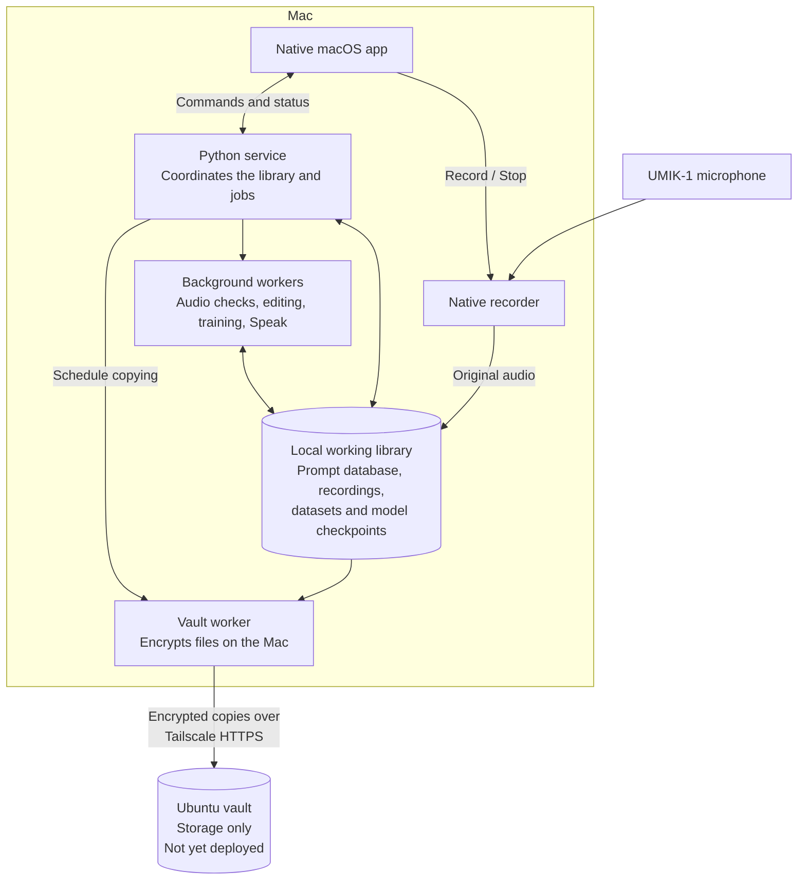
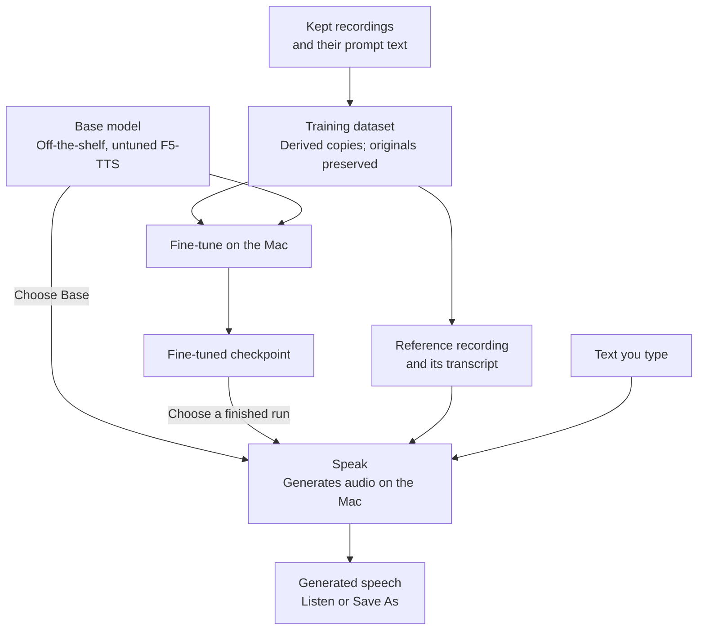
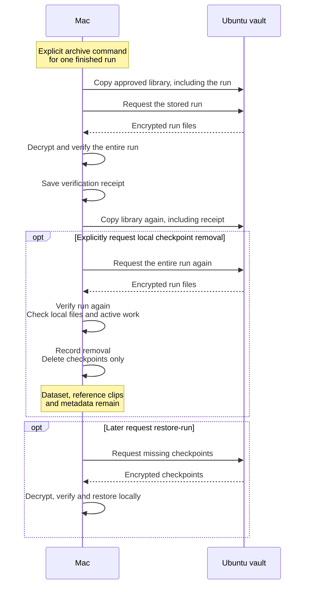

# Application architecture diagrams

These diagrams describe the implemented design at `a8eeeed`, reviewed on
2026-09-19. At that point, the combined Mac app update still needed installation
and physical checks, and the Ubuntu vault had not been deployed. The diagrams
show existing behavior; they do not decide the pending rollout order or product
choices.

Open this document in a Markdown preview that supports Mermaid to view the
diagrams, or use the SVG links below each caption without a Mermaid extension.
The broader lab boundaries are in [Architecture](../ARCHITECTURE.md).

## 1. What runs where

[Open the rendered diagram](diagrams/application-components.svg).

The Mac records, trains models, and generates speech. Ubuntu provides encrypted
storage.



The library node groups the local catalog, rebuildable index, and asset files;
it is not one database containing every audio file. The worker node groups
separate processes. Training and Speak share one job slot and use an isolated,
pinned F5-TTS runtime on the Mac.

The app communicates with the recorder and service through versioned local
messages. The recorder owns the microphone and audio writer; Stop goes directly
to it. Recording and Save do not wait for the vault. Background copying starts
after a quiet period, and no new copy pass starts during training or Speak.

The encryption key stays in the Mac's Keychain, with an offline recovery copy.
Ubuntu cannot decrypt the recordings and runs no voice model. Uploads require an
approved destination and an enabled library binding. The Ubuntu deployment uses
a Tailscale HTTPS gateway in front of the storage container.

Sources: [native application processes](NATIVE_RECORDING_APPLICATION.md),
[background copying](LIBRARY_VAULT.md#background-copying-in-the-app), and
[vault deployment](../deploy/vault/README.md).

## 2. How recordings become a voice

[Open the rendered diagram](diagrams/recordings-to-voice.svg).

A **checkpoint** is a saved fine-tuned model. A **reference clip** is a short
recording supplied when generating speech. They serve different purposes.



Training selects the latest kept, valid take for each eligible spoken prompt.
Held-out evaluation recordings do not enter training. Dataset creation applies
edits and level normalization to derived copies; it preserves the originals.

Both model choices use a reference recording. Currently, even **Base requires a
finished run**, because Speak gets its reference clips from that run's dataset.
Base uses the newest finished run's references; a named fine-tuned run uses its
own. This is an application dependency: Base's weights remain untuned.

Sources: [corpus selection](FINETUNE.md#the-corpus),
[Speak model and reference selection](FINETUNE.md#speak-page), and
[`resolve_speech_model`](../src/cole_voice_lab/finetune.py).

## 3. What archiving actually does

[Open the rendered diagram](diagrams/finetune-archive-restore.svg).

Archiving is an explicit command for one finished run. Removing local
checkpoints is a separate, optional part of that command. It can recover disk
space while retaining a verified encrypted copy. It never happens just because
a run is old.



The command is `voice-lab finetune archive --run <id>`. It needs a vault binding
and destination approval that include the separate `training` storage class.
Without `--remove-local-copy`, the model remains usable locally.

After removal, the fine-tuned voice needs `voice-lab finetune restore-run --run
<id>` before Speak can use it. **Base remains available under the current
behavior**, because its own weights and the reference clips remain local.
The diagram preserves the existing second verification of the whole run;
narrowing that check remains a pending choice.

The vault does not store the pretrained Base weights' bytes. Their run entry is
a pinned identity, and restoration can reconnect that entry to a matching local
runtime file. The download arrows represent the run files actually stored in
the vault.

Sources: [archiving a finished run](FINETUNE.md#archiving-a-finished-run) and
[fine-tune runs in the vault](LIBRARY_VAULT.md#fine-tune-runs-in-the-vault).

## 4. What stays local and what is copied

| Material | Mac | Vault |
| --- | --- | --- |
| Recordings, prompts and library records | Working copies | Encrypted copies |
| Datasets and finished fine-tuned models | Local unless checkpoints explicitly removed | Only if Cole opts into training storage |
| Downloaded Base model and runtime | Local | Pretrained file pins and run identity evidence; runtime and Base weights are not copied |
| Generated Speak clips | Local | Not copied |
| Decryption key | Keychain plus offline recovery sheet | Never |

A whole-library restore builds a **separate local library**, downloading,
decrypting, and checking its contents in a staging directory before publishing
it. The app does not work directly against a remote database. The recording
index rebuilds on first open, and missing model runtimes require separate
provisioning.

Whole-library restore does not restore the old Mac's vault binding, upload
ledger, or local manifest history. Continuing uploads from a new Mac therefore
requires a separately approved fresh vault namespace and binding under the
current recovery procedure. Historical restore selection also depends on
available trusted local manifest history; the vault is not a browsable catalog
of every old snapshot.

Sources: [copy classification](LIBRARY_VAULT.md#what-is-copied-and-what-stays-on-the-mac),
[whole-library restore](LIBRARY_VAULT.md#restore), and
[operator workflow](RUNBOOK.md#9-library-vault).

## Updating the rendered diagrams

The Mermaid blocks in this document are the editable source. The three SVGs
are generated copies for viewers without Mermaid support. Regenerate them with
an installed Mermaid CLI, without downloading packages:

```sh
mmdc -i docs/APPLICATION_ARCHITECTURE_DIAGRAMS.md -o /tmp/voice-lab-architecture.svg -t neutral -w 1200
```

Copy the numbered outputs `voice-lab-architecture-1.svg`, `-2.svg`, and `-3.svg`
to `docs/diagrams/application-components.svg`, `recordings-to-voice.svg`, and
`finetune-archive-restore.svg`, respectively. Review all three after regeneration.
