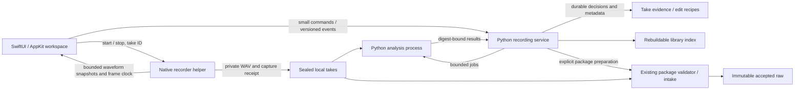

# Native recording experience: design and acceptance contract

**Status:** proposed implementation design, September 11, 2026. The application
still uses Qt. This document specifies the replacement; it does not claim that
the replacement exists or has passed acceptance.

**Execution plan:** [Native recording UX](../.claude/plans/2026-09-11-native-recording-ux.md).
That checklist owns implementation progress. This document owns the intended
behavior, architectural decisions, compatibility requirements, and release gates.

## 1. Outcome

Cole can open the app, select a prompt, record, stop, review if desired, and save
directly to the next unrecorded prompt. The interface responds immediately,
draws the actual incoming waveform, and keeps the script, waveform, timer, and
controls in stable positions. Recording one take does not require creating or
finishing a session. Saving does not start another recording.

Retain the existing library, dated takes, silent-room-tone instructions, exact
prompt identity, playback, manual frame-based trimming, recoverable removal,
headphone review, and lab export. Preserve all existing audio and evidence.

## 2. Evidence behind the redesign

The September 11 synthetic benchmark used the actual Python capture/library
code, an inert microphone process, and mono 48 kHz 24-bit generated WAVs. The
first four takes were ten seconds each; the fifth was then recorded and saved.
These are single-run wall times on the development Mac, not hardware timings,
UI end-to-end timings, or performance percentiles.

| Operation | Seconds | Instrumented WAV inspections |
| --- | ---: | ---: |
| Current state with no saved takes | 0.003 | 0 |
| Current state with four saved takes | 2.678 | 8 |
| Library rows and sessions snapshot | 7.821 | 24 |
| Start fifth take, inert device | 7.947 | 24 |
| Poll during fifth take | 2.562 | 8 |
| Stop fifth take, inert device | 5.804 | 17 |
| Keep fifth take, refresh, select next | 31.708 | 95 |

The last operation inspected 950 seconds of audio in aggregate to save a
ten-second take. The original disposable probe and results were written to
`/tmp/cole-voice-lab-latency-review/`; execution step 1 creates a maintained,
synthetic-only benchmark rather than depending on that temporary directory.

Relevant current implementation boundaries:

- `src/cole_voice_lab/capture.py:1236`: `_inspections()` inspects every completed
  WAV; `_state()` and `current()` invoke it during ordinary status reads.
- `src/cole_voice_lab/recording_library.py:902`: desktop `current()` repeats
  inspection and provenance checks; start, stop, accept, and selection call it.
- `src/cole_voice_lab/recording_library.py:610`: `_scan()` traverses historical
  recordings and validates packages. `rows()` and `sessions()` each call it.
- `src/cole_voice_lab/desktop_window.py:929`: `_snapshot()` requests both scans;
  `_submit()` uses one worker and one global busy flag for unrelated operations.
- `src/cole_voice_lab/capture_native.py:520`: the writer reports PCM byte counts,
  without the envelope needed for live waveform drawing.
- `src/cole_voice_lab/desktop_window.py:1330`: control visibility, editor height,
  and layout stretch change with transport state. `desktop_waveform.py` displays
  finished clips only.

These observations identify unnecessary work and missing capabilities. They do
not establish the real microphone's startup latency or certify a new recorder.

## 3. Stack decision

Use Swift 6 for the native macOS app and a persistent native recorder helper.
Use SwiftUI for the workspace, AppKit for window/keyboard/accessibility behavior
where needed, Core Audio Audio Queue input for capture, and AVFoundation for
playback. Keep Python 3.12/Pydantic as the authoritative lab service and contract
owner. Do not add Rust, C++, Electron, a web server, or model dependencies to
the recording interface.

A small C11 target owns the Audio Queue callback and preallocated ring buffer:
bounded PCM copying, timestamp checks, and atomics only. This is a deliberate
way to keep allocations, Swift reference counting, and actor scheduling outside
the callback, not a second recording engine. Swift owns device lifecycle and
the writer/control loop. Start with this boundary in the native package; do not
build a general DSP framework. Preserve the existing macOS 13 deployment floor
unless the executable compatibility probe demonstrates a concrete constraint.
The new package should use system frameworks and standard libraries initially.

**Execution finding, September 11:** The installed Python 3.12.14 service
interpreter declares macOS 26.0 (`LC_BUILD_VERSION`), despite the old launcher's
13.0 metadata. The native app/helper continue to compile for macOS 13, but the
local preview bound to this interpreter must declare an effective macOS 26.0
minimum. Its build script must inspect the entire launch boundary and use the
highest required minimum. No replacement interpreter is downloaded implicitly;
a future lower-floor release needs a separately verified compatible environment.

| Alternative | Assessment |
| --- | --- |
| Repair the existing Qt application | Can meet the responsiveness requirements; lowest migration cost. Retains a second UI technology if a native Mac interface remains the destination. |
| Swift native UI and capture, Python lab service | Selected: native interaction and accessibility, independent audio timing, reuse of strict Python evidence and model contracts. Requires explicit compatibility and hardware acceptance. |
| Swift UI wrapping the existing synchronous desktop methods | Rejected: retains the measured repeated validation and busy-state bottlenecks. |
| Rust/C++ recorder rewrite | Unnecessary for this scope. Reconsider only for a measured native callback/DSP limitation that the small capture boundary cannot resolve. |

The existing Audio Queue strategy already solved an observed continuity problem.
Port its guarantees before considering a different capture API. Apple documents
Audio Queue recording buffers and sample timestamps in its
[recording guide](https://developer.apple.com/library/archive/documentation/MusicAudio/Conceptual/AudioQueueProgrammingGuide/AQRecord/RecordingAudio.html).
The guide's illustrative file writing inside a callback is not the design here:
the callback hands off to a bounded writer queue.

SwiftUI's [Canvas](https://developer.apple.com/documentation/swiftui/canvas) and
[TimelineView](https://developer.apple.com/documentation/swiftui/timelineview)
provide the drawing and scheduling primitives; visual scheduling never supplies
the authoritative audio clock. Swift 6's
[data isolation](https://www.swift.org/migration/documentation/swift-6-concurrency-migration-guide/dataracesafety/)
governs UI/control state, not work inside the audio callback.

## 4. Fixed workspace and interaction

Use a Voice Memos-inspired recording workspace inside the existing library
concept. Keep the library sidebar visible by default, with a user-controlled
Focus mode that collapses it. Processing never changes that choice.

```text
┌──────────────────┬─────────────────────────────────────────────────────┐
│ Library          │ Prompt title · category · progress    Microphone    │
│ Search / filters ├─────────────────────────────────────────────────────┤
│                  │ Read aloud OR Silent room tone / Do not speak       │
│ Prompt rows      │                                                     │
│ and coverage     │ Large script / silence instructions                 │
│                  │ Delivery guidance · approximate duration            │
│                  ├─────────────────────────────────────────────────────┤
│                  │ Take selector                                       │
│                  │                                                     │
│                  │ Live / stopped waveform — permanent drawing area    │
│                  │                                                     │
│                  │ In                 Timeline                     Out │
│                  │                00:00.00                              │
│                  │       Rewind   Back   Play/Pause   Forward           │
│                  ├─────────────────────────────────────────────────────┤
│                  │ Record/Stop        Retake         Save & Next       │
│                  │ Reserved status line / background activity          │
└──────────────────┴─────────────────────────────────────────────────────┘
```

The diagram defines persistent regions, not final pixel styling. Implement
named spacing/type tokens and produce real light/dark rendered states before
polishing. Validate at 1060×700 and 1440×980 logical points, 1×/2× display scale,
and increased reading-text sizes. The user may resize the window or explicitly
expand an inspector; background work and transport state cannot resize regions.
Long scripts and take lists scroll inside their reserved regions. Preserve
reading scroll position through start/stop/save; reset it only for a new prompt.

Start with system semantic colors, SF system text, an adjustable 24-point script,
13-point supporting text, and a monospaced-digit timer. Use an 8-point spacing
scale, 16-point outer insets, a 280-point default sidebar, and a 56-point primary
Record/Stop hit target. Keep a compact take-picker row above the waveform; a
popover or explicitly opened inspector holds extended history. At the smallest
window, reserve at least 120 points for the waveform and scroll the script
within its card. Larger windows allocate additional height to script and
waveform by window geometry, never by recording state. Resolve the exact height
budget in the step-3 shell fixture before adding controls; geometry tests make
overlap or clipping a failure, not a reason to hide controls during processing.

- One large circular Record control becomes a red Stop control in the same
  slot. Its bounds and hit target stay constant, including for silence labels.
- Playback controls, Retake, Save & Next, trim fields, and status space remain
  mounted. Unavailable actions are gray and disabled with accessible reasons.
- During saving, the current script and stopped waveform remain visible until
  the durable save acknowledgment and next target can be applied together.
  Then the next script and empty waveform appear in a single state update.
- During recording, the waveform is red, with an actual sample-based playhead
  and a rolling recent-time viewport. Stop keeps the captured waveform in the
  same rectangle; a short visual transition may fit the full take after sealing.
- Quiet room tone uses the same layout, clearly labeled silence instructions,
  a true low-amplitude waveform, and no spoken transcript. Visual amplitude
  fitting remains an explicit display-only option; no fabricated movement.
- Keep waveform amplitude scaling stable while recording. Do not continually
  normalize each incoming buffer; a quiet signal must not look like clipping.
- No modal spinner, disappearing editor, repeated full-table reload, or focus
  jump for routine processing. Use one fixed status line and an optional activity
  inspector. Persistent failures may show a recoverable sheet or details panel.
- Preserve native light/dark contrast, visible keyboard focus, VoiceOver labels,
  non-color status text, Reduce Motion, and a readable mono-spaced timer.
  VoiceOver announces state changes, not every waveform or timer update.
- Do not play recording-start/stop sounds through speakers. Playback remains
  mutually exclusive with capture. A playback shutdown failure prevents capture
  with an explicit explanation until the audio controller is safely recovered.

**Amended 2026-09-14 — display-only dB amplitude scale:** Physical P05 UMIK-1
speech peaks of −28 to −33 dBFS drew visually flat on the linear full-scale
waveform. Live and stopped waveforms draw signed extrema on a fixed logarithmic
axis labelled "dB display scale": 0 dBFS is the full half-height, −30 dBFS half of
it, and nonzero levels at or below −60 dBFS a minimal hairline. Exact silence stays
on the baseline. The mapping is fixed, symmetric and monotonic, so it remains
stable while recording and is not normalization; without Fit only true 0 dBFS
reaches full height. Room tone keeps its true lower level (−50 dBFS draws at one
sixth of the half-height); the physical quiet/spoken gate still confirms they
differ. Explicit Fit gain still applies before the mapping. Extrema, frame accounting, snapshots,
archives and waveform source rules are unchanged.

**Amended 2026-09-14 — labels, Prompt and Instructions (`docs/PROMPT_CATALOG_V2.md`
§6.1–§6.3):** The header's second line is one non-wrapping row of label chips in
effective-label order: the category, then `Test` in a physical-test catalog, the
catalog labels, then Reference candidate and Holdout. The category and `Test` chips
always show; later chips that do not fit collapse into a trailing `+N`, and the
row (identifier `recording.labels`) carries an accessibility label naming every
label ("Labels: Procedure, Test, Recovery").
The script card keeps its region and uses one layout for every kind, top to bottom:
a kind banner (`SILENT ROOM TONE · DO NOT SPEAK` for room tone, `TEST STEP · FOLLOW
INSTRUCTIONS` for a procedure step, none for a spoken prompt); a Prompt section
(`PROMPT · READ ALOUD`, the spoken text at the reading size, identifier
`recording.script`, label "Prompt, read aloud") only for spoken prompts, with a muted
"No spoken prompt" line in its place otherwise; and an Instructions section that is
always present (`INSTRUCTIONS · NOT READ ALOUD`, catalog instructions at 17 pt, then
`Guidance: <style>` and the duration in the fixed 32-point row, identifier
`recording.instructions`, label "Instructions, do not read aloud"). Under a Prompt
the Instructions section keeps its natural height up to 40% of the card and scrolls
beyond that, so the Prompt keeps the rest; without one it fills the card. Category
alone decides the kind, so a v1 room tone's text shows as Instructions and never as
a Prompt. Catalog text and labels render verbatim, never as Markdown. Library rows
use a waveform symbol for room tone, a checklist for procedure steps and a text
symbol otherwise. This replaces the diagram's category subtitle and single script
block; quiet room tone's "clearly labeled silence instructions" and "no spoken
transcript" are its banner, its missing Prompt section and its Instructions section.

**Amended 2026-09-14 — library filters and Continue Missing (`docs/PROMPT_CATALOG_V2.md`
§6.4):** The sidebar reads, top to bottom: the Library title with the covered count; a
prominent full-width **Continue Missing** button (identifier `library.continueMissing`,
large control size, help text "Selects the next missing prompt in catalog order; ignores
search and filters."; while coverage is incomplete it stays disabled with the existing
"Waiting for complete library metadata" reason, and its gating and behavior are
unchanged); the search field (`library.search`); the Show picker (`library.filter`); and
a Labels menu of toggles (`library.labels`), one toggle per label in first-appearance
catalog order plus a "Show all labels" item that empties the selection. The menu title
reads "Labels: Any", up to two selected titles in that order ("Labels: Room Tone, Test"),
or "Labels: 3 selected"; catalog-derived titles render verbatim. Search stays
case-insensitive and matches the title, prompt id, Prompt, Instructions, guidance and
each label title. Selected labels combine with OR; labels, status and search combine
with AND, so an empty selection shows every prompt. The selection lives in memory only
and drops any token the loaded catalog does not carry. The pinned "Current prompt ·
outside filter" row uses the same predicate. Search and filters never affect Continue
Missing, Save & Next or the covered count. Keyboard rules are unchanged: typing in the
search field and an open Show or Labels menu suppress the transport keys, and the search
field remains the sidebar's first editable field, which the transport harness asserts
together with Continue Missing's placement above it. This replaces the diagram's
"Search / filters" line.

**Amended 2026-09-14 — System, Light and Dark appearance (`docs/PROMPT_CATALOG_V2.md`
§8.2 Step 8):** The View menu carries an Appearance submenu with System, Light and Dark.
The choice is a user preference in the app's defaults domain (key `RecordingAppearance`,
values `light` and `dark`; System removes the key, and an absent or unknown value reads
as System). The application scene applies it app-wide through `NSApp.appearance`, which
reaches SwiftUI content, AppKit sheets, popovers and menus and the supporting-text
palette alike; choosing System sets `nil` and restores the system appearance at once,
without a relaunch. `.preferredColorScheme(nil)` is not used: it does not reliably revert
on macOS and does not reach the AppKit surfaces. `RecordingWorkspace` never reads the
preference. The shell, accessibility and waveform harnesses host their views with a
forced `NSAppearance`, register a Light preference in their own process (volatile, never
written to disk) and prove on the rendered pixels that their dark passes still draw dark
and their light passes light; the verification entry never builds the scene and never
reads the preference. Colours stay semantic: the waveform plot draws the system text
background instead of fixed RGB values, warning text keeps label contrast with an orange
glyph beside it, and text contrast stays at least 4.5:1 in both appearances. This adds
an explicit choice on top of "Preserve native light/dark contrast"; geometry, waveform
extrema and the dB display scale are unchanged.

**Not built yet — a library vault line (plan `2026-09-17-library-vault-on-ubuntu-pc.md`,
Step 12):** The sidebar shows nothing about the library vault, the encrypted copy of the
library that the `voice-lab vault` commands keep. The recording service already answers a
`vault-status` command and publishes `vault-status` events (states `off`, `up-to-date`,
`waiting`, `copying`, `unreachable` and `failed`), and the app's model applies them, but no
view shows them and this section specifies no line. Until Step 12 the state is read with
`voice-lab vault status` in a terminal, and the native `vault` suite that would check the
line is not built either.

### Keyboard behavior

| Input | Behavior |
| --- | --- |
| R | Record when ready; Stop while starting/recording |
| Space | Play/pause the selected stopped take; never open the microphone |
| Return / Enter | Save the current draft and advance to the next missing prompt |
| Command-S | Save the current draft/edits without advancing |
| Left / Right in waveform | Seek 0.1 seconds within the retained range |
| Home / End in waveform | Seek to retained start/end |
| Command-1 / Command-2 | View ▸ Record Page / Speak Page (§17); do nothing while a take is starting, recording, stopping or saving, or while a confirmation is open |
| Command-Return | On the Speak page, press Speak when it is enabled (§17); the Record page does not use it |

R, Space, Return, Command-S and the waveform keys belong to the Record page. Its key
monitor exists only while the Record page is shown (added 2026-09-16, §17), so on the
Speak page these keys only type into the text box.

Preserve typing, popups, dialogs, and text-selection behavior. Ignore key repeat
for transport and coalesce duplicate clicks by operation ID. A second press
must not create a second take or skip two prompts. Stop during startup cancels
startup or drains whatever frames arrived; it never waits behind analysis.

## 5. State and availability

Transport, operator decision, verification, and export are separate dimensions.
Do not combine them into a single `busy` or `accepted` boolean.

| Transport phase | Visible content | Enabled workflow actions |
| --- | --- | --- |
| Ready | Current prompt, empty or explicitly selected historical waveform | Record when device/storage/gate ready; eligible history playback |
| Starting | Same prompt, waveform baseline, timer zero until confirmed frames | Stop/cancel startup |
| Recording | Same prompt, live waveform, confirmed frame time | Stop |
| Stopping/sealing | Same waveform and prompt; stopping status | No second Stop or Save until the file is sealed |
| Draft review | Completed waveform; optional analysis status | Play/trim, Retake, Save, Save & Next |
| Saving | Unchanged script/waveform and footer | Conflicting take mutations disabled |
| Saved/ready for next | Atomically selected target and appropriate waveform | Record; independent background analysis continues |
| Recoverable error | Last coherent content, named failure and recovery action | Only operations proven safe for that failure |

Saving may finish while quality analysis is pending. Show `Saved · checking`.
This means the take and operator decision are durable; it does not mean accepted
raw or approved for synthesis. Informational QC findings produce `Needs review`;
structural/continuity/digest failures produce `Invalid take`. Background results
update only their take. They never replace the active prompt or waveform.

A stopped draft is reviewable without a mandatory playback. Save requires the
current draft to be selected and its waveform ready; selecting an older take
cannot approve the current one. Derive that waveform during capture so this
requirement does not trigger a full WAV reload on Stop. Trims save as an exact
frame-range recipe first; rendering the derivative can finish in the background.
An unsaved trim remains an explicit edit with the existing discard confirmation.

**Amended 2026-09-13 — incomplete coverage:** When the index is usable but its
coverage is Building or Unknown, current-prompt Record, Stop, owned-source review
and plain **Save** keep their ordinary device, storage and evidence gates. Plain
Save retains the selected prompt. **Save & Next** and **Continue Missing** require
complete catalog coverage; completion of unrelated background QC is not required.
Named index/storage/source failures remain visible and may block their dependent
operation. Recovery scanning itself never gates the current-take controls.
When discovery changes coverage to Building or Unknown, publish that state before
continuing the scan so the visible Save action updates during reconciliation.
Do not wait for the scan's completion to announce reduced navigation availability.

**Amended 2026-09-14 — returning to a recorded prompt (physical P06):** Explicitly
selecting a prompt counts as selecting its latest retained take (kept, not Invalid;
newest capture date, unknown dates last). The service resolves that take from exact
prompt metadata in the same durable navigation operation as the prompt, checks a
native take's current head, and reads no audio. Without complete coverage, or when
nothing is retained, no take is selected. The client prepares that take's review
stopped: Ready shows its waveform and Play, never autoplay, and Save stays disabled.
Record while that review is still loading supersedes it without a failure. Continue
Missing, Save & Next, Retake and context restore never select a take this way.

**Amended 2026-09-14 — prompt sections in every phase:** "Current prompt" and
"script" in the table above mean the whole §4 presentation: label chips, kind banner,
Prompt section and Instructions section. They derive only from the selected exact
catalog prompt and its catalog purpose, never from transport phase, operator
decision, analysis or coverage, so starting, recording, stopping, draft review and
saving never add, remove or reorder a section or chip. Saving keeps both sections
until the next target applies in the same state update as its waveform.

## 6. Recording, prompts, and sessions

Make the take the primary record. Bind it to a stable take ID, subject, exact
prompt and catalog identity, recording timestamps, device UID/configuration,
capture receipt, original digest, operator decision, and verification revision.
Record capture-request time and actual first-sample/last-sample timing separately.
Do not derive historical dates from file modification times.

Recording groups retain useful context: physical device, host, acoustic setup,
purpose, and room-tone relationships. They are created automatically and are
visible as secondary history metadata. Starting a new group is automatic after
an app restart or device/configuration change; a manual New setup action records
room/microphone-position changes the app cannot detect. No mandatory group-name,
Start session, End session, or Finalize step appears in the fast recording loop.
One-off means one existing catalog prompt can be captured and saved independently;
freeform dictation and transcript authoring are outside this increment.

Save & Next searches forward in canonical catalog order, wraps once, and stops
when nothing is missing. It ignores table sorting and filters. Already retained
takes across groups count, including both room tones. Removed, rejected, and
invalid takes do not satisfy coverage. A saved take awaiting analysis or with
nonfatal QC findings counts as recorded, with its visible checking/review badge.
A stopped unsaved draft is shown as Draft and offered for review, never silently
treated as saved coverage. Library evidence that cannot be read is Unknown/error,
not Missing. Continue Missing requires a complete metadata index for that catalog;
explicit selected-prompt capture can proceed independently of historical QC.

Keep the queue cursor and saved decision recoverable. Bind navigation commands
to the displayed prompt, take, catalog digest, and index revision. If metadata
changes during Save, resolve a new target from the authoritative current index
and publish it once. There is no provisional first-room-tone selection.
Late QC failures leave the user on their current prompt and add the failed take
to Needs attention. When every prompt is recorded, keep the last take visible
and show completion in the reserved status area; do not start another session.

Catalog coverage and export context are distinct. Never silently reuse an old
room tone as evidence of a new acoustic setup. A context-incomplete one-off is
still saved, reviewable, and playable; the explicit Prepare for lab action
explains missing compatible room tone or other package prerequisites. It does
not insert room tone into Save & Next or fabricate acoustic compatibility.

**Amended 2026-09-13 — Save intent:** The displayed control and its keyboard
shortcut request the same action: Save while coverage is incomplete, Save & Next
when advancement is available. Capture that intent at activation. A subsequent
coverage change cannot silently turn a requested advance into a nonadvancing Save,
or make a plain Save advance. Reconciliation never invents missing prompts.

**Amended 2026-09-16 — groups are internal; coverage is the corpus (D-018):** Recording
groups stay as the service's internal context. Every reservation still names one, and the
service still manages them automatically. When a context opens it reuses the current group
if the catalog version, subject, device, host and gate still match. Otherwise it opens a
new one, as it always does on Reconnect audio. The operator never sees or acts on a group. The app shows
no group, session, setup, package or room-tone-binding wording. The take picker no longer
prefixes a session-dated take with "Session"; a take without a take-precise time shows its
date followed by "exact time unknown". The app has no manual New setup action; the only
`new_setup` context it sends is Reconnect audio's. "Catalog coverage and export context
are distinct" becomes **coverage is the corpus**. The Library header counts prompts with a
kept take against the active catalog's prompts (for example `34/1,886`, identifier
`library.coverage`, read aloud as "34 of 1,886 prompts recorded"). The latest kept take of each
spoken prompt is exactly what Fine-tune model trains on (§16). A take's group limits
neither coverage nor training. "Including both room tones" held for the pilot catalogs;
the active `cole-corpus` catalog lists no room tone (D-017). A catalog that still lists
one shows the silent card (§4) and counts its take like any other prompt. No action uses a
room tone as acoustic evidence any more, because the Prepare for lab action and its
room-tone prerequisite are gone (§9). `Needs review` badges stay informational; they gate
nothing in the app.

## 7. Runtime architecture and ownership



The UI main actor owns only view state and user intent. The native helper owns
the microphone, sample clock, buffers, WAV writer, and capture receipt. It stays
alive between takes to avoid process startup/import costs, but does not start
input or collect samples until Record. Device discovery and memory preparation
may happen earlier without turning on the microphone. Stop releases active
capture; no ambient recording or preroll is used to meet latency targets.

Keep high-frequency waveform/time state confined to the waveform/transport
subtree. An envelope update cannot republish the library model, rebuild the take
list, or trigger layout measurement for the script. State transitions update
the wider workspace only when its meaning changes. File hashing, metadata sync,
image/envelope decoding, and process waits never run on the UI main actor.

The Python service owns durable take decisions, prompt coverage/navigation,
history, edits, and analysis scheduling. It is a persistent local subprocess,
not a per-click interpreter. CPU-heavy QC runs in a separate process, initially
one worker, never on the UI thread or the service's control/metadata executor.
Large library imports and exports yield between files. Interactive metadata
commands and Stop cannot queue behind a bulk job or a long database transaction.

The native recorder is the canonical new desktop capture implementation.
During rollout, the Qt/console paths keep the existing recorder explicitly;
after native cutover, migrate supported capture entry points to the canonical
helper before deleting the redundant Python ctypes implementation. Preserve
historical format readers indefinitely. Do not maintain two new capture engines.

### Local protocols

Define strict, versioned request/response/event models in
`src/cole_voice_lab/recording_contracts.py`, generated schemas under `schemas/`,
and conforming Swift types under `apps/macos/Sources/RecordingContracts/`.
Cross-language positive and negative fixture generators are part of the gate.

- Use inherited local pipes/socket pairs between known child processes; no
  listening HTTP/TCP endpoint. Use bounded length-prefixed UTF-8 JSON frames.
- Envelope: `data`, `error`, `meta`. Metadata includes protocol version,
  request ID, take ID where relevant, state revision, process generation, and
  event sequence. Errors carry a stable code, message, details, and retryability.
- Recorder commands: prepare resources, start, stop, state snapshot, shutdown.
  Service commands cover the catalog (`CatalogCommand`, answered by
  `CatalogEvent`), indexed history, capture reservation/sealing, save, next
  prompt, edits, removal/restore, analysis retry, package preparation, and
  recovery. The concrete schema enumerates operations; no arbitrary evaluation.
- State transitions, saves, failures, and capture receipts are reliable messages.
  Waveform snapshots use a separate bounded/coalescing telemetry channel so a
  slow renderer cannot block commands or the raw writer.
- A command has one durable operation ID. Repeating Save after a lost reply
  returns the existing result. Repeating Start cannot open a second microphone.
  Outdated generations/revisions cannot change current selection or edits.
- Handshake verifies supported versions and executable/runtime identities.
  Reconnect requests a current snapshot; an event gap is not silently ignored.
- The helper detects parent/control-channel loss and stops within a bounded
  deadline, preserving a partial. Enforce the existing ten-minute capture limit
  independently of the UI. Never reopen the microphone automatically on reconnect.
- Python owns canonical evidence serialization. Swift transport JSON need not
  have canonical byte order; Python validates it and writes canonical receipts.
  Native emergency receipts use a separately specified recovery contract, with
  byte-level conformance fixtures, rather than impersonating canonical lab JSON.

**Amended 2026-09-16 — the catalog arrives from the service (`docs/CORPUS_STORE.md`,
D-017):** The launch configuration carries no catalog. After both handshakes the
app sends `CatalogCommand` with a 30-second deadline. The service resolves the
subject's active version in the library's corpus store once per process, pins it,
and answers with `CatalogEvent`: the exact `PromptSuite` and its
`CatalogReference`. The app builds its prompt list and Library from that event and
takes the catalog digest from the reference; Swift never computes it. Only then
does the app request the durable snapshot and send open-context, which names the
reference; the service refuses any other reference (`RECORDING.STALE_REVISION`)
and an embedded catalog outside legacy continuation (`RECORDING.INVALID_MESSAGE`).
New contexts mint `recording-group/v2` groups, which reference the published
version instead of embedding the catalog; groups that embed one stay readable.
Until the catalog arrives the header reads "Preparing catalog" and no history,
cursor or Record is available. A catalog activated while the app runs takes
effect at the next launch. Reconnect audio names the reference it already holds,
or requests the catalog first when none arrived at launch.

**Amended 2026-09-16 — a fine-tune worker replaces package preparation (§16, D-018):**
The service no longer accepts `prepare-package` and runs no package queue or package
worker. The diagram's `SVC → PKG → RAW` path and "package preparation" in the command
list above are retired. So is the package-worker sentence of the one-index-owner
amendment below. The service instead answers `fine-tune`, `cancel-fine-tune` and
`fine-tune-status`, and sends `fine-tune-progress`, `fine-tune` and `fine-tune-status`
events. All are take-less, and the service answers them before any context check. It
starts at most one more process of its own: the fine-tune worker (`python -m
cole_voice_lab.recording_finetune_jobs --worker`). The worker leads its own session and
process group, and it starts the F5-TTS runtime's processes in that group. It talks to the
service over its own stdin/stdout frames, never opens the recording index, takes no
library lock and reads takes read-only. When its stdin closes it kills its own group, so no
training outlives the service. It is not a configured peer: the launch configuration
names only the recorder helper and the service.

### Native capture and waveform path

Keep stable UMIK-1 UID selection without changing the OS default input. Require
mono 48 kHz 24-bit little-endian PCM, the actual selected physical device, and
the existing timestamp continuity conditions. No implicit resampling, AGC,
voice processing, normalization, silence insertion, or noise removal.

The callback validates frames/timestamps, copies into preallocated slots, and
returns. It performs no file/pipe I/O, logging, actor hops, allocations, or
waiting for a mutex. A full raw-audio ring is a capture failure, never a reason
to discard samples. Native controller shutdown must not hold a callback lock.

The writer consumes frames in order and tracks received versus written counts.
A separate bounded visualization path computes signed min/max envelopes in
fixed sample buckets, preserving extrema rather than merely subsampling.
Snapshots carry absolute frame ranges, bucket width, and capture generation.
Coalescing old visual updates is permitted; losing raw frames is not. Retain a
bounded multiresolution envelope for the stopped overview and detailed zoom.

At Stop, cease acquisition, drain queued frames, finalize the WAV header, flush
and sync the file, compute its final WAV digest, and seal it. A running PCM hash
is not the final WAV hash because the header changes. One native hash pass over
the current finished take is allowed; revisiting historical audio is not.
Verify received/written/header counts and descriptor identity before sealing.
Publish successful continuity evidence using the existing semantics and record
the native implementation/build identity separately.

**Amended 2026-09-14 — seal timestamps:** `last_sample_at` and `sealed_at` are
anchored to a wall/host clock pair read at close (with `first_sample_at` still
projected from the start anchor and every ordering checked before publication),
so `last_sample_at - first_sample_at` may differ from `(frames - 1) / 48000` by
wall-clock slew over the take; the exact frame count remains authoritative.

Live waveform and timer derive from confirmed written frames. A visualization
delay cannot invent samples or increase duration. A quiet signal stays quiet.
The final duration must agree exactly with the final WAV frame count. Suspended
or occluded windows may reduce drawing cadence without affecting capture.

**Amended 2026-09-13 — one index owner:** Ordinary interactive, discovery,
analysis and package publications use the service's same RecordingIndex handle.
Discovery children inspect historical evidence and send strict, generation-bound,
size/digest-checked metadata spools with bounded acknowledgments; they do not open
the shared database. Package workers produce durable verified packages, then the
existing parent completion path publishes through the owner's handle before
announcing Prepared. Preserve audits for unexpected external database changes;
never bless a worker data-version or disable a corruption check.

Historical analysis prepares individual jobs/heads outside the queue and take-store
locks, then applies a short current-job/revision check. Worker claiming interleaves
with historical preparation, retaining new-take priority and historical fairness.
No lock spans a whole historical page, source validation, child wait or stream.

## 8. Persistence, verification, and edits

Use existing asset-root directories; do not create runtime assets in the repo:

| Private location | Role |
| --- | --- |
| `tmp/recording-takes/<take-id>/` | Active partial and then sealed original WAV; private staging, never accepted raw |
| `provenance/recording-takes/<take-id>/` | Versioned canonical capture binding, immutable decision revisions, recovery/analysis evidence |
| `provenance/recording-groups/` | Group context and explicitly bound room-tone relationships |
| `provenance/recording-library/` | Disposable SQLite index and journal/WAL/SHM files, all private |
| `derived/recording-waveforms/` | Digest/version-bound rebuildable envelope cache |
| Existing `derived/recording-edits/` and `provenance/recording-edits/` | Existing canonical trim/removal capability, extended for new take identities |

New models distinguish captured draft, saved operator decision, analysis state,
and package/intake status. A digest-bound analysis receipt includes algorithm
revision, input identity, complete metrics/findings, and completion/failure.
Persist group/purpose/pilot-gate bindings when reserving the take. Existing pilot
approval and holdout restrictions remain enforced before recording.

Prepare any expensive corpus-gate validation when opening the bound catalog or
context, off the interactive executor. Retain the verified evidence identities
and invalidate readiness when they change. Reserving each subsequent take checks
that prepared authorization, not the entire underlying pilot audio again. An
unprepared or invalid gate has an explicit readiness state and cannot authorize
corpus capture.

### Durable save ordering

1. Reserve a take ID and private destination before capture. Record the exact
   prompt/context and capture intent with an atomic, synced evidence write.
2. Native Stop seals the file and durable recovery receipt. Service registration
   validates structure, identity, sizes, format/count evidence and receipt shape;
   full independent hash/QC work is scheduled. No successful raw claim is made.
3. Serialize the small Save command against metadata mutations. Calculate the
   proposed kept-take projection and next target, then write an immutable
   operation record containing the take/receipt digest, keep decision, trim
   bounds, resolved target/completion result, and catalog/index revision. Sync
   this record before acknowledging success or displaying the next prompt.
4. Atomically replace the evidence head; update the indexed projection in a
   separate SQLite transaction; return the persisted operation result. Evidence
   is authoritative and the index is rebuildable. A crash between filesystem
   and SQLite commits is recovered through the operation ID and immutable record,
   not a claimed transaction spanning both stores. A recorded operation result
   makes a lost-reply retry deterministic even if other takes later change.
5. A restarted service replays committed operations and restarts pending analysis.
   A retry after an uncertain response resolves the same take and navigation
   result without creating another decision or skipping another prompt.

Index reads and metadata-only snapshots do not inspect WAV samples. Build a
single snapshot for rows, groups, and progress from one revision. Incremental
events update affected rows; no clear-and-repopulate operation runs each second.
Startup imports metadata incrementally and records coverage completeness.
Missing/corrupt index data triggers an explicit rebuild state. It is never
interpreted as an empty recording history.

Independent verification is performed once for each new or changed sealed
take/analysis version, and again at actual strict publication, intake, reference,
and dataset boundaries as required. The index and filesystem timestamps cannot
authorize accepted raw. Source changes invalidate related results. Metadata
watching/reconciliation detects ordinary changes; selected-source access uses
confined no-follow descriptors and checks the expected digest/identity. Security
tests must also cover replacements with identical size or preserved mtime.

Playback of a just-recorded draft uses its owned sealed source and existing
envelope. Historical playback verifies only the selected source before opening
it, not every package in the library. Slow loads keep the previous display
visible with the relevant playback actions disabled. Bound the audio/envelope
cache; do not retain decoded PCM for every historical take.

Use AVAudioEngine/AVAudioPlayerNode and integer source-frame ranges for stopped
preview. Apple's
[segment scheduling API](https://developer.apple.com/documentation/avfaudio/avaudioplayernode/schedulesegment%28_%3Astartingframe%3Aframecount%3Aat%3Acompletionhandler%3A%29)
accepts a start frame and frame count. Derive the playhead from the actual player
clock and clamp it to those bounds. Any device-format conversion for playback
does not alter original PCM or become capture processing. Exercise output route
changes and delayed completion callbacks with the same generation guards.

Keep one canonical edit implementation in `recording_edits.py`. Native playback
honors frame-range recipes immediately; Python creates checksum-bound derived
audio when required. Late derivative jobs are keyed by source and edit revision
and cannot overwrite a newer trim. Rejected and removed takes remain recoverable.
An Undo affordance may complement the existing removal confirmation, but never
physically deletes raw audio. Save, Reset, and Restore do not autoplay.

**Amended 2026-09-13 — publication ordering:** Canonical Save retains the existing
synced pending journal → index projection → acknowledgment order. No separate
projection outbox or optimistic acknowledgment is introduced. Background readers
cannot repair this journal. A newly committed current-session reservation is
protected in its index publication before acknowledgment; repair of an older
operation does not invent live capture ownership. Inventory findings commit before
notifications and cannot replace the selected take or waveform.

## 9. Existing recordings and package compatibility

Keep v1 capture manifests, READY markers, desktop sidecars, original paths,
digests, dates, consent, and accepted-raw references valid. Import their metadata
into the new index with explicit legacy identity and provenance precision.
Validate historical evidence progressively; do not rewrite it to fit new models.
Keep draft, rejected, removed, finalized, accepted, and interrupted cases distinct.
Copies of one package are deduplicated; distinct recording events are not merged
merely because their PCM happens to be identical.

The new package-preparation capability selects saved, independently verified
takes and explicit compatible room-tone evidence. A v1 package has one subject,
device/configuration, capture host, and declared prompt suite; split selections
when those properties differ. Keep exact transcript/style/catalog bindings and
never mix held-out material into training. Reuse `expected_recording_paths()` and
`finalize_capture_session()`, validate the completed result, and publish READY
last. Copy originals into a new staging package; never hard-link writable
staging bytes into accepted raw or mutate an existing raw package.

Persist a validated package-to-take map outside the strict package file set.
It binds package digest/path to original take IDs, digests, dates, group, catalog,
and edit/removal identity. This is required to preserve local history and avoid
counting an exported copy as a new take. Reject a missing or inconsistent map
for new-format local package history rather than inventing dates or identity.
Raw packages remain compatible with existing transfer/intake. Transferring rich
new sidecars is not part of the unchanged package payload; a destination lacking
them exposes only the session-level history the v1 manifest actually provides.
Do not claim that v1 package transfer preserves new per-take metadata.

Removal and trim identity must follow a take across staging and package aliases.
Extend the shared eligibility boundary so removing a take cannot be bypassed
by selecting its finalized/raw copy. Publish alias/removal evidence atomically
with package registration and test existing reference/dataset consumers. Trims
remain derivatives: do not silently substitute edited PCM into raw-only exports.

Automatic groups are not permission to publish incomplete v1 packages. Missing
compatible room tone blocks Prepare for lab, not saving the user's one-off.
An explicit package-preparation queue may request that material after the user
chooses to prepare a package. Completing a recording queue does not itself
authorize transfer, synthesis, or model execution.

**Amended 2026-09-13 — legacy publication:** Prepare and validate all legacy source
reads, spool records, canonical JSON and aliases before the atomic SQL publication.
Reject staging made stale by a concurrent legacy edit or external database commit;
preserve newer native projections and unrelated Unknown findings. The prepared
legacy batch has an explicit 32 MiB serialized-metadata budget and 200,000-record
limit. Exceeding it produces a named capacity failure and preserves the prior
projection; it never removes recordings. This bounds serialized preparation, not
Python object memory. Measure the final 1,000-row transaction and interactive wait.
If that transaction misses acceptance, design staged generations visibly rather
than weakening a latency target or calling an O(N) transaction constant-time.

**Amended 2026-09-16 — package preparation is no longer an app action (D-018):** The app
has no Prepare for lab control, sheet or package queue. The service accepts no
`prepare-package` command. `PreparePackageCommand` survives only as the selection type
inside `recording_packages.py` plans and commits. The evidence rules of this section still
hold. v1 manifests, READY markers, sidecars, package maps and package aliases stay
readable. Removal and trim identity still follow a take through a package that already
exists. What is gone is every entry point that turns native takes into a new v1 package.
`RecordingPackageStore.plan` and `prepare` are kept with their tests, but nothing in the
app, the service or `voice-lab` calls them. The lab's transfer path is unchanged for what
it already handles: `sync plan`, `intake validate|accept|scan` and `dataset`, applied to
sessions finalized by `capture run`, `capture console` or the Qt desktop and to packages
prepared before this change. Preparing a lab package from native takes would need a new
command, which is a separate change. Fine-tuning needs no package: it reads the library
directly (§16, D-016). These passages describe the retired action and no longer apply to
the app:
- this section's second and fifth paragraphs (package selection, and Prepare for lab's
  room-tone prerequisite);
- "lab export" in §1;
- the explicit Prepare for lab sentence in §6;
- the package-preparation edge and command in §7;
- the disposable package step of §13;
- the export rows of §14.

This section's parity row is now the native `finetune` suite (`finetune_from_recordings`
in `scripts/recording_acceptance_matrix.py`).

## 10. Recovery and resource behavior

| Condition | Required behavior |
| --- | --- |
| Stop during startup | Cancel/stop promptly; zero-frame attempt is not a completed WAV; preserve any partial |
| Double-click or held key | One idempotent operation and one state transition |
| Microphone unplug, format change, timestamp gap, ring overflow | Stop capture, preserve partial, show failure; no silent switch of input or inserted samples |
| Low disk before Record | Explain available space and disable Record; preserve enough reserved space to finish the active take |
| Writer/fsync failure | No successful Save; retain recoverable material and report the exact failure |
| Analysis slow or failed | Continue independent recording; display pending/review/failed state on its take; block eligibility where required |
| Service crash after durable Save but before reply | Reconcile operation ID and restore the committed result once |
| UI/helper crash or control-channel loss | Stop microphone within the watchdog deadline; recover sealed drafts; incomplete captures remain explicitly partial |
| Sleep/wake or device configuration change | End current capture safely; require explicit Record after recovery; start a new context group |
| Stale waveform, QC, or edit result | Ignore for current view, retain diagnostic event; never apply it to a different take/revision |
| Second app/legacy recorder | Shared asset-root capture lock prevents competing ownership; playback/capture interlock also applies |
| Quit with a stopped unsaved take | Preserve draft for review on reopen; do not convert it into a kept take |
| Quit with an unsaved trim | Existing explicit discard/save decision; no silent auto-application |
| Corrupt/missing history evidence | Named affected records/Unknown status; never present corruption as new missing prompts |
| No corpus store (`CORPUS.STORE_MISSING`) | Show the service message, which names `voice-lab catalog init`, as status and context reason; header reads Catalog unavailable; no Library, snapshot, open-context or Record; pin nothing, so a relaunch after `init` resolves again |
| No active catalog for the subject (`CORPUS.NO_ACTIVE_CATALOG`) | Same as no corpus store; the message names `voice-lab catalog init` and `voice-lab catalog activate` |
| Missing or altered catalog snapshot (`CORPUS.SNAPSHOT_MISMATCH`) | Refuse the catalog, context, reservation or review that depends on it; say missing or altered without file content; never fall back to another catalog or an embedded copy; history that needs the snapshot stays Unknown, never Missing; restore `provenance/corpus/snapshots/` from backup |
| Fine-tune runtime not configured (no `finetune_runtime_root` in the build settings, or no `bin/python` under it) | Fine-tune model stays disabled with "Fine-tuning is not set up: this app has no F5 runtime to train with" and nothing is submitted (the service would refuse `FINETUNE.RUNTIME_UNAVAILABLE`, naming the setting or the missing python); recording is unaffected. A runtime whose F5-TTS package, pinned weights or pinned Vocos vocoder (`pretrained/vocos-mel-24khz/`) is missing or wrong fails the job in its first stage, within seconds (`FINETUNE.RUNTIME_UNAVAILABLE` naming a missing vocoder file, `FINETUNE.PRETRAINED_MISMATCH`), before any dataset is written |
| Less than 8 GiB free on the library's disk when Fine-tune model is pressed | Refuse `RECORDING.DISK_SPACE` (retryable), naming the need and the free space; write nothing; the status line shows the message with a warning; Record keeps its own disk check. There is no free-space check during a job: a full disk fails the job with that step's error |
| A fine-tune already queued or running | The control reads Cancel fine-tune, so no second job can be requested; a second submit is refused `FINETUNE.JOB_ACTIVE` (retryable) and the app then shows the job the service holds; Record, Save, Save & Next and navigation stay available |
| Fine-tune worker crash, app quit or service restart during a job | Quit asks first (below). Kill the worker's whole process group (the worker also kills its own group when its input closes or it fails); never resume or retry the job. A worker that exits without a result fails the job `FINETUNE.INTERRUPTED` at once. A job left running by a stopped service is failed `FINETUNE.INTERRUPTED` by the next service, which rewrites its `run.json` as failed and kills a surviving group only when its command line proves it is this job's. Until that is done a status request reports the job running with "Checking the last fine-tune" (never waiting for it); then the job's run and final state are sent to the app, after its handshake if they came earlier, and the app shows `Fine-tune interrupted: <message>` as the latest outcome and asks for the status again. Fine-tune model is then available again. A job still queued starts when the service starts again |
| Quit or window close while a fine-tune is queued or running | Ask first: "A fine-tune is running. Quitting stops it, and the partial run is discarded." with Quit and stop fine-tune and Keep running (the cancel action); an unsaved trim is decided before it; Keep running cancels the quit and the job continues. With the local channel closed there is no job left to ask about |
| Cancel fine-tune | Queued: cancelled at once. Running: show "Cancelling the fine-tune", send SIGTERM to the job's process group and SIGKILL after 10 s, rewrite `run.json` as failed ("cancelled by the operator") while it still says running, remove the runtime's `ckpts/<run id>` link when it points at this run (even when the rewrite failed), then show "Fine-tune cancelled"; checkpoints already written stay in the run directory; recordings are unaffected. A cancel (or failure) while samples are written leaves a finished `run.json`: that model is usable and counts as the latest finished run, and the app shows `Model ready · <run id> · no samples` |
| Corpus-store refusal for a job (`CORPUS.STORE_MISSING`, `CORPUS.NO_ACTIVE_CATALOG`, `CORPUS.SNAPSHOT_MISMATCH`; any other store failure as `RECORDING.GATE_NOT_READY`) | A job trains on the catalog version the service pinned (the one the app shows). If that pin cannot be resolved, the submit is refused under that code. If its snapshot is missing or altered when the worker reads it (before its first stage), or a take's group snapshot is while it selects takes, the job fails with that code before any dataset is written. Show the service's message with a warning; the pinned catalog, the Library and recording are unchanged; fix it as in the rows above and press Fine-tune model again |
| Unreadable `run.json` under `derived/finetune/` | The status reply still names the runtime and the active job, and carries `latest_run_error` instead of the latest run; Fine-tune model stays usable and its help names the problem; repair or move the record |
| Fine-tune supervision stops (error-only envelope, request id `finetune-supervisor`, `RECORDING.WRITE_FAILED`; also when a job's or Speak request's process group is still alive 10 s after the SIGKILL of a cancel or deadline, or 5 s after the SIGKILL that ends every worker) | Show "fine-tune supervision stopped; restart the app to recover the job" with a warning (a failure before the app's handshake is sent right after it); the service refuses every fine-tune request `RECORDING.GATE_NOT_READY` "fine-tune supervision stopped; restart the app", so no second job starts; Fine-tune model and Cancel fine-tune stay disabled with that reason; recording is unaffected; after a relaunch a job it left running is failed as in the restart row |
| Speak with no finished run (`FINETUNE.NO_FINISHED_RUN`), or finished runs that cannot be read | Speak stays disabled with "Fine-tune once before using Speak" and the model menu reads "No fine-tuned model yet"; Base needs a finished run too, for its reference clip. A submit is refused `FINETUNE.NO_FINISHED_RUN`, and so is a chosen run that is missing or not finished. When the status reply carries `latest_run_error` (an unreadable `run.json`, or an unreadable dataset, corpus or samples record of one of the newest 32 finished runs), Speak stays disabled with that message; repair or move the record. Recording is unaffected |
| Speak without a runtime (`FINETUNE.RUNTIME_UNAVAILABLE`, `FINETUNE.PRETRAINED_MISMATCH`) | No `finetune_runtime_root`, or no `bin/python` under it: Speak stays disabled with "Speak is not set up: this app has no F5 runtime to speak with" and nothing is submitted. A runtime whose package, pinned weights or pinned Vocos files are missing or wrong fails the request when its worker describes the runtime, before anything is synthesized; the status line shows the service's message with a warning and the request's output directory is removed |
| Speak while a fine-tune is queued or running, or Fine-tune model while Speak generates (`FINETUNE.JOB_ACTIVE`) | One GPU slot. Speak is disabled with "Speak is unavailable while a fine-tune runs"; Fine-tune model is disabled with "Wait for Speak to finish"; neither sends anything. A request the service refuses anyway fails with its message (retryable) and the app asks for the fine-tune status, so the job the service holds is shown. Recording, Save and navigation stay available either way |
| Speak request past its deadline (`FINETUNE.SYNTHESIS_DEADLINE`) | 120 seconds after the worker starts (model load included), kill the worker's whole process group, remove the request's `derived/speech/<operation id>/`, and fail the request (retryable) with "speech synthesis took longer than 120 seconds and was stopped; try a shorter text", shown verbatim with a warning and announced |
| Cancel Speak | Queued: cancelled at once. Running: the reply is still running and the line reads `Cancelling Speak`; the service kills the worker's process group with SIGKILL at once, removes the partial output, then reports cancelled (`Speak cancelled`). A request whose clip was already complete when the cancel arrived may still end finished, and its clip is then shown. A refused cancel shows the service's words and leaves Cancel available |
| Service channel closed, or fine-tune supervision stopped, while Speak generates | Requests live only in the service's memory, so no final event will come. Channel closed: the request fails locally with "The recording service closed before Speak finished; restart the app to use Speak again" and Speak stays disabled ("The recording service closed · restart the app to use Speak"). Supervision stopped: the request fails with the supervisor's message and Speak stays disabled with it. The service kills the worker's group when it stops; a directory under `derived/speech/` left without `speech.json` by such a stop is removed when supervision next starts (next row) |
| Speak output a stopped service left, at the next supervision start (`RECORDING.SOURCE_CHANGED` only for a damaged marker) | Before any request runs, remove every `derived/speech/<operation id>/` without `speech.json` that holds only what Speak writes (`job.json`, `speech-01.wav`, the JSON writer's temporary files, `synthesis-tmp/`, a Finder `.DS_Store`), and a `speech-active.json` marker whose service process is gone. Anything else under `derived/speech/` (another file or a link in such a directory, a file beside the request directories, a directory with another name) is left in place untouched and does not stop anything. A damaged marker stops supervision with "fine-tune supervision stopped: …is damaged…; remove it, then restart the app", shown as in the supervision row; finished requests are never touched |
| Speak clip changed, missing or no longer private before Save As or playback (`RECORDING.SOURCE_CHANGED`) | Save As re-hashes the clip while copying: "The clip changed after Speak wrote it, so it was not saved"; the temporary file is removed and an existing file at the destination is untouched. The player refuses a clip whose digest, frame count, format, owner, mode or link count differs, shows the failure under the player and offers Recover audio; the output is reset at once, so an unreadable clip does not hold Record back unless that reset fails |
| Save As into the recording library | Refused before anything is read or written: "Save the clip outside the recording library" (the destination folder and the library are compared after resolving links); a folder that cannot be written is "The clip could not be saved as <name>: <reason>" |
| Speak playback failure | Show the failure under the Speak player with Recover audio (disabled while capture owns the output). While the Speak output is failed, Record is disabled and its help reads "Speak playback failed: <message> · recover audio on the Speak page", as for a failed review output; the page can still be switched to recover it |

Bound callback buffers, waveform snapshots, decoded preview memory, worker
concurrency, and result delivery. Keep the durable work backlog outside memory;
page it from evidence/index records. Prioritize new take analysis over historical
reconciliation without starving it. Check disk space against maximum take size,
pending derivative work, and a named reserve before Record; never evict human
audio automatically. A full telemetry queue may coalesce visual snapshots; a
full capture queue must fail explicitly. These are different contracts.

**Amended 2026-09-13 — asynchronous recovery:** A concurrent background job may
inspect history, but historical reads must not become an interactive command's
dependency. Opening requests one bounded recovery inventory snapshot rather than
recovering every historical take. Findings are paginated; retain only the visible
page and navigation cursors in the UI. Display scanning, known pending work and
named errors honestly. Complete means every covered item is classified, not that
all preserved captures are healthy. Prior findings on reopen await recheck.

Canonical generation/revision/work-token checks reject late observations. Current
reservations remain protected through the Reserve-to-helper-Start gap; explicit
Re-check, sealing or a new service generation resolves that exclusion. Publication
and completion use a short current-operation store/index barrier, with no historical
reads while it is held. Transient metadata contention releases/requeues its claim;
it cannot strand a permanently pending item. Sleep/wake ends capture safely and
requires explicit recording after audio/context recovery; no automatic resume.

**Amended 2026-09-13 — device reconnection:** A matching terminal device-loss or
device-format error also invalidates audio/context readiness and offers explicit
Reconnect audio. Keep Stop reachable until the recorder reaches a terminal state.
Preserve the named error and interrupted take; unresolved sealed drafts and trim
edits must be resolved before reconnecting. Successful reconnection creates a new
setup context and never issues Record. Real unplug/reconnect behavior remains a
physical acceptance gate; model tests alone do not establish it.

**Amended 2026-09-14 — unsealed capture terminal (physical P09):** Any capture
terminal for a current-session reservation without a registered seal (a helper
error state, a start rejected after dispatch, a failed Stop request, a failed seal
registration) requests exactly one explicit Re-check of that take per take and
start operation. A recheck requested while an inventory page loads is queued, not
dropped. Record stays disabled until the recheck replies; the client then returns
to Ready, and a repeated terminal cannot restore the error. A closed local channel
(request deadline, peer exit) is not such a terminal's own error: its recheck still
runs, but Record stays unavailable, naming a restart, so no Record press reserves a
take the recorder cannot start. The service classifies
the preserved evidence under capture ownership and rewrites nothing. A never-sealed
reservation is not presented as a draft, and Retake and Take actions stay disabled.
A named terminal error is never masked by recovery progress. Other unsealed findings
stay visible and open the recovery sheet from the status line. A zero-frame Stop in
this session is shown once as "Recording cancelled before audio arrived · nothing
was captured". Its unchanged service finding is not raised as an attention alert.
Device loss and sleep keep their explicit Reconnect audio path. A helper completion
failure publishes its terminal state and releases capture ownership.

Analysis and recovery scans currently restart on launch. Persisted incremental
scan resumption is deferred; the existing successful discovery fingerprint
checkpoint remains reusable. This repeat work must remain independent of current
take commands.

## 11. Trust boundaries

The assets are private human audio, truthful capture provenance, and retained
operator decisions. The concrete risks addressed here are accidental loss,
concurrent/stale actions, corrupted or replaced files, unsafe paths, and mistaken
promotion of incomplete or unchecked material. Local processes and cached
metadata are not independent proof of raw integrity. We do not claim to defend
against a hostile administrator controlling the entire Mac.

Retain private modes, root confinement, no-follow opens, descriptor identity
checks, exact package declarations, and independent digests at publication and
intake. The UI receives IDs/relative references, not arbitrary writable paths.
Validate every process message. Logs contain structured operation IDs, timings,
counts, revisions, and error codes; do not log waveform arrays, PCM, transcripts,
consent content, or sensitive path/device details to public logs. Runtime traces,
screenshots containing actual material, and audio stay under the private root.
No cloud dependency, audio transfer, or new synthesis authority is introduced.

**Amended 2026-09-16 — Speak page:** §17 adds local synthesis to the app under D-019. The
service writes each clip under the private root (`derived/speech/<operation id>/`, 0600),
and the UI receives it as a relative path with its digest and frame count; the player and
Save As re-check the file against them. F5-TTS's temporary copy of the reference clip is
written inside the request's directory, not the system's temporary directory, and removed
with the synthesis. A Save As copy is written outside the root, only
where the operator chose, and never inside the library. Speak reads no consent
record: D-019 records in-app speech as local listening by Cole and leaves that scope for
Cole to confirm; every use beyond it keeps the lab's consent, transfer and promotion rules.

**Amended 2026-09-13 — SQLite descriptor ownership:** SQLite alone owns open
database and sidecar descriptors. Checking their paths must not open and close an
auxiliary descriptor: on this Mac that discards live SQLite POSIX locks, including
another connection's locks. Keep directory bindings and private owner/mode/type/link
checks, using descriptor-relative no-follow stat for SQLite members and a fixed
database inode identity. A newly created inode is bound before its creation
descriptor closes, before SQLite connects. Connection closure serializes with index
transactions. These pre/post path checks do not claim atomic access to SQLite's
internal file descriptor; selected-source and accepted-raw verification remain
independent of this cache.

## 12. Performance acceptance

Targets below are proposed release gates, not measured claims. Measure release
builds on the recording Mac and UMIK-1. Report cold launch/permission separately
from warm operation; never subtract real storage/device latency from end-to-end
results. Permission dialogs and absent hardware are excluded from warm timings,
but must have correct visible states. If a target is unattainable, profile and
amend the design explicitly; do not quietly weaken checks or fake progress.

| Metric | Initial release target |
| --- | --- |
| Click/key to visible acknowledged state | p95 ≤50 ms; p99 ≤100 ms |
| Warm Record to first confirmed frames | p95 ≤250 ms; no dependence on saved-history size |
| Cold device start after permission already granted | p95 ≤750 ms; actual starting state remains visible |
| Stop command reaches capture controller | p95 ≤50 ms even during QC/import/export |
| Stop to sealed review for a ≤30-second take | p95 ≤300 ms; longer takes reported separately |
| Save & Next to durable acknowledgment and displayed next prompt | p95 ≤200 ms; p99 ≤400 ms |
| Captured-sample to visible waveform age | p95 ≤100 ms |
| Foreground waveform drawing | 60 Hz target, p95 render work ≤16.7 ms; explicit 30 Hz energy-saving mode allowed |
| Warm indexed launch to useful library/recorder | p95 ≤1 second |
| Metadata snapshot and next-missing lookup at 1,000 takes | p95 ≤50 ms; zero WAV opens on unchanged state reads |
| Added recorder/waveform working memory over warmed idle | ≤64 MiB through a ten-minute take; no PCM accumulation proportional to history |
| Added indexed-history/cache memory at 1,000 takes | ≤64 MiB over the small-library baseline; caches have enforced capacity |
| Historical audio inspections requested by start/poll/stop/save | Zero; selected-source checks and current-take sealing are separate |
| Timer and final audio duration | Exact agreement in frame counts; no guessed media time |
| Stable layout during transport/background processing | Named region bounds differ by ≤1 logical point at fixed window/settings |

**Amended 2026-09-14 — final duration and the maximum-duration case:** The
operator chose the simplest reliable behavior for rare ten-minute recordings.
Keep the existing hard 600-second elapsed lifecycle limit and exact 28,800,000-frame
ceiling. Startup remains inside that elapsed limit; this is a maximum duration,
not a promise to acquire exactly 600 seconds of samples. The historical ten-minute
fixture sealed 28,798,080 intact frames (599.960 seconds), 1,920 frames short of its
nominal signal. Every received frame was preserved. Its old report remains failed
under the old exact-duration case definition; no historical verdict is rewritten.

Explicitly declare only the 600-second acceptance case as a maximum-duration-limit
case. It waits for automatic maximum-duration termination and contributes no user
Stop latency sample. Require successful matching seal/continuity, received frames
equal to sealed frames, positive frames no greater than the unchanged ceiling,
and exact final timer/waveform/source agreement. Record actual duration, nominal
shortfall and whether the frame ceiling was reached separately. Other short takes,
unexpected terminal reasons, timeouts and identity mismatches remain failures.
This visibly amends that case's completion promise; it does not extend microphone
capture, fabricate missing samples or change any numerical latency/memory target.

For the final-duration row, observe the same retained-frame duration used by the
timer at initial untrimmed review, together with the final waveform and independently
sealed source frame count. Retain the pre-Stop live snapshot separately. In the
historical case it lagged the final file by 4,800 frames (100 ms); live telemetry
can precede trailing callbacks drained by Stop. Comparing that earlier snapshot
with future audio does not measure the final review timer. Version and name the
new observation explicitly, require matching take/generation and full-original
range, and never reinterpret old `timer_frames` fields. This frame-value check
does not establish the separate actual-presentation timing gates.

Use generated 1/10/30/120/600-second signals and silence, 0/4/36/1,000 historical
takes, and 100 rapid record-stop-save cycles. Generate large fixtures outside
the repo with a declared disk budget; use smaller fixtures for routine tests.
Run end-to-end measurements with analysis idle and with a real competing QC/
history job. Track p50/p95/p99, failures, memory, frame age, callback continuity,
and historical WAV-open counts attributed to each command/job trace. A concurrent
background reconciliation job may inspect history; those reads must not become
a dependency of the interactive command. The 1,000-take test asserts bounded memory and
no history-proportional cost in recording commands. Do not use sleeps as the
primary functional synchronization mechanism or wall-time thresholds in generic
unit tests; deterministic barriers and read counters belong there.

**Measured 2026-09-13, before reconciliation fix:** On the unlocked recording Mac,
plain native openings passed 3/3 at 29 takes, 2/3 at 30, and 0/3 at 31 with the same
1,102-prompt synthetic catalog. Earlier first failure was at 25 takes. These are a
load-sensitive transition, not a guaranteed capacity. Separate normal-module
service observers measured Recover at 4.982–6.057 s (29), 5.575–6.170 s (30), and
6.224–6.462 s (31); those are not native pass counts. At 1,000 takes, phase hooks
measured 74.476 s of analysis bootstrap and the next launch repeated all 1,000
jobs. Queue/store locks and external-connection-triggered index audits caused
interactive dependencies. No deadline or table target above has been relaxed.

**Profiled 2026-09-13, legacy publication prototype:** Replacing 1,000 prepared
legacy rows with 2,000 aliases held the index mutex for 99–155 ms; an overlapping
history request waited for that publication. Later clean trials of the identical
source measured 44–54 ms, so host/run variation is material. Profiling found 9,013
SQL calls (35.5–40.5 ms) and 2,000 redundant path validations (9.8–10.7 ms);
commit took 4.1–5.0 ms and no integrity audit ran. This motivates batching prepared
metadata while retaining atomic publication and the original conflict checks.
The batched candidate reduced this to 20 execute calls and four bulk calls. In the
same six-trial probe, mutex holds were 38.21–50.77 ms and deliberately overlapping
200-row history requests took 67.28–77.10 ms. This does not establish the 50 ms
metadata gate; the full native p95 measurement remains required. Preserve those
forced-overlap misses when assessing whether another publication/read design
increment is needed. No target has changed.

The post-fix gate must hold historical workers while checking interactive progress,
measure owned publications under competing discovery/analysis/package work, and
report the full native acceptance table. Save & Next measurements still require an
actual advancing Save; plain Save is not a substitute for that metric. The rapid-cycle
benchmark now invokes the normal Save action and records the visible
advance intent at the command boundary. While coverage is Building it measures plain
Save separately and keeps the same prompt; all 100 declared capture/Stop/Save cycles
must still reach durable kept acknowledgment with matching frame counts. Only actual
advancing Saves supply Save & Next latency samples. Reports name eligible, dispatched,
acknowledged and unavailable counts, and expose missing or underpowered operations at
each design point allocated enough samples by the profile. A powered small-library
group cannot stand in for missing large-library Save & Next or next-missing lookup
evidence. Those gates remain outstanding until measured; the targets above are unchanged.
The separate 1,000-row legacy SQL publication needs measured latency evidence. Characterization,
raw margins, host/build identities and exclusions are retained under the private
Verification/20260912-defect-b-vch9e1h7 root; performance acceptance remains pending
until its post-fix reports and full verification pass.

**Measured 2026-09-13 — interrupted release 04 acceptance:** The default run
completed three 100-cycle capture phases, then its Python fixture builder crashed
with SIGBUS in SQLite's mapped WAL-index read while preparing the 1,000-take idle
case. That case never launched its native client; the remaining six cases did not
run, and no aggregate acceptance report exists. The retained 4-take case measured
Stop-to-review p95 601.684 ms and advancing Save p95 262.425 ms (97 samples); the
36-take case measured 968.997 ms and 352.939 ms (87 advancing samples). Advancing
p99 remains underpowered. The empty-library case subsequently failed Continue
Missing during Building and remains a failed case. All 15 rows, missing design
points, path-audit findings and partial evidence are retained privately in
`native-acceptance-04/retained-partial-measurements.md` under the verification root
named above. No table target is changed.

A bounded follow-up demonstrated that the former path guard releases SQLite's
database and SHM locks; closing an auxiliary database descriptor also releases
another live connection's database lock. The corrected guard retains both locks
in the same probe and passes focused tests and four regression mutations. This
proves the lock defect and its correction, not the original SIGBUS's exact trigger.
Complete native acceptance and full verification still need to run after this
correction and the benchmark's availability/fixture-failure reporting corrections.

**Amended 2026-09-13 — inspection evidence correction:** Direct observation of
two normal `python -m` service startups showed that the earlier audit labeled the
service as a worker: `sitecustomize` saw `-m` before Python installed the module
name in `argv[0]`. Earlier zero-service-read reports therefore cannot establish
the historical-inspection gate. Separately, changing the selected-source filter
between two descriptor snapshots could count an already-held file as newly opened.
Retain those reports unchanged. Current acceptance requires process startup/open
controls, actual client open/read/decode events, positive controls for both playback
and waveform reader branches, and fixed source exemptions captured at command issue.
Raw descriptor holdings remain lifetime diagnostics. Missing hooks, overflow or
uncorrelated metadata responses invalidate a case before it contributes samples.
Observer storage remains included in measured footprint; no target changes.

**Measured 2026-09-13 — release 05 diagnostic:** A fresh 20-cycle run with
four initial takes and the acceptance case's 106-prompt catalog completed all
20 exact captures and advancing Saves. With the screen unlocked at both recorded
boundaries, Stop-to-review measured p50 151.799 ms / p95 192.021 ms and Save and
Next measured p50 60.322 ms / p95 78.278 ms. Both client reader branches and the
Python process audit passed their source-inspection controls. A second run with
service-stage tracing also passed those controls, but the screen was locked;
its timings cannot establish tracing overhead against the unlocked control.
These are 20-cycle diagnostics at 4–24 takes, not the full acceptance run or
the 1,000-take metadata gate. The private report is
`performance-profile-preparation/paired-analysis-02/report.md` under the same
verification root. Full acceptance, matrix regeneration, unlocked `scripts/verify`
and physical gates remain outstanding. All numerical targets above are unchanged.

The subsequent unlocked full release 05 run was stopped after two 100-cycle
capture/Save phases failed audit validation: Foundation standardized the harness's
`/private/tmp` source exemptions to `/tmp`, while real reader events retained the
authorized `/private/tmp` path. All 100 sources in the first case had matching
take/hash/device/inode identities and complete reader controls, with zero dropped
events. The retained aggregate has zero accepted samples; it remains invalid.
The harness now preserves the authorized path. Sixteen focused tests pass, the
old normalization fails the new real-file regression, and the restored fix passes.
Evidence is in `native-acceptance-05` and `path-alias-fix-01` under the same private
root. Fresh full acceptance is required; no target or inspection control is relaxed.

**Measured 2026-09-13 — full release 06:** The unchanged release completed all
ten declared cases in 3,847.714 seconds, with the screen unlocked and zero swap
at the recorded final boundary. Nine cases completed; the idle 1,000-take case
finished 100 captures but then received `HISTORY_UNKNOWN` on Continue Missing.
That case remains excluded from acceptance samples. This is the intended
fail-closed response when coverage is no longer Complete at execution; it does
not establish that ordinary Record or explicit prompt selection is blocked.

The canonical fifteen-row result is three passes, three failures, two
underpowered rows and seven unmeasured rows. Stop-to-review p95 is 2,211.148 ms
and the 1,000-take metadata row p95 is 376.555 ms. Advancing Save has p95
108.774 ms / p99 114.758 ms in powered small-library groups, but neither required
1,000-take group supplies accepted advancing samples. Recorder/waveform growth
passes at 44.281 MiB; historical inspections pass at zero across 3,320 accepted
command windows; realized offscreen layout displacement is zero points. The
idle large-library failure also leaves the indexed-history memory row unmeasured.

One of 464 accepted timer observations disagrees: the 600-second case requests
28,800,000 frames, seals 28,798,080, and retains 28,793,280 as its timer at Stop.
The original report still says `reached_configured_frames=true` and zero short
cycles; those fields do not override the actual frame counts. Investigate the
maximum-duration and measurement boundaries, preserving this failed evidence.
Separately profile real metadata requests with a private, non-acceptance harness
before choosing a latency correction. No deadline, duration or numerical target
above changes. Matrix regeneration, full verification and physical gates remain
outstanding. The full report is
`/private/tmp/cvaccept06-t86lovij/cole-recording-benchmark-0mzuk_k_/report.json`
(SHA-256 `44b1fa2cb2920aad667a2b68692595832bb00d63f68fbc2b80f76a75206aeaa8`);
supporting evidence is retained in `native-acceptance-06` and
`full-report-preparation` under the private defect-b verification root.

**Evidence correction after release 06:** The benchmark's Stop-delivery endpoint
observed the UI model entering Stopping before its asynchronous recorder request;
it did not prove receipt by the helper's capture controller. Preserve the original
report, but do not treat its 0.686 ms observation as a verified controller latency.
Retain that boundary as a local model-transition diagnostic and leave the controller
row unmeasured until an actual receipt is correlated. The 50 ms target is unchanged.
The duration-reached flag must likewise use actual sealed versus declared frames,
and an already-terminal/no-op Stop must not produce a Stop-command latency sample.
The before-Stop timer and final review timer are distinct observations: the latter
received the sealed frame count in the retained 600-second case. The existing
before-Stop comparison remains a reported discrepancy, not a rewritten pass.

The corrected harness and adapter pass 118 focused Python tests and 25 strict
native harness tests. Seven isolated behavioral mutations fail, with restored
checks passing. A terminal/short take retains its raw frame and Stop-attempt
evidence, then fails the case before Save. Failed cases remain in the aggregate
failure record even though they contribute no accepted timing samples; zero
accepted short cycles therefore cannot prove every attempted duration completed.
Evidence is retained in `timer-boundary-verification-07-result.json` under the
private defect-b root. This corrects benchmark accounting, not the ten-minute
capture safety policy, and does not reclassify the original release 06 report.

Two private, non-acceptance profiles on fresh 1,100-take clones acknowledged
100 history and 100 Next Missing commands each. The unsampled history p95 was
224.741 ms and Next Missing p95 was 99.339 ms. One bounded client CPU sample
identified repeated schema normalization/validation and regex construction;
these are sampled stack observations, not a measurement of server execution.
Reuse of immutable per-channel validators and compiled schema patterns is a
bounded correction to measure once, preserving validation semantics and all
autorelease pools. It is not evidence that the 50 ms target is attainable or
unattainable. The complete diagnostic report is
`metadata-profile-preparation-06/report.md` under the same private root.

**Measured 2026-09-13 — bounded validator correction:** Immutable validators and
compiled schema patterns are now reused per client channel. Twenty-four focused
tests pass, six regression mutations fail, and Python agrees with all 281
Swift-encoded conformance cases. One fresh private 1,100-take remeasurement
acknowledged all 205 requests, left the take inventory unchanged and closed its
owned processes. History p95 measured 197.501 ms and Next Missing p95 84.958 ms,
versus 224.741 ms and 99.339 ms in the earlier unsampled control. First Next Missing
availability separately waited 61.609 seconds for Complete; history requests
succeeded while Building. Host scheduling differed, so this is an observed
improvement rather than an isolated causal estimate. Both endpoints still exceed
50 ms. This diagnostic does not replace the full release 06 acceptance report or
establish capture performance on the changed build. Evidence is retained in
`schema-preparation-fix-01` and `metadata-profile-remeasure-07/report.md` under the
same private root. No further latency optimization or target change is made here;
full verification, corrected benchmark evidence and physical gates remain open.

## 13. Verification and rollout

Automated tests use synthetic audio and injected capture/playback adapters;
they never open a real microphone or produce audible playback. Cover contracts,
durability fault injection, media-clock/continuity errors, event ordering,
keyboard safety, fixed geometry, visual snapshots, waveform extrema, edits,
index invalidation, package acceptance, alias removal, and old-format imports.

**Verification correction, 2026-09-13:** The first full native verification after
the validator/accounting corrections stopped in the package-preparation harness.
Its supposedly room-tone-only submission actually selected room tone and one
utterance, so the service correctly prepared a package while the harness waited
for rejection. All four captured takes were durably kept and verified. Save's
Ready publication precedes its history refresh; a test of package eligibility
must observe the projected kept-and-verified state and assert its exact selection,
not infer eligibility from Ready or analysis completion alone. The precise stale
projection timing was not retained. Preserve the failed run and prove the corrected
synchronization with a delayed-projection regression, without changing package
semantics or timeouts. Evidence is retained in `verification-release07` under the
private defect-b root. Full verification and matrix generation remain outstanding.

The corrected harness passes nine strict focused tests and an isolated mutation
that removes kept-state eligibility fails. One existing synthetic integration
passes in 5.480 seconds: four kept/verified 4,801-frame takes, room-tone-only
selection blocked, all four selected entries prepared, and idempotent resubmission.
Exact selection checkpoints and restored-source checks are retained in
`package-harness-synchronization-08/result.json` under the same private root.
Fresh full verification is still required after this harness-only correction.

**Verified 2026-09-13 — release 08 software checks:** The current-source native
smoke passes three exact 24,000-frame captures and three advancing Saves. All native
suites pass and regenerate the matrix; `scripts/verify` also passes with 2,358 Python
tests, one opt-in rollback replay skipped, and 90.16% branch coverage. Lint/types,
package build, schema consistency and the private-asset guard pass. The Mac was
unlocked at both recorded boundaries of each verification stage; all 399 frozen
files still matched afterward and fixture processes closed. Seventeen functional
matrix rows are verified. This does not close performance or physical acceptance:
the current smoke is underpowered, full release 06 remains historical evidence,
and its three failed rows plus the controller-receipt gap remain open. Hardware
outcomes and separate preview installation/handoff are still outstanding. Evidence
is retained in `verification-release08` and
`current-evidence-08-02/current-evidence-matrix.md` under the private defect-b root.
Retain Python's strict mypy/Ruff and ≥90% branch coverage. Add Swift strict
concurrency compilation, native unit/integration tests, and address/thread
sanitizer runs for the ring/lifecycle tests where supported. Run `scripts/verify`
for every completed implementation increment; native verification joins that
gate once its harness exists. Measure release performance without sanitizers.

The current host has macOS 26.6.1, Command Line Tools, and Swift 6.3.1. Full Xcode
is not selected. Use SwiftPM and a native AppKit/SwiftUI snapshot harness so core
builds/tests do not require an unplanned Xcode download. If XCUI automation is
later selected, explicitly document the full-Xcode dependency and alternate
automated harness coverage; do not claim such tests ran on Command Line Tools.
Record exact compiler/SDK/build identities in acceptance results.

Ship a separately named preview app first, with the existing icon, stable
configured asset root, microphone usage description, signed helper identity,
and a checked Python service interpreter. Keep the current launcher available
until parity, synthetic migration, performance, and physical acceptance pass.
No automatic downloads or replacement of a running app. Bundle creation and
installation are separate operations with explicit destination handling.

The existing `.app` is a thin launcher into this checkout and its `.venv`;
copying that launcher alone does not provide rollback. Before cutover, freeze
the pre-cutover application code (including relevant uncommitted desktop files)
and its working Python/Qt dependency environment into a separate local release
artifact. Resolve editable imports to the frozen release, not the live checkout.
Retain its own launcher, build/dependency identities, and private-root settings.
Prove it can start after the primary checkout's Qt code/dependencies are absent
in a disposable cutover fixture. Do not move or modify the user's live checkout
to perform that test. A missing rollback dependency is an explicit release error.

New private formats expand alongside old ones. Index backfill never rewrites raw
packages. A rollback launches the frozen previous app with its understood records;
new native drafts stay preserved and explicitly require the native reader.
Test this limitation rather than pretending the old app can edit new formats.
Old-format readers remain permanent; only temporary rollout routing belongs in
`*_migration` companion modules/tests and an active migration manifest. Give
those files start/target dates during execution and remove them at cutover.
Disposable index-schema changes use reversible, timestamped migrations; keep
schema changes separate from backfill. Do not dual-write immutable raw evidence.

Physical acceptance uses an explicitly initiated, bounded diagnostic outside the
corpus: microphone permission/denial, correct UMIK-1, startup/stop, quiet/spoken
waveforms, rapid cycles, headphone comparison, unplug/reconnect, sleep/wake,
reopen/recovery, and a disposable full package through local intake. Record the
result and exact build/device/OS identities. Actual recordings are not permitted
merely because this planning document exists. The final switch happens only
after a safe app exit and concrete acceptance results; deployment approval, when
needed, is sought after the candidate is built and reviewable.

**Amended 2026-09-16 — no package step in the app (§9, D-018):** A build from the
corpus-first pipeline cannot perform "a disposable full package through local intake": it
has no package action. The physical check for such a build is instead Fine-tune model on
real recordings (§16): start a job, watch its progress, cancel it after a few minutes, then
start a full job and let it finish, and listen to a sample from that run. The app always
trains the default 120 passes, about two hours on the recording Mac, and has no shorter
setting, so the full job may finish after the session. The acceptance matrix's physical gate
rows (`PHYSICAL_GATE_ROWS` in `scripts/recording_acceptance_matrix.py`) list this check in
place of the package item, and its fine-tune parity row cites §16.

Update usage docs and CURRENT only to claim behavior that has actually shipped.
Supersede older changing-layout/session-required UX decisions explicitly. Keep
regression intent from the room-tone, media-clock, continuity, editor, Save &
Next, and Stop-color fixes even when their Qt-specific tests are retired.

## 14. Design stress checks

| Future or adverse case | Architectural response |
| --- | --- |
| One prompt today, another next week | Independent takes; automatic groups; explicit compatible export context |
| Much larger corpus or slower analysis | Indexed coverage and separate bounded QC process; capture command cost stays independent of history |
| A different microphone is supported later | Device adapter/format policy changes behind the recorder contract; no implicit change to current UMIK-1/raw requirements |
| A different frontend is added later | Versioned commands/events and the same take evidence; no duplicate lab validator |
| A new QC algorithm flags old takes | New digest/version-bound analysis revisions; original audio and operator decisions remain intact |
| Destination only understands existing v1 packages | Existing strict export/import remains usable, with truthful limits on transferred per-take metadata |

## 15. Scope limits

This increment does not expand the corpus, approve training, change consent or
transfer policy, replace raw-only reference/dataset contracts with edited audio,
or migrate model stacks. Recording pause/overdub, automatic speech trimming,
transcription, waveform-based audio enhancement, arbitrary microphone support,
cloud sync, App Store distribution, and iOS are separate product decisions.

**Amended 2026-09-16:** §16 adds training to the app, under D-018, which Cole decided on
2026-09-15. The training rules of D-016 and `docs/FINETUNE.md` are unchanged. Consent,
transfer and promotion policy are unchanged too. Nothing leaves the Mac.

**Amended 2026-09-16:** §17 adds a Speak page, under D-019, which Cole asked for on
2026-09-15. Its clips are for local listening. They are not references, datasets or
promotion material. The consent, transfer and promotion policy is unchanged; D-019 records
that Speak reads no consent record and leaves that scope open for Cole to confirm.

## 16. Fine-tuning from the app

Added 2026-09-16 (plan `2026-09-15-corpus-first-app-pipeline.md`, D-018). The Record page
has one workflow beyond recording: **Fine-tune model**. It trains F5-TTS on the latest kept
take of every spoken prompt that has one, straight from the library. It shows progress in
the status line, and recording stays available throughout. The training itself is the
lab's `voice-lab finetune run` pipeline (`docs/FINETUNE.md`, "From the app"). This section
specifies what the operator sees. The native `finetune` suite
(`scripts/verify-native-recording --suite finetune`) checks it against a stub runtime. It
runs one finished job, then saves a take while a second job trains, waits until that job's
line shows the loss and time left, and cancels it, and it covers a build without a runtime.

### The Fine-tune model control

The footer slot between Retake and Save & Next, where Prepare for lab was, holds one
button. It reads **Fine-tune model** (identifier `transport.fine-tune`) and, while a job is
queued or running, **Cancel fine-tune** (identifier `transport.cancel-fine-tune`). Its
words change in place and both titles share one 104-point width, so a job starting or
ending never moves keyboard focus, Retake or Save. Its accessibility label is its title
and its hint is its help text.

Pressing Fine-tune model sends `fine-tune` with `allow_missing: true` and no `epochs`, so
the job uses the default length (120 passes). The active catalog lists standard sentences
nobody has recorded, and `allow_missing` lets the job train on the prompts that have a
kept take. There is no confirmation dialog; the status line says the job is waiting to
start. Nothing else starts a job. Launch and Reconnect audio only ask for its status, and
Save and Save & Next never touch it.

The first reason that applies is the button's help text, and the button is disabled:

1. A local channel closed: "A local recording channel closed · restart the app to record
   again". The job went with the channel, so the slot then reads Fine-tune model, disabled,
   even if a job was shown running.
2. No recording service: "Recording service is unavailable".
3. The service stopped supervising fine-tune jobs: the service's message (below).
4. Availability is not known yet: "Checking whether fine-tuning is available". If the
   status request failed, the service's message appears instead. The button stays disabled
   until a later status request succeeds, at the next launch or Reconnect audio. The status
   is requested as soon as the service's handshake succeeds, so a failed recorder handshake,
   recorder snapshot or catalog step never leaves this reason standing; only a failed
   service handshake does. An unreadable `run.json` under `derived/finetune/` no longer
   fails the request (below).
5. The service has no usable runtime: "Fine-tuning is not set up: this app has no F5
   runtime to train with". This covers settings without `finetune_runtime_root` and a
   root with no `bin/python`.
6. A take is starting, recording or stopping: "Finish the current take before
   fine-tuning".
7. A Save is in progress: "Wait for the current Save to finish before fine-tuning"; for a
   trim save, "Wait for the trim to finish saving before fine-tuning".

Otherwise the button is enabled with the help "Train the voice model on the latest kept
take of every recorded prompt. Recording stays available while it runs; quitting the app
stops it." Unless reason 1, 2 or 3 applies, the help (enabled or not) continues on its own
lines with "Last fine-tune: " and the last job's outcome line, from the moment the job ends
until the next job starts, and with the service's `latest_run_error` message when the latest
finished run cannot be read (the button stays usable then). While a job is queued or running
the slot is Cancel fine-tune. The start button's own reasons for that state ("The fine-tune
is being cancelled", "A fine-tune is already queued", "A fine-tune is already running") are
therefore never shown. Cancel fine-tune uses reasons 1–3, then "No fine-tune is running" and
"The fine-tune is being cancelled". When enabled, its help is "Stop the fine-tune. Your
recordings are not affected. Quitting the app also stops it."

Quitting the app, or closing its window, while a job is queued or running asks first, in the
same sheet as the trim and take decisions: "A fine-tune is running. Quitting stops it, and
the partial run is discarded." with **Quit and stop fine-tune** (identifier
`quit-fine-tune.quit`) and **Keep running** (`quit-fine-tune.keep-running`, the cancel
action), which cancels the quit. An unsaved trim is decided first. Transport keys are inert
while the sheet is open.

The app checks neither free disk nor the corpus nor the runtime's packages and weights.
The service checks those, and its refusals arrive as failures (§10).

The app asks for `fine-tune-status` right after the service's handshake, again right after
the catalog step at launch, and again after Reconnect audio, whether or not a context then
opens. The reply says whether the runtime is configured and names the latest finished run
(or, when that cannot be read, `latest_run_error`). It also names any job the service holds
queued or running, which the app then shows, for example after a refused submit. A job the
app never showed that ends (a job the service recovered at launch) becomes the latest
outcome, unless a job is active in the app, and the app then asks for the status once more.

### Progress and the status line

The status region keeps its one line and its geometry. The fine-tune lines are:

| Job state | Line |
| --- | --- |
| Queued | `Fine-tuning · waiting to start` |
| Running, before its first stage | `Fine-tuning · starting` |
| Selecting takes and checking the runtime | `Fine-tuning · choosing the latest takes` |
| Writing the training copies | `Fine-tuning · preparing the recordings` |
| Training | `Fine-tuning · pass 30 of 120 · 42 min left · loss 0.52` |
| Writing listening samples | `Fine-tuning · writing sample sentences` |
| Cancel pending | `Cancelling the fine-tune` |
| Being checked by a restarted service | `Checking the last fine-tune` |
| Finished | `Model ready · <run id>` |
| Cancelled or failed after training finished (its run is finished) | `Model ready · <run id> · no samples` (`· samples incomplete` when some samples exist) |
| Cancelled | `Fine-tune cancelled`, or the service's note when it sent one |
| Interrupted (`FINETUNE.INTERRUPTED`) | `Fine-tune interrupted: ` and the service's message |
| Failed or refused | the service's message, verbatim (`Fine-tune failed` if it sent none) |
| Supervision stopped | `fine-tune supervision stopped; restart the app to recover the job` |

The training line leaves out any part the trainer has not reported yet. It starts at
`pass 1 of N` until the trainer prints its first status. Minutes round up, so the last
minute reads `1 min left`, and the loss shows two decimals. The service parses the tail of
the run's `train.log`: F5's `Epoch E/N` status with its `update=` and `loss=` fields and
the elapsed and remaining time of the current pass. Time left is the current pass's
remaining time plus the remaining passes at the current pass's length. A non-finite loss
is left out. The first running event is sent at once. After that the service sends at
most one progress event every five seconds, and it may skip a stage.

Priority, first match wins:

1. While Record shows Stop (starting, recording, stopping), the recording status.
2. A playback or review failure, a trim field error, the unsaved-trim notice, the
   waveform-archive notice.
3. A capture terminal's own notice (while it is the current status), then a recovery
   supervisor error or a running recovery scan.
4. A recording warning, which always beats fine-tuning: an error, a recoverable error,
   audio to reconnect, or Record unavailable at Ready (the region then offers Check
   again).
5. A job's outcome (model ready, cancelled, failed, refused, or supervision stopped), for
   eight seconds after the job ends, even if the recording status changes meanwhile.
6. Any other recording status, for eight seconds after it changes.
7. A queued or running job's line.
8. A job's outcome, after its eight seconds, until the recording status next changes or the
   next job starts. A job that ends while a take is recording is not shown once Stop's
   status change has happened after its eight seconds; the Fine-tune model help still names
   it.
9. Standing recovery findings (one finding's own message, or "N recovery findings ·
   originals are retained"), which stay reachable through Recovery… but no longer hide a
   fine-tune line. While a recording status holds the region (6), these findings show if
   there are any.
10. Otherwise the recording status.

The latest finished run from an earlier session is not news, and nothing shows it. A
failure or stopped supervision draws the warning glyph while its line is shown, and
VoiceOver then reads "Warning: " before the line. A fine-tune line never carries the
standing findings' warning. No fine-tune event changes the
selection, the take, Save, navigation or the waveform.

### One job at a time, and recording alongside it

The service holds at most one queued or running job (`provenance/finetune-jobs/head.json`).
A submit while one is active is refused `FINETUNE.JOB_ACTIVE` (retryable). The same
operation submitted again returns that job's state instead. `voice-lab finetune run` and
`train` read that head and refuse `FINETUNE.JOB_ACTIVE` while the app's job is queued or
running. The app does not see a CLI training, so do not press Fine-tune model while one
runs (`docs/FINETUNE.md`).

The worker takes no library lock, never opens the recording index and reads takes
read-only. A selection that overlaps a committing Save is retried for up to ten seconds.
Record, Save, Save & Next, Continue Missing, navigation, review and trims keep their own
rules while a job runs. A job trains on the takes that were kept when it selected them. A
take saved later counts from the next job on.

A job trains on the catalog version the service pinned at launch (§7), the version the
Library shows: the submit records it, and the worker reads exactly that snapshot. After
`voice-lab catalog activate`, jobs and the Library move to the new version together at the
next launch.

### Cancellation and interruption

Cancel fine-tune ends a queued job at once. A running job first shows "Cancelling the
fine-tune". The service then stops the worker's whole process group, which includes the
F5 trainer and whatever it started: SIGTERM, then SIGKILL after ten seconds. If the run's
`run.json` still says running, the service rewrites it as failed with "cancelled by the
operator". It removes the runtime's `ckpts/<run id>` link when that link points at this
run, even if that rewrite failed. Only then does it report `cancelled`. A job cancelled, or
failing, while it writes samples is different: training has already marked its `run.json`
finished, and that stays. The model is usable and still counts as the latest finished run,
although its link is gone and its samples are missing or incomplete; the job's note or error
says so, and the status line reads `Model ready · <run id> · no samples`. Checkpoints and
training copies already written stay in the run directory.

A job is never resumed or retried. Quitting the app (after its confirmation) or a service
exit kills the worker's group, and a worker that fails kills its own group. A job left
running is failed `FINETUNE.INTERRUPTED` ("the recording service stopped while this
fine-tune was running; start it again") by the next service start, and its `run.json` is
rewritten the same way. Meanwhile the app shows `Checking the last fine-tune`; then it shows
`Fine-tune interrupted: the recording service stopped while this fine-tune was running;
start it again` as the latest outcome. Press Fine-tune model again. A job still queued when
the service stopped starts when the service starts again. A worker is also failed
`FINETUNE.INTERRUPTED` when it cannot start, exits without a result, does not accept its
request within two seconds, or runs longer than 24 hours. A worker group that is still
alive ten seconds after the SIGKILL of a cancel, or five seconds after the SIGKILL that ends
a worker, stops fine-tune supervision (§10) rather than let a second job start beside it.

### Results

A finished job leaves `derived/finetune/<run id>/` exactly as `voice-lab finetune run`
does with its default options: the dataset, `run.json`, `train.log`, the checkpoints and the listening samples
(`docs/FINETUNE.md`). The run id is `finetune-<UTC time>` (for example
`finetune-20260916t153000z`), with `-2`, `-3`, … if that directory exists. The status line
reads `Model ready · <run id>`. Listen to `samples/finetuned/sample-0N.wav` against
`samples/base/sample-0N.wav`; the app does not play these files, but its Speak page (§17)
speaks any text with the new model or with Base. A job stopped while writing samples
leaves a finished run without them (`Model ready · <run id> · no samples`); its model is
usable. The job's own records are under `provenance/finetune-jobs/`.

The latest finished run, reported by `fine-tune-status`, is the run with the newest
`finished_at` among `derived/finetune/*/run.json` with status finished. On equal times the
greater run id wins. The same reply lists up to 32 finished runs in that order, and the
Speak page's Latest is the first of them (§17). Runs made by `voice-lab finetune run` with
the default output root count too. Each run in that reply also says where its checkpoints
are — `local` on this Mac, or `archived` after `voice-lab finetune archive
--remove-local-copy` removed them once the vault copy was verified — and whether the run is
in the vault at all. The two are separate facts, and the app's model carries both; nothing
in the window shows them yet (plan `2026-09-17-library-vault-on-ubuntu-pc.md`, Step 12).

## 17. Speak page

Added 2026-09-16 (plan `2026-09-15-in-app-speak-page.md`, D-019). The window has a second
page, **Speak**. Cole types text, picks a finished fine-tuned model (or Base) and a
reference clip, presses **Speak** (⌘↩), hears the result and can save a WAV copy. The
Record page and its geometry are unchanged. Speak is a local listening tool (D-019): each
clip stays in the library under `derived/speech/<operation id>/`, and nothing leaves the
Mac. What the service runs (model and reference resolution, the clip record, the digest
cache, the deadline and the shared GPU slot) is in `docs/FINETUNE.md`, "Speak page". This
section specifies what the operator sees.

### The page switch

The window toolbar holds a segmented `Record | Speak` control (identifier `page.picker`,
segments `page.record` and `page.speak`, labelled "Record page" and "Speak page"). The View
menu has **Record Page** (⌘1) and **Speak Page** (⌘2), with the shown page checked. The
app opens on Record. Only the shown page is mounted. The Record workspace keeps its frame
and regions (§4), and its key monitor exists only while Record is shown. The Speak page
has no region probes. Closing the window and quitting behave the same on either page, and
their confirmation sheets appear on either page.

The control's help is "Switch between recording takes and speaking text (⌘1, ⌘2)". The
control and the other page's menu item are disabled, and the help names the first reason,
while:

1. a take is starting, recording or stopping: "Finish the current take before switching
   pages";
2. a Save, of a take or of a trim, is in progress: "Wait for the take to finish saving
   before switching pages";
3. a confirmation (an unsaved trim, quitting during a fine-tune) is open: "Answer the open
   question before switching pages".

Otherwise the switch is immediate. The page being left pauses its own player. Everything
else on it stays as it was: a trim preview, the Speak text, the choices and the clips. A
Speak request keeps running while Record is shown, and a fine-tune keeps running while
Speak is shown. Speak never changes the Record page's selection, take, Save, waveform or
status line. The one Speak state the Record page shows is a failed Speak output, which
disables Record (see Recover audio).

### Text

The text box (identifier `speak.text`, label "Text to speak") shows the placeholder "Type
what the voice should say" while it is empty. Under it, `N / 2,000` counts Unicode scalars,
as the service counts code points, and VoiceOver reads it as "N of 2,000 characters". A
typed or pasted tab is removed, and CR and CRLF line ends become newlines. Newlines are
allowed. The text cannot be sent, and Speak names the reason, when it:

- is empty: "Type the words to speak";
- is only whitespace: "Type words to speak, not only spaces";
- is longer than 2,000 characters: "Shorten the text to 2,000 characters (N now)", with a
  warning glyph beside the count;
- contains a format or control character other than a newline: "Remove the hidden
  formatting or control character from the text".

The service applies the same rules to every request. One request produces one clip.

### Model and reference

The **Model** menu (identifier `speak.model`) lists the finished runs from the service's
`fine-tune-status` reply:

1. **Latest · <run id>**: the newest finished run. The request says `latest`, and the
   service resolves it again when it runs.
2. Every earlier finished run, by its run id, newest first. The reply lists at most 32
   runs in all. A run whose id is `latest` or `base` is not offered by id.
3. **Base**: the pinned F5-TTS v1 Base weights, the voice model before fine-tuning.

With no finished run the menu reads "No fine-tuned model yet" and is disabled. A choice
that is no longer listed falls back to Latest. The app asks for the fine-tune status after
the service's handshake, after the catalog step, after Reconnect audio, and after a Speak
request is refused because a job holds the GPU. It also adds a run when a fine-tune it
shows finishes. A run finished by `voice-lab finetune run` therefore appears at the next of
these, not at once.

The **Reference** menu (identifier `speak.reference`, label "Reference clip", help "The
recorded clip whose delivery the voice follows") lists the chosen model's reference
prompts. These are the prompts marked `reference_candidate` that have a training clip in
the reference run, in catalog order. Each is titled as the Library titles it, or by its
prompt id when the active catalog has no such prompt. The reference run is the chosen run
itself; for Latest and Base it is the newest finished run, so Base speaks with the latest
run's clips. The first reference is chosen by default. When the model changes, a
reference the new run does not offer moves to its first. When the run has no reference
prompt, the menu reads "Chosen by the service" and the service uses the run's first clip.
The reference is the run's level-normalized training copy, read with its exact prompt text.
Both menus are disabled while a request is queued or running. Every request uses 32 F5
flow steps; the page has no control for them.

A run whose checkpoints were archived is listed like any other, by its run id, with nothing
to mark it. Speaking with it is refused by the service, and Latest is refused too when the
newest finished run is the archived one; the refusal's message, which names
`voice-lab finetune restore-run --run <id>`, appears on the status line below. Base still speaks, because it borrows only that run's reference clip, which stays on
the Mac. Marking archived runs in the menu, and a reason that keeps Speak from asking, are
plan `2026-09-17-library-vault-on-ubuntu-pc.md`, Step 12, and are not built.

### Speak, Generating and Cancel

**Speak** (identifier `speak.generate`, ⌘↩) sends one `synthesize` request with the text,
the model (`latest`, a run id or `base`), the reference prompt and 32 steps. Until the
request ends, the button reads **Generating…** with a spinner (an hourglass under Reduce
Motion), and VoiceOver names it "Generating speech". **Cancel** (identifier
`speak.cancel`, label "Cancel speech generation") is enabled only while a request is
queued or running and no cancel is pending.

The first reason that applies disables Speak and is its help. The same text appears beside
the buttons while nothing is generating.

1. No recording service: "Recording service is unavailable".
2. A local channel closed: "The recording service closed · restart the app to use Speak".
3. Fine-tune supervision stopped: the service's message, "fine-tune supervision stopped;
   restart the app to recover the job".
4. No fine-tune status has arrived yet: "Checking for a fine-tuned model", or the status
   request's failure message.
5. No usable runtime: "Speak is not set up: this app has no F5 runtime to speak with".
6. The finished runs cannot be read (`latest_run_error`): the service's message.
7. No finished run: "Fine-tune once before using Speak".
8. A fine-tune is queued or running: "Speak is unavailable while a fine-tune runs".
9. A take is starting, recording or stopping: "Speak is unavailable while recording".
10. A Save is in progress: "Wait for the take to finish saving before using Speak".
11. A stopped take's recording is still being registered: "Wait for the take to finish
    registering".
12. A request is queued or running: "Speak is already generating", or "Speak is being
    cancelled" once Cancel was pressed.
13. The text rules above.

Otherwise the help is "Speak the text with the chosen model (⌘↩)".

The status line at the bottom of the page (identifier `speak.status`) has one line:

| Request | Line |
| --- | --- |
| None yet this session | `Nothing spoken yet this session` |
| Queued | `Generating · waiting to start` |
| Running | `Generating…` |
| Cancel pending | `Cancelling Speak` |
| Finished | `Spoken · <m:ss.s> · <model>`, where the model is `Latest · <run id>`, the run id, or `Base` |
| Failed or refused | the service's message, verbatim (`Speak failed` if it sent none) |
| Cancelled | `Speak cancelled` |
| Supervision stopped | the service's message |

A failure or stopped supervision draws the warning glyph, and VoiceOver then reads
"Warning: " before the line. A refused cancel leaves the request running and shows the
service's words on this line until the request moves on.

### One request at a time

The service runs at most one Speak request, and Speak and fine-tuning share one GPU slot.
A request is refused `FINETUNE.JOB_ACTIVE` (retryable) while a fine-tune is queued or
running or another request is active. A `fine-tune` submit is refused the same way while a
request is active. The app keeps both sides from asking. Speak is disabled while a
fine-tune is active (reason 8), and Fine-tune model is disabled with "Wait for Speak to
finish" while a request is queued or running. If the service refuses a request anyway, the
request fails with its message and the app asks for the fine-tune status, so the job the
service holds is shown. While a request's worker runs, the service keeps a marker
(`provenance/finetune-jobs/speech-active.json`), so `voice-lab finetune run`, `train` and
`synthesize` started in a terminal refuse `FINETUNE.JOB_ACTIVE` meanwhile, as they do while a
fine-tune is queued or running. The app does not see such a command, so Speak is not held
back while one runs (`docs/FINETUNE.md`). Recording is
independent. A request keeps generating if a take is started, and Record, Save and
navigation keep their own rules; only starting a new request waits for them.

Requests live in the service's memory. The reply to Speak is `queued`. The service then
reports `running` when the request's worker starts, and exactly one of finished, failed or
cancelled. The app applies these in order and ignores repeats and events of an earlier
request.

**Deadline.** A request has 120 seconds from its worker's start, loading the model
included. Past that, the service kills the worker's whole process group, removes the
partial output, and fails the request `FINETUNE.SYNTHESIS_DEADLINE` (retryable): "speech
synthesis took longer than 120 seconds and was stopped; try a shorter text".

**Cancel.** A queued request is cancelled at once. For a running request the reply is still
running and the line reads `Cancelling Speak`. The service kills the worker's process group
with SIGKILL at once, removes the partial output once the group is gone, and then reports
cancelled (`Speak cancelled`). A request whose clip was complete before the cancel reached
the service can still end finished; its clip is then listed as usual.

**The service goes away.** A request still active when the service's channel closes fails
locally with "The recording service closed before Speak finished; restart the app to use
Speak again". When fine-tune supervision stops (§10), an active request fails with the
supervisor's message, and Speak stays disabled until a relaunch. Closing the window or
quitting does not ask about a running request, because it is short and in memory; it ends
with the service, which kills its worker's group. Such a request can leave a
`derived/speech/<operation id>/` directory without `speech.json`; the service removes it
when it next starts (§10).

### Listening and the recording interlock

A finished request's clip is added to the clip list, selected, and loaded into the page's
own player, stopped; it does not play by itself. The player has play/pause (identifier
`speak.play-pause`), a position slider that scrubs (`speak.position`), and `elapsed /
total` as `m:ss.s` (`speak.time`). The position is read from the player clock only while it
plays. The clip is loaded as a speech source (24 kHz, 16-bit, mono). The player refuses the
file unless it is an owned, private, single-link regular file under the library whose
SHA-256, frame count and format equal what the service reported
(`RECORDING.SOURCE_CHANGED`). It therefore plays exactly the bytes Speak wrote.

Speak's player and the Record page's review player never play together: playing one pauses
the other, and leaving a page pauses its player. Capture owns the audio output (§7).
Pressing Record stops the review player and then the Speak player, and either one failing
to stop refuses the take. While a take is starting, recording or stopping, Speak playback
is unavailable ("Playback is unavailable while recording") and no clip is loaded. A clip
that finished meanwhile loads when capture ends. Sleep, window close and quit stop the
Speak player as they stop the review player. A failed stop on close or quit keeps the
window open; the failure is shown under the Speak player and holds Record back.

Under the player the page shows why playing is refused: the player's failure, the clip's
failure, or the last refused action's message. "No clip is selected" and "The clip is
loading" appear as the play button's help.

### This session's clips

The **This session** list (identifier `speak.clips`, label "Clips spoken this session")
shows the clips spoken since launch, newest first, at most 200. Each row shows the text (up
to two lines) and `<model> · <duration>`. Choosing a row selects that clip and loads it
into the player. The list is kept in memory only. The clips themselves stay in the library
after the app quits, a later launch does not list them, and nothing in the app deletes
them.

### Save As

**Save As…** (identifier `speak.save-as`) saves a copy of the selected clip as a WAV file.
The save panel ("Save Speech") suggests the clip's first words, lowercased and joined by
hyphens, or `speech.wav`. The copy runs off the main thread. The clip is read once through
the private-file reader and hashed while it is copied into a hidden temporary file in the
destination folder. The temporary file is then flushed and renamed over the destination,
and the folder is flushed. It is a byte copy, never a link, and the destination is an
ordinary file (mode 0644 before the umask). One Save As runs at a time ("A clip is being
saved"). The result appears beside the button: `Saved <name>`, or a warning with one of:

- "Save the clip outside the recording library": the destination folder is the library or
  inside it, after resolving links. Nothing is read or written.
- "The clip changed after Speak wrote it, so it was not saved": the clip is missing, is no
  longer an owned, private, single-link file, or no longer hashes to what Speak reported.
  The temporary file is removed, and an existing file at the destination is untouched.
- "The clip could not be saved as <name>: <reason>": the folder cannot be opened or
  written.

A workspace without a library cannot save ("Speak clips need the recording library, which
this workspace does not have").

### Recover audio

When the Speak player has failed, or the selected clip could not be loaded, the page shows
**Recover audio** (identifier `speak.recover`). It is disabled while capture owns the
output. It resets the Speak output and loads the selected clip again. A clip that cannot be
loaded is reported on the clip, and the output is reset at once, so it does not hold
Record back unless that reset fails. A failed Speak output does hold Record back: Record is
disabled, and its help reads "Speak playback failed: <message> · recover audio on the Speak
page", until Recover audio succeeds.

### VoiceOver and keys

Every control has a label. VoiceOver announces, at medium priority:

- "Generating speech" when Speak is pressed;
- "Speech ready, N seconds" when a request finishes, in tenths ("Speech ready, under 0.1
  seconds" for a very short clip);
- the failure message when a request fails or is refused ("Speak failed" without one), and
  "Speak finished without a playable clip";
- the channel-closed and supervision-stopped messages.

Cancelling is not announced. Synthetic sessions post no announcements. Reduce Motion
replaces the spinner with an hourglass and turns off animation. Text uses
`RecordingPalette`.

⌘1 and ⌘2 switch pages (§4). ⌘↩ presses Speak when it is enabled. The Record page's keys
(R, Space, Return, ⌘S, the waveform keys) do nothing on the Speak page, where the text box
takes typing.

### Verification

The native `speak` suite (`scripts/verify-native-recording --suite speak`) runs the real
app model, recorder helper, service and Speak worker against a stub runtime and two
finished runs written by `tests/finetune_speech_runs.py`. The app speaks with Latest and
its default reference, with Base and a named reference, and with the earlier run. It plays
half of the Latest clip through the offline engine, cancels a slow request, and shows a
deadline failure verbatim; the test-only service wrapper shortens the deadline to 10
seconds. It checks that Fine-tune model waits while Speak generates and that Speak waits
while a fine-tune trains; these are the app's own gates, and the service's refusals in both
directions are covered by `tests/test_speech_synthesis.py`. It starts a take while a clip
plays, checks the interlock during the take, saves the take, runs Save As, and checks the
Record regions after switching back. `scripts/verify_native_speak.py` then re-reads every
clip, `speech.json`, file mode, header and reference digest. It confirms that cancelled,
past-deadline and GPU-holding requests left no output, that no Speak marker remains, that
both finished runs still read as finished, and that no fixture process remains. The
announcements it checks are the model's; synthetic sessions post none. The harness reports
how many windows were visible when it finished (none); it does not measure the microphone,
which its synthetic-PCM configuration keeps closed. The `accessibility` suite hosts the page container:
it checks the Speak identifiers and labels, that no Record control, region or key monitor
remains on the Speak page, and that Record returns with identical regions, in both
appearances. Its contrast check covers the palette's text on the text, window and control
backgrounds, which are the ones the Speak page uses; the selected clip row's tint is not
measured.

The hosted checks have no window toolbar. The physical check (plan Step 6, acceptance
matrix) remains open: hear typed text from the latest fine-tune and from Base in the
installed app, Save As, then record, and confirm the Record page in the real window.
