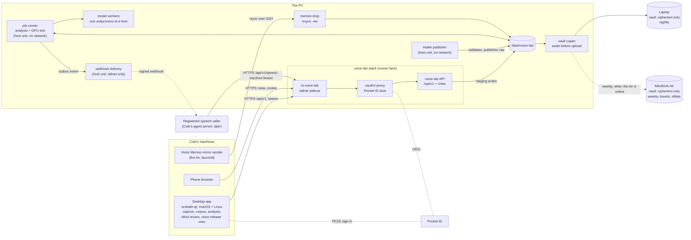

# Design: the combined voice platform

Status: **accepted** (2026-10-06). The owner answered every question in
[§13](#13-owner-decisions-2026-10-06) on 2026-10-06: the recommendations, with one
global constraint, that everything is free and runs on his own hardware (no cloud,
nothing paid). The decisions are recorded in [DECISIONS.md](../../DECISIONS.md) as
D-021 to D-032. Accepted is not deployed: each phase of [§9](#9-phased-plan) still
ships through its own reviewed PRs.

This document describes how `voice-lab` absorbs `voice-journey` and its capture
client, moves its whole backend to the PC, gains a cross-platform desktop app and
a read-only web view, and becomes publishable. It builds on the existing
invariants in [AGENTS.md](../../AGENTS.md), [ARCHITECTURE.md](../../ARCHITECTURE.md),
[DECISIONS.md](../../DECISIONS.md) and [SECURITY.md](../../SECURITY.md). Those stay
authoritative for what is built. Where this design changes one of them, the change
is named in [§12](#12-amendments-to-existing-decisions) and recorded in DECISIONS.md;
the wording of AGENTS.md, ARCHITECTURE.md and SECURITY.md about how the lab runs
changes with the phase that implements it, never ahead of the code. Two decisions
apply at once and are already in the tree: the MIT licence (D-027) and the
free-and-own-hardware rule (D-028, an AGENTS.md invariant).

Amended 2026-10-11 (D-044 to D-047): ChloeSpeech is retired and voice-lab is the speech
engine. Speech is generated with Cole's own designated voice release and served, as queued
jobs with webhooks, to callers registered on the tailnet
([§3.6](#36-speech-for-registered-callers), [SPEECH_API.md](../SPEECH_API.md)). The sections
below say so where they named the ChloeSpeech boundary or promotion.

Contents:

1. [Goals and non-goals](#1-goals-and-non-goals)
2. [Today and target](#2-today-and-target)
3. [Architecture](#3-architecture)
4. [Data and privacy model](#4-data-and-privacy-model)
5. [Merging voice-journey](#5-merging-voice-journey)
6. [The desktop app](#6-the-desktop-app)
7. [Model workers on ROCm](#7-model-workers-on-rocm)
8. [Deployment](#8-deployment)
9. [Phased plan](#9-phased-plan)
10. [Risks](#10-risks)
11. [Open questions and spikes](#11-open-questions-and-spikes)
12. [Amendments to existing decisions](#12-amendments-to-existing-decisions)
13. [Owner decisions, 2026-10-06](#13-owner-decisions-2026-10-06)
14. [What this demonstrates](#14-what-this-demonstrates)

## Decisions already made by the owner

These are requirements of this design, not proposals:

1. **One project, `voice-lab`.** `voice-journey` (the longitudinal analysis of about
   2,400 Apple Voice Memos, mostly singing, 2019 to now) and its capture client
   `voice-journey-capture` merge into it.
2. **voice-journey's server is ported to Python.** voice-lab is Python 3.12 with
   strict Pydantic contracts, strict mypy, Ruff and pytest.
3. **The entire backend moves to the PC** (the Arch workstation, registry id `arch`:
   AMD Radeon RX 6900 XT, Navi 21 / `gfx1030`, 16 GB VRAM; Ryzen 5 5600G; 125 GB RAM;
   `/data` a 3.6 TB btrfs HDD). The Mac mini is being decommissioned.
4. **The frontend is a cross-platform `scshafe-qt` desktop app** for macOS and Linux
   (no Windows), plus a **small read-only web view** for phone access, behind Pocket ID.
5. **The name stays `voice-lab`**, and the repository becomes publishable: code only.
   Recordings, weights and consent records (history since D-050) never enter Git.
6. **Free, and on the owner's own hardware** (2026-10-06, D-028). No cloud service and
   nothing paid, anywhere in the platform: no object storage, no hosted GPU, no paid
   model or API, no paid signing or notarization, no hosted CI beyond what is free
   for a public repository. What remains allowed, because it is free and carries no
   private byte:
   - GitHub, including Actions on the public repository and GitHub Packages for
     public packages; PyPI;
   - one-off downloads of public code and model weights at pinned revisions
     (Hugging Face, GitHub, PyTorch's wheel index), by the operator's explicit
     `--allow-downloads` step; nothing is ever uploaded to them;
   - the fleet's existing tailnet on Tailscale's free plan as the transport. Its
     coordination server sees node metadata, never payload; traffic between nodes is
     WireGuard-encrypted end to end, and a relay, when one is used, carries only
     ciphertext (and vault traffic is sealed before it leaves the PC anyway).

## 1. Goals and non-goals

### Goals

- **One coherent, privacy-first voice platform.** Capture, intake, a corpus that spans
  phone memos and calibrated measurement sessions, longitudinal analysis, voice-model
  evaluation and speech in Cole's own voice live in one repository with one set of
  invariants, one API and one operator app (D-044).
- **Every private byte on hardware Cole owns.** No recording, derived audio or weight
  leaves Cole's hosts without an explicit, digest-bound approval
  (AGENTS.md), and no copy ever goes to a cloud service (D-028). The second and
  offsite copies of recordings are ciphertext on Cole's own laptop and MacBook Air,
  sealed before they leave the PC.
- **Keep every existing guarantee.** Fail-closed checksum intake, content-addressed
  write-protected raw audio, isolated pinned model workers and blind listening as the
  primary decision signal all carry over unchanged. (The one-way, manifest-only
  ChloeSpeech boundary of D-001 was retired on 2026-10-11, D-044.)
- **Retire the Mac mini's role** (intake, Voice Memos mirror sender) and the Mac-only
  Swift app, without a gap in service at any phase.
- **Use the PC's GPU** for the model bake-off, fine-tuning and analysis, replacing the
  16 GiB Apple-silicon memory ceiling of D-008.
- **A publishable portfolio piece.** The owner's goal is a public repository that
  reads as one well-engineered system: privacy engineering, reproducible ML
  evaluation, a cross-platform native UI and deploy automation
  ([§14](#14-what-this-demonstrates)). The design favours that coherence over
  short-term convenience where they conflict.

### Non-goals

- **No cloud, nothing paid, no public endpoint** (the owner's constraint above, D-028). No
  hosted service, cloud GPU, object storage, paid model or API, paid certificate or
  notarization. Everything is tailnet-only; Funnel stays off. SECURITY.md's approval
  rule for a hosted GPU stays in force as a rule, but this design uses none.
- **No Windows support**, and no mobile app. The phone gets a read-only web view.
- **No multi-user product.** The platform has one subject and one operator. Pocket ID
  gates access; it is not a user-management system.
- **No other speech engine.** ChloeSpeech is retired (D-044): voice-lab generates speech
  itself, only with the voice release Cole designates (D-045).
- **No automatic winner.** The lab never authors a listening verdict, and never
  designates a voice release: designation is Cole's act, by a CLI command (D-045).
- **No rewrite of stored identifiers.** `cole-voice-lab.<record>/vN` schema ids and
  the `cole-voice-lab-common-v1` normalization id stay for ever, although the package
  and its variables are renamed in phase 6 ([§13](#13-owner-decisions-2026-10-06),
  decision 2).
- **No always-on synthesis endpoint, and no audio streamed while it is synthesized**
  (SECURITY.md, "Deliberately avoided", as amended by D-046). Synthesis stays a queued,
  one-at-a-time job in the GPU slot. Registered callers on the tailnet may request it, fetch
  each sentence as soon as it is finished, and learn of the job's end by polling, its event
  stream or a signed webhook (§3.6).

## 2. Today and target

| Concern | Today | Target |
| --- | --- | --- |
| Repositories | `voice-lab` (private, Python + Swift), `voice-journey` (public, Node + React), `voice-journey-capture` (public, PySide6) | One repository, `voice-lab`, public once screened; the other two archived with a redirect |
| Capture, prompted speech | Swift macOS app + Python recording service on the Air; Audio Queue capture with continuity evidence (D-015) | `scshafe-qt` desktop app on macOS and Linux; same continuity contract, PortAudio backend (spike S-1) |
| Capture, measurement sessions | `voice-journey-capture`: UMIK-1 seven-segment ritual, level pinning, chunked HTTPS upload | The same flow, inside the desktop app |
| Intake | The reviewed Mac mini design (rsync with a per-plan approval digest, `intake scan` LaunchAgent) and voice-journey's HTTP intake on the laptop | One HTTPS intake API on the PC (resumable chunks, as voice-journey's), feeding voice-lab's strict validator, which alone publishes raw |
| Raw store | Asset root on the Air (working library) and the Mini (intake root) | `/data/voice-lab/lab/raw/` on the PC: content-addressed, read-only, its own btrfs subvolume |
| Voice Memos corpus | Mirror sender on the Mac mini (launchd, Full Disk Access) → `rrsync` drop on the laptop | Sender on the Air → `rrsync` drop on the PC |
| Analysis | Node pipeline (`watchd`) + one Python feature extractor, in the laptop container | Python `journey` package; pipeline jobs on the PC |
| Model bake-off and fine-tuning | MLX (Qwen3-TTS, Chatterbox) and MPS (F5-TTS, Seed-VC) on Apple silicon, one candidate at a time | PyTorch on ROCm on the PC's `gfx1030`, same worker contract; per-model spikes; Mac runtimes kept as a fallback |
| Blind review | Static review pages and the CLI | Blind review screen in the desktop app (blinded indices only); the CLI stays |
| Promotion | CLI validates a reviewed manifest and writes the handoff | Retired 2026-10-11 (D-044): Cole designates a voice release by CLI on the PC (D-045), and the speech API renders with it for registered callers (D-046) |
| UI | Swift app (about 24k lines with its tests), legacy Qt Widgets desktop, React SPA (four views) | One `scshafe-qt` app + a server-rendered read-only web view |
| Auth | Capture client: Pocket ID PKCE; web: oauth2-proxy + Pocket ID | Same Pocket ID model for both, plus token checks in the API itself |
| Production host | The laptop (voice-journey stack, runner lane); the Mini (intake design) | The PC: a new `pc` host role in the runner lane |
| Second copy of recordings | Laptop stack backup pulled to the PC (voice-journey); encrypted vault built but not deployed (D-020) | Sealed vault generations from the PC to a vault on the laptop (nightly) and one on the MacBook Air (weekly; it travels, so it is the offsite copy); optionally a rotated USB drive. All ciphertext, all Cole's hardware (decision 3) |
| Licence | Proprietary, "Cole and Chloe" (voice-lab); none (voice-journey); MIT (capture) | MIT, "2026 voice-lab contributors", applied 2026-10-06 (decision 1); voice-journey's code becomes MIT when imported in phase 3 |

## 3. Architecture

### 3.1 Components



| Component | Runs where | What it owns | Origin |
| --- | --- | --- | --- |
| **Desktop app** | Cole's Macs and the PC | The UI; capture of prompted takes and measurement sessions; a durable local spool of takes not yet accepted; sign-in | Swift app + legacy Qt desktop + `voice-journey-capture` + React SPA, merged |
| **Intake API** | PC, `voice-lab` container | Resumable chunked uploads into `incoming/`; never writes `raw/` | voice-journey `intake.mjs` (protocol), voice-lab `intake.py` (acceptance) |
| **Intake publisher** | PC, host unit, no network | Re-hashing, audio inspection, QC, content-addressed publication into `raw/`, receipts | voice-lab `intake.py` (`intake scan`, the Mini LaunchAgent design) |
| **Raw store** | PC, `/data/voice-lab/lab/raw/` | Accepted originals: read-only, content-addressed | voice-lab (D-003) |
| **Memos drop** | PC, `vj-mirror` account | The Voice Memos mirror, append-only (`-wo -no-del`) | voice-journey `vj-mirror` |
| **Corpus index** | PC, job runner + API | One index over phone memos, measurement sessions and lab takes; the prompt catalog | voice-journey `index-recordings`, voice-lab `recording_index` + `corpus_store_sqlite` |
| **Analysis** | PC, job runner | Singing filter, local speech-to-text, lyric clusters, voice features, journeys, coach, goals, referee | voice-journey pipeline, ported |
| **Datasets and references** | PC, job runner / CLI | Derived audio, references, fine-tune datasets; never in `raw/` | voice-lab `references`, `datasets`, `finetune` |
| **Model workers** | PC, job runner subprocesses on ROCm | One isolated runtime per model stack, `worker-request/v1` in, `worker-result/v1` out | voice-lab `workers/` |
| **Blind review** | Desktop app + API | Blinded listening packages, score sheets; the reveal stays server-side | voice-lab `blind` |
| **Voice release and speech** | PC: CLI, API, job runner, delivery unit | The designated voice release (D-045); speech jobs for registered callers, their ledger and webhooks (D-046, §3.6) | Replaces voice-lab `promotion` (retired, D-044) |
| **Read-only web view** | PC, same container, `/view` | Phone-sized summaries, charts and tables; GET only | voice-journey SPA views, simplified |
| **Vault copier** | PC, host unit | Seals generations and pushes them to the laptop vault (nightly) and the Air vault (weekly, resumable when the Air wakes) | voice-lab `library_*` + `storage_*` (D-020), re-pointed (D-023) |

### 3.2 Processes and services on the PC

| Process | Kind | Identity | Network | Writes |
| --- | --- | --- | --- | --- |
| `ts-voice-lab` | container (stack) | Tailscale sidecar, `tag:voice-lab` | tailnet only, no Funnel | its own state |
| `oauth2-proxy` | container (stack) | digest-pinned door, Pocket ID client `voice-lab` | door + upstream bridges | none |
| `voice-lab` (API + view) | container (stack) | uid `voice-lab`, read-only root | upstream bridge only | `incoming/`, `state/` |
| `voice-lab-intake.path` / `.service` | systemd host unit | `voice-lab` | `PrivateNetwork=yes` | `raw/`, `provenance/intake/` |
| `voice-lab-jobs.service` | systemd host unit | `voice-lab`, groups `render`, `video` | `PrivateNetwork=yes` | `derived/`, `experiments/`, `evaluations/`, `journey/` |
| model worker | subprocess of the job runner | inherits; one at a time (D-008 carried over) | none (inherited namespace) | its run directory only |
| `voice-lab-vault@laptop.timer`, `voice-lab-vault@air.timer` | systemd host units, one per destination | `voice-lab` | tailnet to that vault node only | `provenance/vault/<destination>/` |
| `vj-mirror` | SSH forced command `rrsync -wo -no-del` | `vj-mirror` | SSH from the Air only (tailnet policy) | `memos/phone/` |
| runner `pc-voice-lab-prod` | GitHub Actions runner | `run-voice-lab` (uid 62000–62999) | public HTTPS only (runner egress table) | nothing directly; `sudo scshafe-deploy` |

Two properties follow from this split:

- **The network-facing process cannot change raw audio.** The API container has no
  write access to `raw/`. A compromised or buggy API can fill staging, not rewrite
  history. Only the intake publisher, which has no network at all, publishes raw.
- **Nothing that reads audio for a model can reach the network.** The job runner and
  its workers run in a private network namespace. Model downloads stay a separate,
  explicit `--allow-downloads` step run by the operator (AGENTS.md), never by a job.

The API and the host units meet only through the filesystem: a finalize request is a
file in `incoming/<session>/FINALIZE`, a job request a file in `state/jobs/queue/`.
Both are watched by systemd path units. This keeps the existing "commands are
files and receipts" style and needs no broker.

### 3.3 Data flow

```text
 prompted take / measurement session (desktop app, local spool, checksummed)
        │  POST /api/v1/intake/sessions        (manifest, digests, sizes)
        │  PUT  .../files/<name>  Content-Range (resumable, 8 MiB chunks)
        │  POST .../finalize                   (writes incoming/<id>/FINALIZE)
        ▼
 incoming/<id>/          staging, same filesystem as raw/
        │  intake publisher: re-hash from open fds, inspect WAV, recompute QC,
        │  fresh inodes, revalidate at the boundary          (intake.py, unchanged)
        ▼
 raw/<sha256>/           read-only, content-addressed; receipt v2
        │                                    ┌──────────── memos/phone/ (mirror drop)
        ▼                                    ▼
 corpus index ◄──────────────── recording-index (phone, measurement, lab take)
        │
        ├── journey pipeline: filter → stt → lyrics → reclassify → features → journeys
        │      └── journey/manifests/*.json   (served by /api/v1 and /view)
        │
        ├── references + datasets   derived/   (never raw/)
        │      └── fine-tune (F5-TTS)  ──► derived/finetune/<run>/
        │
        └── ExperimentPlan ──► worker-request/v1 ──► model worker (ROCm) ──► worker-result/v1
                                   │
                                   ├── normalization + automatic diagnostics
                                   └── blinded listening package ──► desktop app blind review
                                                                     │
                                         verdict (Cole) ◄────────────┘
                                                │
                       voice release (Cole, CLI) ─► speech jobs ─► registered callers (§3.6)
```

The capture app keeps every take in its local spool until the server returns an
intake receipt whose manifest digest matches the one the app computed. The PC being
off (it is a workstation) delays acceptance; it never loses a take.

### 3.4 API boundaries

There are four boundaries, each versioned:

| Boundary | Between | Contract | Versioning |
| --- | --- | --- | --- |
| **HTTP API** | desktop app ↔ backend | JSON over HTTPS, Pydantic models, JSON Schema generated into `schemas/api/v1/` | Path-versioned: `/api/v1/…`. A breaking change adds `/api/v2` and serves both for at least one app release. `GET /api/v1/meta` returns the server build, the API versions served and the minimum client version |
| **Worker contract** | job runner ↔ model runtime | `worker-request/v1` / `worker-result/v1` on stdin/stdout (D-004) | Unchanged |
| **Mirror drop** | mirror sender ↔ PC | Files + `_mirror/latest.json` (size and SHA-256 per file) over `rrsync` | Unchanged from voice-journey |
| **Speech API** | voice-lab ↔ registered callers | `/api/v1/speech` and Standard Webhooks events ([SPEECH_API.md](../SPEECH_API.md)) | Path-versioned with the HTTP API; the event `type` names its version |

The `/api/v1` surface, by resource. Every route is the port of an existing
route or command, except `speech`, the new capability of D-046.

| Resource | Routes | Ported from |
| --- | --- | --- |
| meta | `GET /api/v1/meta`, `GET /healthz` | voice-journey `/healthz` |
| chains | `GET /api/v1/chains` | voice-journey PR #1 (`/api/chains`) |
| intake | `POST /api/v1/intake/sessions`, `GET …/{id}`, `PUT …/{id}/files/{name}`, `POST …/{id}/finalize`, `GET …/{id}/receipt` | voice-journey `intake.mjs` (`intake-session.v1`) + voice-lab intake receipt v2 |
| catalog | `GET /api/v1/catalog` (active version), `GET /api/v1/catalog/prompts/{id}/takes` | voice-lab `catalog_ports`, recording service `CatalogCommand` |
| recordings | `GET /api/v1/recordings`, `GET …/{id}`, `GET …/{id}/audio` (Range), `…/transcript`, `…/features` | voice-journey `/api/rows`, `/api/row`, `/api/audio`, `/api/transcript`, `/api/feature-detail` |
| review | `GET /api/v1/review/queue`, `POST /api/v1/review/verdicts` | voice-journey `/api/review-queue`, `/api/verdicts` |
| analysis | `GET /api/v1/summary`, `/trends`, `/journeys`, `/coach`; `GET/POST /api/v1/goals`, `POST /api/v1/goals/{id}/abandon` | voice-journey routes of the same names |
| referee | `GET /api/v1/referee/next`, `POST /api/v1/referee/verdicts`, `GET /api/v1/referee/results` | voice-journey referee |
| jobs | `POST /api/v1/jobs` (`pipeline`, `finetune`, `audition`, `synthesize`), `GET …/{id}`, `GET …/{id}/events` (SSE), `POST …/{id}/cancel` | voice-lab recording service fine-tune supervisor (`FINETUNE.JOB_ACTIVE`, one GPU slot) |
| blind | `GET /api/v1/blind/{package}/items`, `GET …/items/{index}/audio`, `POST /api/v1/blind/{package}/scores` | voice-lab `blind` (blinded indices only; the reveal is never served) |
| speech | `POST /api/v1/speech`, `GET …/{id}`, `GET …/{id}/segments/{n}/audio` and `GET …/{id}/audio` (Range), `GET …/{id}/events` (SSE), `POST …/{id}/cancel`; registered callers only, with machine tokens (§3.6) | new (D-046); renders through Speak's seam, `finetune.synthesize_speech` |
| view | `GET /view/…` (HTML) | voice-journey SPA views |

Writes that are acts of judgement stay out of the API on purpose: publishing a
reference, approving a destination, writing a verdict, designating a
voice release, registering a speech caller, evicting a model, archiving a run. Those
remain CLI commands or configuration on the PC with their explicit flags and digests.

During phase 3 the API also answers voice-journey's unversioned paths (`/api/rows`,
`/api/intake/…`) so the React SPA and the current capture client keep working; they
are removed in phase 4 once nothing calls them.

The HTTP server follows `storage_server.py`'s precedent: the standard library's
`ThreadingHTTPServer`, strict Pydantic request and response models, JSON refusals
with stable codes (decision 9, D-031). No ASGI framework: the JSON Schemas in
`schemas/api/v1/` are generated from the Pydantic models by the existing
`cole_voice_lab.schema` tooling, which is what an OpenAPI generator would have
added.

### 3.5 Authentication

Pocket ID is the identity provider for everything, as today:

| Client | Pocket ID client | Flow | Reaches |
| --- | --- | --- | --- |
| Desktop app | `voice-lab-desktop`, public | Authorization code + PKCE S256, one-shot loopback redirect on `127.0.0.1`, state, nonce, issuer and audience checks; tokens only in the OS keychain (`keyring`) | `/api/v1/*` with `Authorization: Bearer` |
| Phone (web view) | `voice-lab`, confidential, used by oauth2-proxy | OIDC code flow, PKCE S256, 12 h cookie | `/view/*`, `/healthz` |
| Speech caller (D-046) | one confidential client per caller | `client_credentials`; the API maps the token's issuer, subject and audience to a registered caller | `/api/v1/speech*` only |

This is `voice-journey-capture`'s `auth.py` and voice-journey's door, unchanged in
shape. The door accepts the app's bearer tokens through oauth2-proxy's
`SKIP_JWT_BEARER_TOKENS` and `EXTRA_JWT_ISSUERS`, and `API_ROUTES=^/api/` answers
401 instead of redirecting.

One change: voice-journey's app trusts `X-Forwarded-User` without checking
anything, relying on network isolation. Because the API now fronts biometric data,
it also verifies the bearer JWT itself (issuer, audience `voice-lab-desktop`,
expiry, signature against Pocket ID's JWKS, which a host unit refreshes into the
stack's state directory because the app container has no route to Pocket ID) and
checks the subject against a configured allow-list of one. For `/view` it checks
that the forwarded identity is the same allowed subject. Defence in depth, not a
replacement for the door.

### 3.6 Speech for registered callers

Added 2026-10-11 (D-044 to D-048); specified in [SPEECH_API.md](../SPEECH_API.md).
voice-lab renders text as speech in Cole's voice for callers listed in a caller registry
(Cole's own agent server, later). Only the voice release Cole designates speaks (D-045).
`POST /api/v1/speech` answers `202` with a job. The job runner splits the text into
sentences and publishes each as soon as it is rendered, so the caller can start playing after
about one sentence's render; it lists them by polling `GET /api/v1/speech/{id}` or follows the
job's event stream, fetches `…/segments/{n}/audio`, and gets the joined `…/audio` and a signed
terminal webhook (Standard Webhooks) at a registered tailnet URL when the job ends. The API
container only enqueues and serves finished files; a new host unit, `voice-lab-speech`, keeps
a resident model worker for the voice release in the one GPU slot (unloaded when idle or when
a long job wants the slot) and renders with no network; a second, `voice-lab-speech-webhooks`,
delivers webhooks over the tailnet only. Every render is in an append-only ledger (the text's
digest, never the text), and rendered audio is deleted after 7 days. Spike S-2 measured a warm
real-time factor of about 0.7 at 32 flow steps on the PC (D-046); a whole long reply still
takes minutes, which is why the API is asynchronous and progressive.

The speech path is family-neutral (D-048): a release names its model family and binds that
family's files by role, the job runner renders through one backend port, and a small registry
gives each family its backend, its segment limit, its native sample rate and whether it
seeds. F5-TTS is the one family today; the API's audio stays 24 kHz mono 16-bit whatever a
family renders. Adding a family for the comparison Cole wants once the corpus is complete is
one runtime lock, one training adapter, one speech backend and one registry entry
([MODEL_FAMILIES.md](../MODEL_FAMILIES.md)).

## 4. Data and privacy model

### 4.1 Asset roots on the PC

```text
/data/voice-lab/                    root:voice-lab 0750   btrfs subvolume
├── lab/                            COLE_VOICE_LAB_ASSET_ROOT; layout unchanged (ARCHITECTURE.md)
│   ├── incoming/                   voice-lab:voice-lab 0700   API container rw
│   ├── raw/                        own subvolume; files 0444, dirs 0555; read-only snapshots
│   ├── derived/  provenance/  experiments/  evaluations/
│   ├── models/   runtimes/         weights and isolated environments (never in Git)
│   └── tmp/                        same filesystem as raw/ for atomic publication
├── memos/
│   └── phone/                      vj-mirror:voice-lab 2750; append-only drop
├── journey/
│   ├── manifests/                  generated recording-index, filter, stt, features, journeys
│   └── models/                     whisper.cpp model
└── state/                          API state (review verdicts, goals, referee, job queue)
```

- **Owner and modes.** A dedicated system user `voice-lab` owns everything. Modes
  follow SECURITY.md: directories `0700`/`0750`, private files `0600`, accepted raw
  `0444` in `0555` directories. The project agents on the PC (`agent-<project>`,
  including `agent-voice-lab`) and the runner accounts are not in group `voice-lab`
  and cannot read the tree.
- **Honest limit.** `cole` has passwordless sudo on the PC, so file modes do not
  stop a session running as `cole`. "Never read asset roots or recordings" stays a
  rule for every agent session, as it is today, not a property the filesystem
  enforces against the owner's own account.
- **Immutability.** Accepted originals are content-addressed and `0444` (D-003). On
  top, `raw/` is its own btrfs subvolume with a read-only snapshot taken after every
  accepted session, so even a root mistake is recoverable until the snapshot is
  deleted. Derived audio is always written elsewhere.
- **The disk.** `/data` is one HDD. It also holds the fleet's backups
  (`/data/backups/`). Snapshots protect against mistakes, not against losing the
  disk; that is what [§4.3](#43-backups-and-the-offsite-copy) is for.

### 4.2 Consent gating and transfer approval

The transfer rules stay, with one scoped change: a standing approval for the home host
(D-021). Consent records are retired (D-050, 2026-10-12): the bullets on consent below
record the design as it was, and D-050's standing decision replaces them.

- **Cole's own voice, by standing decision** (D-050). Cole's voice may be used for
  fine-tuning, listening (Speak), assistant speech and benchmarks on his own hardware. No
  consent record, purpose or execution boundary is required or read. The subject is pinned in
  code to `cole-self`: designation, the speech API and job runner, reference publication,
  dataset building, the offline workers and the benchmark refuse any other subject. Zero-shot
  rendering still needs a checksum-bound reference. Consent records already on disk stay as
  history. Rendered audio leaves the PC only to a registered caller and may reach Cole's own
  devices through it (D-046).
- *Superseded by D-050.* **Consent for synthesis.** Recognizable-human synthesis still
  requires a checksum-bound reference and an approved, checksum-bound consent record with a
  matching subject and purpose. Offline workers already require the
  `tailnet-local-host` execution boundary; the PC is such a host, so no consent
  contract changes. `ConsentRecord.hosted_transfer_allowed` stays `Literal[False]`.
- *Superseded by D-050.* **Speak and fine-tuning** (decision 7, D-022). D-019 scoped Speak
  and fine-tuning as "local listening … on the Mac that holds Cole's library", reading no
  consent record, and left open whether they should require one. The owner has answered:
  **both require an approved, checksum-bound consent record** once they run on the
  PC, because synthesis then happens on a different machine from the listener.
  - Fine-tuning needs a record whose purposes include `private-fine-tuning`; Speak
    needs one whose purposes include a new purpose, `private-home-host-synthesis`.
  - Both need a new execution boundary, `home-host`: the record is valid only for
    the host that the standing home-host approval (D-021) names, so a record for the
    PC cannot authorize synthesis anywhere else.
  - Subject, approval state and checksum are checked as for the lab's other
    rendering paths, and the job runner records the consent record's digest in each
    run's and each clip's evidence. A missing, pending, revoked or mismatched record
    refuses the job before a worker starts.
  - Until phase 5 moves them, the Mac-local fine-tuning and Speak of D-016 to D-019
    keep their current behaviour; the requirement starts with the PC's job runner.

  D-019's second open question (retention for Speak clips) is unchanged and still
  open.
- *Superseded by D-050.* **Speech for registered callers** (D-046, D-047, 2026-10-11).
  Rendering through the speech API needs an approved, checksum-bound consent record whose
  purposes include `private-assistant-speech` and whose boundaries include `home-host`, checked when the job
  is queued and again before the worker starts; each render's ledger entry names the
  record's digest. The purpose `private-chloe-speech-rendering` is retired: stored records
  that name it still parse, and nothing grants or requires it. Rendered audio leaves the PC
  only to a registered caller and may reach Cole's own devices through it.
- **Transfer approval.** AGENTS.md: "No human audio is sent to a hosted service or
  GPU host without a separate, explicit transfer approval naming the destination
  and payload digest." The PC is a GPU host. Today each Mini transfer needs a
  reviewed plan and its pasted `plan_sha256`. For the platform's own home that is
  friction on every take, so D-021 (decision 6) adopts a **standing home-host
  approval** modelled on D-020's `VaultDestinationApproval`:
  - it binds the endpoint FQDN, the node's stable Tailscale ID, `tag:voice-lab`,
    the tailnet suffix, the file classes (`capture`, `measurement`) and a mandatory
    expiry of at most 366 days;
  - the app re-checks the node identity before each upload session, as the vault
    client does, and writes a chained ledger entry naming the session's manifest
    digest before the first byte;
  - it covers only Cole's own PC. Any other destination of Cole's own, such as the
    Air fallback of [§7.3](#73-what-changes-in-the-matrix), still needs the separate
    per-payload approval. No hosted GPU or other cloud destination is part of this
    design at all (D-028).
- **Between Cole's hosts.** Moving voice-journey's data from the laptop to the PC
  (phase 3) is a one-off transfer under the existing rule: one approval naming the
  PC and the digest of the transfer manifest.
- **Audio-reading gates.** voice-journey's `--approval` text for pipeline stages
  that read audio, and its playback approval, carry over as configuration that the
  job runner and the API refuse to run without.

### 4.3 Backups and the offsite copy

Today the PC is the fleet's backup target: `scshafe-backup-pull@stacks` pulls the
laptop's nightly stack backups into `/data/backups/scshafe/…`, and there is no copy
beyond the PC. Once the PC holds the only working copy of the recordings, the PC
cannot also be their backup.

The plan reuses what is already built, D-020's encrypted vault, with the direction
reversed, and keeps every copy on hardware Cole owns (decision 3, D-023). There is
no cloud bucket and no paid storage (D-028).

```text
PC (plaintext, the working library)
  │  library_replication: classify, seal (AES-256-GCM), chain manifests, ledger entry
  ├──► vault on the laptop        ciphertext only; tag:voice-lab-vault; nightly      (phase 2)
  ├──► vault on the MacBook Air   ciphertext only; tag:voice-lab-vault-air; weekly,
  │                               resumed whenever the Air is online   (phase 3, offsite)
  └ ─► rotated USB drive          ciphertext only; local-directory backend   (optional, later)

PC btrfs: read-only snapshots of raw/ after each accepted session; nightly of the rest
Laptop stack backups ──pull──► PC /data/backups (unchanged; the fleet's existing flow)
```

- **What is copied.** `raw/`, `provenance/`, the corpus store (through SQLite
  backup), `evaluations/`, the stack state of [§8.3](#83-backups), and finished
  fine-tune runs if the `training` class is opted in (D-020). `memos/phone/` is
  copied too, as a new `memos` class: the design does not count Apple's iCloud sync
  of the phone's Voice Memos as a backup, because it is a cloud service outside
  Cole's hardware. Not copied: `runtimes/` and `models/`, which are reproducible from
  locks; `tmp/`; Speak clips.
- **One binding per destination.** D-020 has one binding and one manifest chain. The
  copier gains one binding, approval, state, manifest chain and ledger per
  destination (`provenance/vault/<destination>/`; as built,
  `provenance/vault/destinations/<destination>/`, with a token pair per destination,
  D-034), so a sleeping Air never holds back
  the laptop's nightly copy, and each destination's rollback and fork checks stay
  exactly D-020's.
- **The key.** The library key is created on the PC as a root-owned credential
  readable only by the vault units (systemd `LoadCredentialEncrypted=`; as built,
  `ImportCredential=` globs over `/etc/credstore.encrypted/`, D-034), with D-020's
  offline recovery sheet. No vault host, neither the laptop nor the Air, ever holds
  it. No key exists yet: D-020's vault was never deployed and no library key was
  ever created.
- **The laptop vault** runs the existing `deploy/vault/` container and sidecar
  templates as a laptop stack, unchanged except for its host. It closes the
  single-disk risk and keeps a copy on a second machine, nightly. It is on the same
  site as the PC.
- **The Air vault** is the offsite copy, because the Air travels with Cole.
  - **Server.** The same standard-library `storage_server.py`, from a sealed install,
    as a launchd daemon under a dedicated non-admin macOS account that owns the vault
    directory (mode `0700`) and listens on loopback only. A second, userspace
    `tailscaled` with its own state directory gives it its own tailnet node,
    `voice-lab-vault-air`, tagged `tag:voice-lab-vault-air`, serving HTTPS to that
    loopback port with the node's tailnet certificate. The copier checks that node's
    StableID, tag and DNS name before every session, as D-020's client does. The
    Air's own node and Cole's account are untouched, and the ciphertext sits under
    FileVault as well.
  - **Cadence.** The Air sleeps and travels, so the copier is built for intermittent
    reach. `voice-lab-vault@air.timer` fires hourly; a run probes the checked node and
    exits quietly if it is unreachable. When it answers and its newest complete
    generation is seven days old or more, the copier pushes the newest state. A
    missed week is caught up the next time the Air is online, wherever it is; the
    operator can also push at once (`vault push --destination air`). The first,
    full seeding is a one-off run at home on the LAN with the Air kept awake.
  - **Resume.** D-020's push only reuses content the previous *generation* holds, so
    an interrupted push re-seals and re-sends all its new content, which a laptop
    that sleeps mid-upload might never finish. The copier gains a per-destination
    resume journal: as each sealed chunk is stored, its ciphertext reference
    (SHA-256, size) and the plaintext file digest and offset it carries are appended
    to `provenance/vault/air/resume.jsonl`. The next attempt, even one whose plan has
    grown since, reuses every journalled chunk of a file whose digest is unchanged,
    after reading it back and checking its ciphertext digest, and continues from the
    first chunk not stored. This is D-020's own dedup (reusing sealed chunk refs),
    extended from the previous generation to the unfinished one. The head is swapped only when the whole generation is stored, so an
    interrupted push leaves the previous generation intact and current. A completed
    generation clears its journal, and `vault verify` still proves presence by
    download and decryption, never by the host's claim.
  - **Staleness.** The app's status screen and the PC's health check show the age of
    each destination's newest complete generation; the Air copy is flagged after
    14 days.
- **A rotated USB drive (optional, later).** If the owner wants a third copy that
  does not depend on the Air, two external drives hold `local-directory` vaults (the
  backend D-020 already has, so no server and no approval are needed). The PC writes
  to the one plugged in; the other is kept away from the house; they swap on a
  schedule the owner sets. Not part of any phase until the owner asks.
- **Residual risk, stated plainly.**
  - The PC and the laptop are on the same site. A fire, flood or burglary at home
    can take both, so **the Air copy is the only real offsite copy**, and only while
    the Air is away from the house. When Cole and the Air are home, all three
    copies are in one place; only a USB drive kept elsewhere would cover that.
  - The Air copy lags the PC by up to a week, longer if the Air stays offline;
    recordings accepted since its last complete generation exist only at home.
  - Ciphertext is useless without the key. If the only recovery sheet is kept at
    home, losing the house loses the key and with it every offsite copy. A copy of
    the sheet must be kept away from the house (it is a secret, not a backup of the
    recordings; how and where is Cole's choice and is never recorded in Git).
  - The Air can be lost or stolen while travelling. That costs an offsite copy, not
    privacy: it holds ciphertext only, and no key.
  - D-020's accepted limits still apply to every destination: sealing hides content,
    not sizes or times, and a host can withhold or delete data.
- **Restore drill.** Each phase that moves data ends with a restore drill: fetch a
  generation, decrypt, re-hash every file against the manifest. Phase 3 adds one from
  the Air, fetched over the tailnet while the Air is away from home.

### 4.4 What is public and what never is

| Public in the repository | Never in Git (guarded by `scripts/guard-private-assets`) |
| --- | --- |
| Code, tests with synthetic fixtures, schemas, prompt catalogs, policy, this document | Recordings and any derived audio, Voice Memos and `CloudRecordings.db` |
| Model *locks*: ids, immutable revisions, file digests | Model weights, runtimes, caches |
| Deployment templates (`deploy/stack/`, units, `.env.example`) | `.env`, tokens, keys, Pocket ID client secrets, the library key |
| Generated JSON Schemas | Approvals, receipts, ledgers, run evidence (consent records retired, D-050) |
| Chain definitions without calibration paths | Calibration files, transcripts, lyrics, generated manifests about the corpus |
| Placeholders (`<tailnet>.ts.net`, `100.64.0.x`) | Real tailnet name, tailnet IPs, home paths |

The guard already scans worktree files, the index, private-evidence JSON patterns,
audio/model signatures and wheel contents. Phase 3 extends its rules to
voice-journey's private shapes: `recording-index`, transcripts, lyric indicators and
features manifests, and `CloudRecordings.db*`.

## 5. Merging voice-journey

### 5.1 Repository strategy

The public `voice-journey` has eight commits on a single root ("Voice Journey: the
published tree"); its older history is in a private archive repository and stays
there. Importing the public history is clean: nothing in it is private, it was
screened when it was published, and it keeps authorship and blame for the code
being ported. `voice-journey-capture` (17 commits, MIT) is the same.

Decided (decision 11, D-030): **import both histories** with `git subtree add`-style
merges into prefixes, each as one reviewed PR with a merge commit:

- `voice-journey` into `legacy/voice-journey/` in phase 3. Ported modules are
  deleted from it as their Python replacements land; the directory is gone by the
  end of phase 3.
- `voice-journey-capture` into `apps/desktop/` in phase 4. It becomes the desktop
  app; it is not a legacy tree.

The alternative, a code-only copy, loses blame on the ported code and gains
nothing, since the history has nothing to hide. Before either import the
publication screen's method runs on the imported history (identities, paths,
names) and the result is recorded.

**Licence of the imported code** (decision 1, D-027). voice-journey has no licence
file today; the owner owns its code. Once imported, it is covered by voice-lab's MIT
`LICENSE`, and the import PR says so. voice-journey-capture is already MIT with the
same "contributors" holder form, so its licence does not change. Both stay in the
public repository: the analysis code is half of what makes the platform more than
a model bake-off (decision 4).

### 5.2 Layout

```text
voice-lab/
├── src/cole_voice_lab/          the backend (one distribution; `voice_lab` from phase 6, decision 2)
│   ├── api/                     NEW  /api/v1 server, auth, routes, SSE
│   ├── view/                    NEW  read-only web view (server-rendered HTML + SVG)
│   ├── journey/                 NEW  ported voice-journey pipeline and analysis
│   ├── memos/                   NEW  Voice Memos drop ingest (mirror-manifest checks)
│   ├── jobs/                    NEW  job runner: queue, one GPU slot, pipeline scheduling
│   ├── workers/                 existing model workers (+ ROCm runtime locks)
│   └── …                        existing modules (intake, catalog, storage, …)
├── contracts/                   NEW  `voice-lab-api`: the /api/v1 Pydantic models only,
│                                     shared by the backend and the app (py >= 3.12)
├── apps/
│   ├── desktop/                 NEW  scshafe-qt app (from voice-journey-capture's history)
│   ├── mirror/                  NEW  Voice Memos mirror sender for macOS + its C launcher
│   └── macos/                   Swift app: frozen in phase 4, removed in phase 6
├── legacy/voice-journey/        phase 3 only
├── deploy/
│   ├── stack/                   runner-lane stack for the PC (compose, serve.json, stack.toml)
│   ├── host/                    systemd units for the intake publisher, job runner, vault copier
│   ├── vault/                   existing vault templates (deployed to the laptop) + a launchd
│   │                                 variant for the Air vault (§4.3)
│   └── macos/, ssh/             Mini intake: removed in phase 2
├── schemas/                     + schemas/api/v1/
├── requirements/runtimes/       + *-rocm.txt hash-locked worker runtimes
└── docs/design/VOICE-PLATFORM.md
```

`contracts/` is a separate, tiny distribution so the desktop app can depend on the
API models without installing the backend (and its Linux-only host code).

### 5.3 The Python port, module by module

voice-journey's server is plain Node ESM (`src/*.mjs`, built-in modules only, raw
`node:http`); its only Python is `analysis/extract_features.py`. Its tests (20 files,
about 160 `node --test` cases over fixtures and temporary data roots) are the
contract: each module is ported together with its tests, translated case for case to
pytest, and the JS module and test are deleted in the same PR.

| voice-journey module | Tests | Python target | Notes |
| --- | --- | --- | --- |
| `paths.mjs` | `paths.test.mjs` (10), `whisper-threads.test.mjs` (4) | `journey/paths.py` | Bind checks move to the API config |
| `index-recordings.mjs` | `index-recordings.test.mjs` (6) | `journey/index.py` | Merges with voice-lab `recording_index`; adds lab takes as a source |
| `host-access.mjs` | `host-access.test.mjs` (6) | `apps/mirror/…/host_access.py` | macOS-only read layer; runs on the Air |
| `mirror.mjs` + C launcher | `mirror.test.mjs` (12), `launcher.test.mjs` (2) | `apps/mirror/` (Python) + `apps/mirror/launcher.c` | Launcher keeps the Full Disk Access grant |
| `filter-proof.mjs` | `filter-proof.test.mjs` (7) | `journey/filter.py` | Pure-JS frame heuristic → NumPy; parity tolerance documented |
| `reclassify.mjs` | `reclassify.test.mjs` (7) | `journey/reclassify.py` | |
| `local-stt.mjs` | `local-stt.test.mjs` (7) | `journey/stt.py` | Still whisper.cpp medium (CPU first; ROCm build is a later option) |
| `lyric-indicators.mjs` | `lyric-indicators.test.mjs` (5) | `journey/lyrics.py` | Jaccard over shingles; exact parity expected |
| `features.mjs` + `analysis/extract_features.py` | `features.test.mjs` (7), `selftest.py` | `journey/features.py` | The Python extractor moves in as is (parselmouth, librosa, NumPy, SciPy pinned) into an isolated analysis runtime |
| `journeys.mjs` | `journeys.test.mjs` (5) | `journey/journeys.py` | Seeded bootstrap: same seed, same intervals |
| `coach.mjs` | `coach.test.mjs` (6) | `journey/coach.py` | |
| `goals.mjs` | `goals.test.mjs` (6) | `journey/goals.py` | State file format kept |
| `evidence-report.mjs` | `evidence-report.test.mjs` (4) | `view/report.py` | |
| `watchd.mjs` | `watchd.test.mjs` (9) | `jobs/watch.py` | Moves out of the HTTP process into the job runner |
| `intake.mjs` | `intake.test.mjs` (14) | `api/intake.py` | Protocol kept; acceptance moves to voice-lab's validator |
| `chains.mjs` (PR #1) | `chains.test.mjs` | `api/chains.py` | Lands with PR #1's semantics |
| `corpus-browser.mjs` | `corpus-browser.test.mjs` (34) | `api/routes/*.py`, `view/` | Split by resource |
| `capture.mjs` | `capture.test.mjs` (9) | — | Deleted (PR #1 retires AVFoundation capture) |
| SPA | `web-spa.test.mjs` (4) | — | React SPA retired in phase 4 |

**Parity harness.** Besides the translated unit tests, a parity test runs the Node
pipeline and the Python pipeline over the same synthetic fixture corpus and compares
every generated manifest: exact for indices, labels, clusters and journeys' inputs;
within a documented numeric tolerance for floating-point features. Before the
laptop stack is stopped, the operator runs the same comparison on the real corpus on
the PC and records only the digests and the counts of differences.

**Order.** Leaves first (paths, lyrics, reclassify, goals, coach), then the
pipeline (index, filter, stt, features, journeys), then `watchd`, then the HTTP
surface. The Node server keeps serving production until the HTTP surface is
complete.

### 5.4 The corpus and its manifests

- **One recording index.** voice-journey's `recording-index.v1` rows (`recordingId`,
  `capturedAt`, `source`, `phoneState`, chain and session for measurements) become
  the corpus index's schema, with a third source kind, `lab-take`, for voice-lab's
  prompted takes. Every row points at bytes by path *and* SHA-256.
  As built (Recording v1 step 7, D-051): the index lists recordings through a source port
  (`journey/sources.py`) whose adapters are `voice-memos` (the phone drop) and
  `measurement`; every row carries `source` with its `type`, and `/api/v1/recordings`
  serves it as `sourceType`. Another kind of recording (the singing studio) is a further
  adapter.
- **Measurement sessions become raw sessions.** Today they land in
  `corpus/measurement/<sessionId>/` with a `session.json` intake record. After the
  merge they go through voice-lab's intake and live in `raw/` like any capture, with
  a v2 receipt; the index refers to them there.
- **Chains.** `manifests/chains.json` (`voice-journey.chains.v1`: `iphone-voicememos`,
  `umik1`) moves into the repository's config, without calibration paths.
- **Generated manifests** (`filter-results`, `local-stt-transcripts`,
  `local-lyric-indicators`, `local-voice-features`, `song-journeys`) keep their
  schema names and versions, live under `/data/voice-lab/journey/manifests/`, and
  are never committed.

### 5.5 The mirror drop moves to the PC

The receiving side moves from the laptop to the PC; the sending side has to move
too, because it runs on the Mac mini, which is being decommissioned.

- **Receiver (PC).** A `vj-mirror` system account whose `authorized_keys` forced
  command is `rrsync -wo -no-del -munge`, rooted at `/data/voice-lab/memos/phone/`,
  as on the laptop today. The tailnet policy lets only the sender's node reach the
  PC's SSH for that account. The ingest keeps voice-journey's rules: rsync temp and
  partial files and `_mirror/` are ignored, a file whose size differs from
  `_mirror/latest.json` is held back, and a recording deleted on the phone is marked
  `phoneState: deleted`, never removed.
- **Sender (the Air).** The mirror, ported to Python with its C launcher, runs from
  launchd every 900 s through the launcher that holds the Full Disk Access grant.
  The Air sleeps; the mirror catches up when it wakes, which the drop already
  tolerates (exit code 3 means "locked, retry next period").
- **Cutover.** The sender is pointed at the PC after the PC's drop has received a
  full mirror; the laptop drop stays read-only until phase 3's rollback window ends.

### 5.6 Production and data move from the laptop to the PC

1. Freeze: stop the laptop's `voice-journey` watcher (the server keeps serving).
2. Transfer `/srv/voice-journey/{corpus/measurement,artifacts,manifests}` to the PC
   under one transfer approval naming the PC and the digest of the file manifest.
   `corpus/phone` is not transferred: the PC's own mirror drop rebuilds it from the
   Air.
3. Import measurement sessions through the intake publisher, so each gets a v2
   receipt and lands in `raw/`.
4. Run the parity comparison on the PC; record digests and difference counts.
5. Switch the capture client to `https://voice-lab.<tailnet>.ts.net` on the PC. The
   owner's bookmark `voice-journey.<tailnet>.ts.net` keeps working for 90 days
   (decision 12, D-032): the laptop's `voice-journey` stack is reduced, by a final
   PR in voice-journey's own repository, to its sidecar and a standard-library
   responder that answers every request with `308` to the same path on
   `voice-lab.<tailnet>.ts.net`. It serves no data and needs no door.
6. Keep the laptop's voice-journey data intact (the app no longer runs) for 14 days,
   then remove it; keep its last backup in `/data/backups/` until the sealed vault
   copies on the laptop and on the Air have each passed a restore drill. The redirect
   stack, its runner and its `host.conf` go after the 90 days.

### 5.7 Retiring `voice-journey` and `voice-journey-capture`

After phase 4 (capture) and phase 6 (publication) the two repositories are archived:

- the README of each is replaced by a short note pointing at `scshafe/voice-lab` and
  the commit that imported it;
- the repository is archived on GitHub (read-only, still public, links keep working);
- their agent users are revoked with `dev identity revoke`, their runner and
  infra `stacks/voice-journey/` removed (after the redirect's 90 days), and their
  Pocket ID clients deleted after the new ones have been in use for a release.

## 6. The desktop app

### 6.1 Screens

| Screen | Replaces | Contents |
| --- | --- | --- |
| **Sign-in and status** | capture client sign-in | Pocket ID sign-in, server and API version, spool status (takes waiting for a receipt) |
| **Record: prompts** | Swift app record view, legacy Qt desktop | Active catalog, large script, grouped transport, take history, waveform trim, Save / Save & next (D-010 to D-018) |
| **Record: measurement** | `voice-journey-capture` | UMIK-1 chain check (USB id `2752:0007`, 48 kHz, 24-bit, mono), level pin and cal-file import with SHA-256, the seven-segment ritual with level polling and abort on change |
| **Uploads** | `upload.py`, `sync plan` | Per-session upload progress, resume, receipts |
| **Corpus** | React Corpus view | Filterable table of all recordings, row detail, playback (Range), manual classification review |
| **Analysis** | React Journey and Practice views | Range river, threads, vibrato, cause and effect; coach and goals |
| **Referee** | React Referee view | Blind A/B pairs within a cluster |
| **Models** | Swift Fine-tune and Speak | Fine-tune jobs with progress and cancel; Speak. Neither needs a consent record (D-050; decision 7 superseded) |
| **Blind review** | static review pages | Blinded listening packages, score entry; never the reveal |
| **Voice release** | (CLI only) | Read-only: the current voice release and its history, with each digest checked (D-045; promotion retired, D-044) |

### 6.2 Capture on two platforms

The Swift app captures through Audio Queue with per-buffer timestamp continuity
evidence (D-015). `voice-journey-capture` captures through PortAudio
(`sounddevice`) and writes raw 24-bit PCM with exact frame counts. The desktop app
uses one capture worker on both platforms, in its own process as today:

- **macOS:** PortAudio's Core Audio backend, the device chosen by UID.
- **Linux:** PortAudio's ALSA backend on the UMIK-1's `hw:` device (or PipeWire with
  `clock.force-rate 48000`, as `docs/FIRST-RUN.md` describes).

The open question is whether PortAudio's callback (`input_overflow` status and ADC
timestamps) can produce evidence equivalent to D-015's on both platforms. That is
spike S-1. Until it passes `scripts/recording_acceptance_matrix.py` on both, the
Swift app stays the macOS prompted-capture path, and nothing about D-015 is relaxed.

### 6.3 Packaging

- **PyPI and uv tool.** `voice-lab-desktop` and `voice-lab-api` are published to
  PyPI with trusted publishing (as `scshafe-qt` is), installable with
  `uv tool install voice-lab-desktop`. This is the Linux path and the developer path.
- **macOS app bundle.** A `.app` is needed on macOS: microphone permission (TCC)
  attaches to the bundle with an `NSMicrophoneUsageDescription`, not to a Python
  process started from a terminal. Built with PyInstaller or Briefcase (spike S-7):
  on GitHub's free macOS runners once the repository is public, and on the Air
  until then. **Ad-hoc signed** (`codesign --sign -`), which is free; there is no
  paid Developer ID and no notarization (decision 13, D-028). On Cole's Mac, builds
  are signed with a free self-signed local identity instead, so the microphone
  permission survives rebuilds; the Mac agent builds and installs them
  (`scripts/mac-refresh`, D-043).
- **First run on macOS.** Gatekeeper blocks an ad-hoc-signed app that carries the
  quarantine attribute (one downloaded with a browser). The app's install page,
  written with phase 4, documents how to allow it once:
  1. open the app; macOS says it could not verify it is free of malware; choose
     **Done**;
  2. in **System Settings → Privacy & Security**, under Security, choose
     **Open Anyway** next to the app's name;
  3. open it again, choose **Open Anyway** and authenticate. macOS remembers the
     choice for that build.

  Alternatively, for a build he has checked, `xattr -dr com.apple.quarantine` on the
  `.app` before the first open removes the prompt. Control-click → Open no longer
  bypasses the check on macOS 15 and later. An app built locally, or installed with
  `uv tool`, is not quarantined and opens without the prompt. The same page notes what ad-hoc signing costs: TCC binds the
  microphone grant to the build's code hash, so each new build asks for the
  microphone again, and the mirror's C launcher is rebuilt only when it changes,
  so that its Full Disk Access grant survives updates.
- **Linux.** The uv tool plus a `.desktop` file and icon; an AppImage only if asked.
- **Python version.** `scshafe-qt` 0.1.x requires Python 3.14; voice-lab is 3.12.
  `scshafe-qt` widens to `requires-python = ">=3.12"` in its own release (its Python
  surface is three functions), so the app and the backend are both on 3.12 and the
  repository has one interpreter line (decision 10, D-031).

### 6.4 `scshafe-qt` gaps

`scshafe-qt` 0.1.2 has the app shell, sidebar, lists, chips, badges, buttons, text
and search fields, empty states, banners, toasts, dialogs, sheets and a shortcut
overlay. The app needs, upstream in `scshafe-qt`, each with its own release:

| Gap | Needed by | Note |
| --- | --- | --- |
| **Charts** (line, band/area, scatter, histogram) | Analysis, Referee results | Qt Graphs is not in `PySide6-Essentials`; a QML `Canvas`/`Shape` chart set themed from the tokens keeps the dependency small |
| **Typography** (a text component over the type scale) | every screen | The scale exists only as constants in `SuiTheme` |
| **Form controls** (checkbox, switch, radio, select, slider) | settings, review, job forms | |
| **Table** (sortable, virtualised) | Corpus | thousands of rows |
| **Waveform** with trim handles | Record | voice-lab's `desktop_waveform.py` (Qt Widgets) is the reference |
| **Level meter** | Record: measurement | |
| **Progress** (determinate, with cancel) | Uploads, Models | |
| Reduced motion | all | Qt exposes no OS setting; the app sets `reducedMotion` itself |

### 6.5 The read-only web view

Server-rendered HTML with inline SVG charts, served by the API process under
`/view/`, GET only. It has no JavaScript build: the React SPA depends on the private
`@scshafe/ui` package from GitHub Packages, which a public repository cannot ask
others to install, and a phone needs only summaries. Pages: summary, recordings
(paged table), journeys, trends, goals. **No audio** (decision 8, D-025): the web
view shows summaries only, never serves a recording, transcript or lyric, and has no
`/view` route that reads from `raw/`, `derived/` or `memos/`.

## 7. Model workers on ROCm

### 7.1 The baseline

Facts, accessed 2026-10-06:

- The PC's discrete GPU reports **`gfx1030`** natively (RX 6900 XT). The 5600G's
  integrated GPU is a second ROCm agent; workers must pin the discrete card with
  `HIP_VISIBLE_DEVICES` / `ROCR_VISIBLE_DEVICES`. `HSA_OVERRIDE_GFX_VERSION=10.3.0` is
  for gfx1031/1032 cards and should not be needed here
  ([Gentoo wiki: ROCm](https://wiki.gentoo.org/wiki/ROCm)).
- AMD's ROCm Linux support matrix lists gfx1030 only as Radeon PRO W6800 / V620, on
  Ubuntu and RHEL. The consumer card and Arch are **not officially supported**
  ([ROCm system requirements](https://rocm.docs.amd.com/projects/install-on-linux/en/latest/reference/system-requirements.html)).
- PyTorch publishes ROCm wheels (`+rocm7.2` for torch 2.14.1, and older `+rocm6.x`
  pins), and its wheel build targets include gfx1030
  ([wheel index](https://download.pytorch.org/whl/torch/),
  [build script](https://github.com/pytorch/pytorch/blob/main/.ci/docker/manywheel/build.sh)).
  Arch's `python-pytorch-rocm` 2.14.0 is built on ROCm 7.2.4, which the PC has
  installed ([package](https://archlinux.org/packages/extra/x86_64/python-pytorch-rocm/)).
  Workers use per-runtime virtual environments with pip wheels, not the system
  torch, so each runtime pins its own torch (D-004).
- **flash-attention is out on this card.** Its CK backend supports MI200/MI300 and
  RDNA3/4, not RDNA2; the Triton backend is reported to build on gfx1030 but run
  6–8× slower than PyTorch's SDPA
  ([flash-attention](https://github.com/Dao-AILab/flash-attention),
  [issue 2132](https://github.com/Dao-AILab/flash-attention/issues/2132)). Every
  worker uses SDPA.
- **bf16 is a risk.** A Qwen3-TTS user on RDNA3 had to run the speaker encoder in
  fp32 because bf16 hung ([Qwen3-TTS #93](https://github.com/QwenLM/Qwen3-TTS/issues/93));
  RDNA2's bf16 support is weaker. Expect fp16/fp32 fallbacks (inference, not
  verified).

### 7.2 Per model

| Model | Status on ROCm | gfx1030 | Risks | Sources |
| --- | --- | --- | --- | --- |
| **F5-TTS** | **Officially documented** for AMD: the README's ROCm section gives `torch==2.9.1+rocm7.2`, and `torch==2.5.1+rocm6.2` "for older GPUs (RDNA1/2/3 only)" | Expected, not reported. Inference measured on the PC 2026-10-11 (S-2, D-046): fp16 native, warm RTF ≈0.7 at 32 steps; fine-tuning not yet | Attention defaults to torch; one AMD report had to force fp32 | [README](https://github.com/SWivid/F5-TTS), [#1236](https://github.com/SWivid/F5-TTS/issues/1236) |
| **Chatterbox Turbo / multilingual** | **Community reports** on RX 7900 XTX and RX 7800 XT; a third-party server documents ROCm and the RX 6000 override | Not reported | Pins torch 2.6.0 (a `+rocm6.2.4` wheel exists) and transformers 5.2.0; SDPA, no custom kernels; MIOpen workspace warnings | [repo](https://github.com/resemble-ai/chatterbox), [#192](https://github.com/resemble-ai/chatterbox/issues/192), [#445](https://github.com/resemble-ai/chatterbox/issues/445), [#293](https://github.com/resemble-ai/chatterbox/issues/293), [Chatterbox-TTS-Server](https://github.com/devnen/Chatterbox-TTS-Server) |
| **Qwen3-TTS** | **Community reports** for inference on RDNA3 (with fp32 workaround) | Not reported | flash-attn optional for inference, but the fine-tuning script hard-codes `flash_attention_2`, so **fine-tuning is blocked** on ROCm without a patch (#372, open); an MI300X segfault with flash-attn (#340) | [repo](https://github.com/QwenLM/Qwen3-TTS), [#93](https://github.com/QwenLM/Qwen3-TTS/issues/93), [#340](https://github.com/QwenLM/Qwen3-TTS/issues/340), [#372](https://github.com/QwenLM/Qwen3-TTS/issues/372) |
| **Seed-VC** | **Unknown**: no ROCm or AMD reports found | Unknown | Pure PyTorch, BigVGAN without its CUDA kernel, `torch.cuda` device checks (true on ROCm); pins torch 2.4.0 (`+rocm6.1` exists); `--compile` depends on Triton; repository unmaintained since 2025-04 | [repo](https://github.com/Plachtaa/seed-vc), [requirements](https://github.com/Plachtaa/seed-vc/blob/main/requirements.txt) |

**No model has a reported gfx1030 run.** Each gets a spike (S-2 to S-5): install the
pinned torch ROCm wheel in an isolated runtime, SDPA only, fp16 then fp32 if bf16
hangs, run the existing automated smoke gate (`docs/MODEL_MATRIX.md`), and record
real-time factor and peak VRAM in the worker evidence.

### 7.3 What changes in the matrix

- Today's Qwen3-TTS and Chatterbox candidates run through **MLX** (`mlx-audio`), which
  is Apple-only. On the PC they run through their **upstream PyTorch** code. Those
  are new runtime and weight identities with new locks; MLX results stay valid
  historical evidence but are not compared with ROCm results in one bake-off. A
  bake-off runs every candidate on the same host.
- Running upstream Chatterbox resolves D-007's gap: the official runtime includes
  its Perth watermark, so a Chatterbox winner no longer needs an "official-runtime
  reproduction" as a separate step.
- D-008's one-candidate-at-a-time residency stays. The reason changes from Metal
  memory release to a 16 GB VRAM budget and one GPU slot shared with fine-tuning
  and Speak; process exit is still the release boundary.
- **Spike, then decide** (decision 5, D-026). Each candidate's spike settles where it
  runs. For a candidate that fails on the GPU, the fallbacks, in order:
  1. fp32 on the GPU;
  2. CPU on the PC (12 threads, 125 GB RAM: slow but workable for a bake-off of
     short prompts);
  3. the Air with its existing MLX and MPS runtimes. This moves references to
     another host, so each run needs a transfer approval naming the Air and the
     payload digest, under the existing rule;
  4. otherwise the candidate is dropped from the matrix, with the reason recorded.

  **No hosted GPU**, rented or free (D-028): a candidate that would need one is
  dropped instead. Results from different hosts are never ranked in one bake-off.

## 8. Deployment

### 8.1 A `pc` host role in the runner lane

Today the runner lane (infra `docs/platform/agent-deploy.md`) deploys only to the
laptop, and says so ("No multi-host scheduling. One production host"). voice-lab
fits it with a second host role rather than an alternative mechanism:

```toml
# dev.toml (phase 2)
[app]
kind = "service"

[deploy]
lane = "runner"
stack = "voice-lab"
layout = "app"
host = "pc"
tailnet_node = "voice-lab"
door = "pocket-id"
verify_on = "pc"
```

**In scshafe-dev:**

- `host` already accepts any host name, so `host = "pc"` parses. What changes is
  meaning: host ids are machines.toml registry keys, and the PC's key is `arch`.
  scshafe-dev adds `pc` as an alias of the registry key `arch`, matching
  `verify_on = "pc"`, and voice-lab writes `host = "pc"` (decision 12, D-032).
- `[app] kind` changes from `tool` to `service` (a service must declare `[deploy]`).
- DEPLOY-03/04/05 apply unchanged to `deploy/stack/`. The rendered `deploy.yml`
  runs `deploy` on `[self-hosted, voice-lab-prod]`; the label is per stack, so a
  runner on the PC needs no template change.
- New: a rule (or `stack.toml` key) for **host units**, `deploy/host/*.service`, that
  the entrypoint installs from the same release (below, decision 14).

**In infra:**

- The non-goal "one production host" becomes "one production host per app".
- `host/platform/arch/` gains what `host/platform/laptop/` has for the lane: the
  signed `scshafe-deploy` entrypoint, `scshafe-runner-install --platform arch`, the
  runner egress table (`inet scshafe_runner_egress`, `skuid 62000-62999`: public
  HTTPS only), `/srv/stacks/<app>/`, the `stack-backup@` units and the
  `%scshafe-runners` sudoers line.
- A runner `pc-voice-lab-prod`, account `run-voice-lab`, in
  `/home/run-voice-lab/actions-runner-voice-lab`, with the pre-job hook's allow file
  for `scshafe/voice-lab` (`refs/heads/main`, `push`/`workflow_dispatch`, `deploy.yml`).
- `stacks/voice-lab/host.conf` (owner-reviewed): `LAYOUT=app`, `NODE=voice-lab`,
  `DOOR=pocket-id`,
  `HOST_BINDS=lab-incoming:/data/voice-lab/lab/incoming:rw,state:/data/voice-lab/state:rw,lab:/data/voice-lab/lab:ro,journey:/data/voice-lab/journey:ro,memos:/data/voice-lab/memos:ro`,
  `GROUPS=voice-lab:<gid>`.
- **Host units.** The intake publisher, job runner and vault copier cannot be
  containers in the current validator (they need `/dev/kfd`, `/dev/dri`, a private
  network namespace and the btrfs snapshot tool). The design: the entrypoint
  installs the released wheel into a content-addressed, sealed release
  (`/opt/voice-lab/releases/<wheel-sha256>/`, the Mini's `seal-mini-install` model
  ported to systemd) and enables the units in `deploy/host/`, each hardened with
  `PrivateNetwork=yes` (except the vault copier), `ProtectSystem=strict`,
  `ReadWritePaths=` limited to its directories and `DeviceAllow=` for the GPU only
  where needed. Decided (decision 14, D-032): the runner lane installs them, not a
  hand install. This extends the signed `scshafe-deploy` entrypoint, so it is a change
  to infra's signed host tree (`host/`) and needs the owner's approval of the new
  `M0.sha256` manifest hash before any host runs it; voice-lab's phase 2 waits for
  that approval.
- **Provisioning** runs on the PC itself (`tools/provision` already runs there), so
  no SSH hop is needed: a single-use `tag:container` auth key and the Pocket ID
  clients, written with `stack env-set`.
- **Tailnet policy** (infra `tailnet/policy.hujson`): `tag:voice-lab` reachable on 443
  from Cole's devices; SSH to the PC's `vj-mirror` account from the Air only;
  `tag:voice-lab-vault` (laptop) and `tag:voice-lab-vault-air` (the Air's vault node)
  each reachable on 443 from the PC only, with no outbound grant.

### 8.2 The web view's node and door

The web view is served by the same container on the same node, `voice-lab`, behind
the same door: `https://voice-lab.<tailnet>.ts.net/view/`. One stack has exactly one
sidecar (infra V-rules), and a second stack from one repository is not something
the lane supports today. The isolation is in the process instead: `/view` routes are
GET only, read through read-only database connections, and never serve the blind
reveal or approvals.

A stricter option, a second stack `voice-lab-view` with its own node and only
read-only mounts, needs multi-stack support in scshafe-dev. It is listed as a later
hardening (open question Q-4), not part of this plan.

### 8.3 Backups

- **Stack state** (`state/`, `.env`, the tailscale identity): `stack-backup@voice-lab`
  nightly at 03:47 and before each deploy, into `/srv/scshafe-backup/stacks/voice-lab/`
  on the PC, as on the laptop. Because the PC is the backup target, `pull-stacks.conf`
  gains no new pull; instead this tree is included in the sealed vault copies.
- **Recordings and lab evidence:** the sealed vault generations of
  [§4.3](#43-backups-and-the-offsite-copy), to the laptop nightly and to the Air
  weekly (its offsite copy); all ciphertext, all on Cole's hardware.
- **btrfs snapshots:** read-only snapshot of `raw/` after each accepted session;
  nightly for the rest of `/data/voice-lab`, kept 14 days.
- **Not backed up:** `runtimes/`, `models/` (rebuildable from locks), `tmp/`.
  `memos/phone/` is backed up in the vault copies (§4.3); iCloud is not treated as a
  backup.

## 9. Phased plan

Each phase ships on its own, leaves every existing feature working, and has a
rollback that loses no recording.

### Phase 0 — done

- voice-lab adopted as a scshafe-dev project, renamed, verified on Linux, screened for
  publication (`docs/PUBLICATION-SCREEN.md`).
- voice-journey public and deployed on the laptop through the runner lane since
  2026-10-06; its capture client signs in with Pocket ID and uploads to its intake.
- The encrypted vault built and tested with synthetic data (D-020), not deployed.

### Phase 1 — design accepted (done, 2026-10-06)

- **Work:** this document reviewed; the owner answered all fourteen decisions in §13,
  with the global constraint that everything is free and on his own hardware; the
  decisions are written into DECISIONS.md as D-021 to D-032. The MIT licence was
  applied to `LICENSE` and `pyproject.toml` in the same PR (decision 1).
- **Acceptance:** the PR is merged; every decision in §13 is answered.
- **Rollback:** none needed; documentation and licence only.

### Phase 2 — PC backend foundation, intake off the Mini

- **Work:**
  - infra: the `pc` host role (§8.1), the entrypoint's host-unit install with the
    owner's hash approval of the signed host tree (decision 14), the `voice-lab` user,
    `/data/voice-lab` subvolumes, tailnet tags and grants;
  - scshafe-dev: `pc` as an alias of the registry key `arch` (decision 12);
  - voice-lab: `api/` with `meta` and `intake` only, writing `incoming/`; the intake
    publisher host unit running `intake.py`; `deploy/stack/` and `deploy/host/`;
    `dev.toml` `kind = "service"` with `[deploy]`;
  - the standing home-host approval (D-021) and its ledger;
  - `sync.py`'s Mini constants (`PRIMARY_MINI_TARGET`, `OPENCLAW_GATEWAY_TARGET`,
    `DEFAULT_REMOTE_ROOT`) replaced by the configured home host, which also closes
    the publication screen's open "tailnet IPs in code" item;
  - the vault deployed on the laptop, the library key created on the PC (with its
    recovery sheet, one copy kept away from the house), first sealed generation;
    per-destination bindings in the copier (§4.3).
- **Acceptance:**
  - a synthetic session uploaded from macOS and from Linux is accepted, its raw files
    are `0444` in the raw subvolume and its receipt digest matches the client's;
  - an interrupted upload resumes; a tampered file, an undeclared file and a symlink
    are each refused;
  - one real pilot session from the Air is accepted on the PC;
  - a restore drill from the laptop vault re-hashes every file of that session;
  - `scripts/verify` and `dev check .` pass; the deploy and health jobs are green.
- **Rollback:** wherever the Mini intake is in use it stays installed until this
  phase is accepted, and the Air keeps every take locally; reverting the stack and
  `dev.toml` stops the PC intake without touching `raw/`.

### Phase 3 — voice-journey merged, ported, served from the PC

- **Work:** import `voice-journey` (§5.1), which brings its code under the MIT
  licence; port module by module (§5.3) with the parity harness; the job runner with
  the journey pipeline; the API's analysis routes plus the old unversioned paths; the
  existing React SPA built into the image and served unchanged; the mirror receiver
  on the PC and the sender on the Air (§5.5); the data move (§5.6) and the
  `voice-journey` redirect; the Air vault (§4.3) with its resume journal, its
  `memos` class and its weekly timer.
- **Acceptance:**
  - every translated test passes and `legacy/voice-journey/` is empty and deleted;
  - parity: zero differences on the fixture corpus outside the documented float
    tolerance, and the same on the real corpus run on the PC (digests and counts
    recorded, no corpus data in the PR);
  - a new Voice Memo recorded on the phone appears in the PC's corpus and passes the
    whole pipeline within one mirror period plus the pipeline's runtime;
  - a `voice-journey-capture` session (still the separate app) lands in the PC's
    `raw/` through the compatibility path;
  - the four SPA views work from the PC; the laptop stack is stopped and
    `voice-journey.<tailnet>.ts.net` redirects to `voice-lab.<tailnet>.ts.net`;
  - the Air vault: a push interrupted by putting the Air to sleep resumes on wake
    without re-sending stored chunks, and a restore drill fetched over the tailnet
    while the Air is away from home re-hashes every file of a generation.
- **Rollback:** restart the laptop stack (its data untouched) and point the sender
  back at the laptop drop; nothing on the PC is deleted. The Air vault can be unbound
  without touching the laptop's.

### Phase 4 — the desktop app and the web view

Three independently shippable steps:

- **4a. Corpus and analysis.** Import `voice-journey-capture` into `apps/desktop/`;
  sign-in, Corpus, Analysis, Referee and Uploads screens on `/api/v1`; the
  `scshafe-qt` charts, table, typography and form controls. **Acceptance:** each React
  view has a screen with the same data (a written checklist); the React SPA and the
  unversioned API paths are removed. **Rollback:** the SPA stays in the image until
  4a is accepted.
- **4b. Measurement capture.** The UMIK-1 ritual moves into the app unchanged.
  **Acceptance:** a real measurement session from macOS and one from Linux are
  accepted on the PC; `voice-journey-capture`'s tests pass in `apps/desktop/`.
  **Rollback:** the standalone capture client still works against `/api/v1`'s
  compatibility route until 4b is accepted.
- **4c. Prompted capture.** Recording, take history, waveform trim and review; spike
  S-1 resolved; the ad-hoc-signed macOS bundle and its documented Gatekeeper first
  run (§6.3). **Acceptance:** `scripts/recording_acceptance_matrix.py` passes with
  the app's capture worker on macOS and Linux with the UMIK-1, continuity evidence
  included; Cole's headphone review of a test batch. The Swift app is frozen with a
  tag. **Rollback:** the Swift app keeps building from that tag and stays the
  macOS path.
- **Web view** ships with 4a. **Acceptance:** each page renders on a phone through the
  door; every `/view` route refuses non-GET methods; no `/view` route serves audio
  (decision 8).

### Phase 5 — model workers on the PC

- **Work:** spikes S-2 to S-5; ROCm runtime locks in `requirements/runtimes/`;
  candidates and locks in `config/`; the job runner's GPU slot (fine-tune, audition,
  Speak) behind `/api/v1/jobs`; Models and Blind review screens; the `home-host`
  execution boundary and the `private-home-host-synthesis` purpose, so that
  fine-tuning and Speak require an approved consent record (decision 7, D-022).
  Added 2026-10-11 (D-044 to D-047): the voice release and the speech API for registered
  callers (§3.6), with its own `private-assistant-speech` purpose. The consent purposes and
  boundary, the speech API, its job runner and delivery units are built ahead of the rest of
  this phase; they render nothing until the ROCm runtime (S-2) and a voice release exist.
  Amended 2026-10-12 (D-050): consent records, their purposes and the `home-host` boundary
  are retired; nothing in this phase builds or checks them.
- **Acceptance:**
  - each candidate passes the automated smoke gate on `gfx1030` with evidence
    (code revision, weight revision, environment fingerprint, reference digest,
    request, duration, output digest), or is marked CPU / Air / dropped with the
    reason;
  - a full zero-shot bake-off runs on the PC, and a re-run reproduces every output
    digest where the runtime is deterministic, within a documented tolerance where it
    is not;
  - an F5-TTS fine-tune completes on the PC, with timing recorded against the Air's
    two-hour baseline;
  - fine-tuning and Speak run with no consent record (D-050), and a run of another subject
    than `cole-self` is never designated, served or benchmarked;
  - a blind review completes in the app;
  - Cole designates a voice release from a finished PC run; a registered caller's speech
    job renders with it, its webhook verifies with the Standard Webhooks algorithm, its
    audio plays on Cole's phone through the caller, and the ledger names the job, the
    release and the output digest; the API refuses the base weights, another run, a release
    of another subject, a caller not registered and a callback URL not on the allowlist;
  - synthesis time on `gfx1030` is recorded for short and maximum-length texts.
- **Rollback:** the Air's MLX and MPS runtimes stay registered and runnable; nothing
  evicts them.

### Phase 6 — publish and retire

- **Work:** the rename as one breaking release (decision 2, D-029): distribution
  `cole-voice-lab` → `voice-lab`, package `cole_voice_lab` → `voice_lab`, variables
  `COLE_VOICE_LAB_*` → `VOICE_LAB_*`, with the old variables read as a fallback for
  that one release and removed in the next; stored schema and normalization ids
  unchanged for ever. The publication screen re-run over the merged tree and the
  imported histories (the licence is already MIT since phase 1); repository settings
  (Dependabot alerts, secret scanning, push protection, `main` protected, all free
  for a public repository); the Swift app, the Mini deployment files and the
  `cole-voice-lab-mini` alias removed; the two old repositories archived (§5.7).
- **Acceptance:** the screen's verdict is "publishable" with no blocking item;
  `scripts/guard-private-assets` passes over every commit of the history; the public
  CI is green; the archived repositories point at voice-lab.
- **Rollback:** visibility can return to private; archiving can be undone.

### Later, optional — a rotated USB drive

Only if the owner asks: two external drives holding `local-directory` vaults, one at
home being written, one kept away from the house, swapped on his schedule (§4.3).

## 10. Risks

| Risk | Likelihood | Impact | Mitigation |
| --- | --- | --- | --- |
| A model does not run on gfx1030 (unsupported consumer card, Arch not an official OS) | Medium | A candidate leaves the GPU path | Spikes before phase 5 work; fp32 → CPU → Air fallbacks, never a hosted GPU; the matrix records why |
| PortAudio cannot give D-015-grade continuity evidence | Medium | Prompted capture stays on the Swift app on macOS | Spike S-1 first; the Swift app stays until the acceptance matrix passes |
| The PC is a workstation: reboots, desktop use, GPU contention | High | Delayed intake and jobs | The app's spool makes the PC being off a delay, not a loss; one GPU slot; jobs never start during a capture session |
| Single HDD holds the working copy and the fleet's backups | Medium | Loss of the disk | Sealed vault copy on the laptop in phase 2, before the Mini path is retired; the Air's offsite copy in phase 3 |
| The PC and the laptop are on one site (fire, flood, burglary) | Low | Loss of both home copies | The Air vault is the real offsite copy, but only while the Air is away; it can lag a week or more. A rotated USB drive kept elsewhere would cover the time the Air is home. Accepted for now (§4.3) |
| The library key's recovery sheet is lost with the house | Low | Every ciphertext copy becomes unreadable | A copy of the sheet kept away from the house (§4.3); never in Git or on a vault host |
| The Air sleeps or travels, so pushes break off | High | A stale offsite copy | Hourly probe, weekly target, resume journal so a broken push continues; staleness flagged at 14 days |
| The Air lacks free disk for the vault | Unknown until Q-1 | No offsite copy | Size it in phase 2 (Q-1); the USB drive is the fallback |
| Voice Memos reach the Air only through Apple's iCloud sync | Certain (the phone's existing setup) | The source of phone memos depends on a cloud service the design does not control | The design adds no cloud service and does not count iCloud as a backup: `memos/phone/` is in the vault copies. Changing how the phone syncs is outside this design |
| Ad-hoc signing: Gatekeeper prompt, and TCC asks for the microphone again after each new build | Certain | Friction on install and update | Documented first-run steps (§6.3); no paid Developer ID (D-028) |
| Parity gaps in the port (floating-point, ffmpeg versions) | Medium | Silent analysis drift | Parity harness on fixtures and the real corpus; documented tolerances; ffmpeg pinned in the image |
| Plaintext biometric data on a host that also runs project agents | Medium | Exposure to an agent | Separate `voice-lab` user, `0750`/`0700` trees, agents not in the group; the "never read asset roots" rule; network-less units |
| Port size: about 160 JS tests and a 24k-line Swift app's features | High | Phases 3–4 take long | Phases ship independently; the old surfaces keep working until each step is accepted |
| Private `@scshafe/ui` in a public build | Certain if kept | Unreproducible public build | The SPA is retired in 4a; the web view needs no npm package |
| Seed-VC is GPL-3.0 and unmaintained | Low | Licence and maintenance | Run from a pinned checkout out of process, never vendored; drop if the spike fails |
| F5-TTS weights are CC-BY-NC-4.0 | Certain | Not commercial-use eligible | Already recorded in the matrix; the public repository ships locks, not weights |

## 11. Open questions and spikes

| Id | Question | Needed by |
| --- | --- | --- |
| S-1 | Can a PortAudio capture worker produce continuity evidence equivalent to D-015 on macOS (Core Audio) and Linux (ALSA `hw:`)? | 4c |
| S-2 | F5-TTS inference and fine-tuning on gfx1030: torch pin, precision, real-time factor, VRAM | 5 |
| S-3 | Chatterbox Turbo and multilingual on gfx1030 with the pinned torch 2.6.0 ROCm wheel | 5 |
| S-4 | Qwen3-TTS inference on gfx1030 with SDPA; whether the speaker encoder needs fp32 | 5 |
| S-5 | Seed-VC on gfx1030 with torch 2.4.0 ROCm, without `--compile` | 5 |
| S-6 | whisper.cpp with its HIP backend on gfx1030 vs the CPU build (speed, identical transcripts?) | after 3 |
| S-7 | macOS bundle: PyInstaller or Briefcase for a PySide6 + QML app with a capture subprocess | 4 |
| Q-1 | Corpus size on the laptop today, and the Air's free disk (to size the laptop and Air vaults); measured by the owner, never by an agent | 2 |
| Q-2 | Does the laptop vault use the PC's tailnet node identity checks as written, or a new tag pair? | 2 |
| S-8 | A second, userspace `tailscaled` under launchd on the Air: does it keep its node identity, serve HTTPS, and come back after sleep without the owner's session? | 3 |
| Q-3 | Should the journey manifests move into SQLite after the port, or stay JSON? | after 3 |
| Q-4 | Is a separate web-view stack (own node, read-only mounts) worth multi-stack support in scshafe-dev? | after 4 |

## 12. Amendments to existing decisions

Accepted on 2026-10-06 and recorded in DECISIONS.md, with the owner's answers of §13
applied. D-021 to D-026 are the proposals of this design as amended; D-027 to D-032
record the other answers.

- **D-021 — The PC is the lab's home host** (decision 6). The backend, asset root and
  model workers move to the PC. A standing home-host approval, shaped like D-020's
  `VaultDestinationApproval` (node stable ID, `tag:voice-lab`, endpoint, file classes,
  expiry ≤ 366 days), replaces the per-plan `plan_sha256` approval for uploads to
  that host only, with a ledger entry per session. Amends AGENTS.md's transfer rule
  for this one destination, the "Mac mini" wording in AGENTS.md's mission and
  ARCHITECTURE.md's trust model ("the mini re-hashes…" becomes "the intake
  publisher re-hashes…"), and D-008's reason for sequential residency. Those texts
  change with phase 2.
- **D-022 — Fine-tuning and Speak run on the PC, behind a consent record**
  (decision 7). D-016, D-018 and D-019 say these run "on the same Mac" that records.
  They move to the PC's job runner; clips stream to the app for listening and are not
  stored on the client. Both require an approved, checksum-bound consent record
  whose purpose names them (`private-fine-tuning`; the new
  `private-home-host-synthesis` for Speak) and whose execution boundary is the new
  `home-host`. This answers D-019's open consent question. *Superseded in its consent part
  by D-050 (2026-10-12): no consent record is required; Cole's standing decision and the
  pinned subject replace it.*
- **D-023 — The vault reverses direction, and every copy stays on Cole's hardware**
  (decision 3). D-020's vault host was the Ubuntu PC holding ciphertext from the Mac.
  The PC now holds plaintext and seals; the vault moves to the laptop (nightly), a
  second ciphertext-only vault runs on the MacBook Air (weekly, resumable, the
  offsite copy), and a rotated USB drive may follow. No cloud storage. The key is a
  new encrypted systemd credential on the PC. Amends D-020's "no second vault
  destination".
- **D-024 — One intake protocol, one validator.** voice-journey's resumable HTTPS
  protocol becomes the transport for all captures; voice-lab's strict validator is
  the only publisher of raw audio. rsync capture sync is retired with the Mini.
- **D-025 — The desktop app replaces the Swift app, the legacy Qt desktop and the React
  SPA**, after the phase 4 acceptance criteria; D-015's evidence contract is kept. The
  phone's web view shows summaries only, never audio (decision 8).
- **D-026 — Model runtimes on ROCm, spike then decide** (decision 5). Candidates on
  the PC use upstream PyTorch implementations with new locks; MLX evidence stays
  historical. Fallbacks: fp32 on the GPU, the PC's CPU, the Air's Apple runtimes with
  a transfer approval, else dropped with the reason. No hosted GPU. Amends D-007 (the
  official Chatterbox runtime is now the evaluated one) and D-008 (VRAM, not Metal).
- **D-027 — MIT licence** (decisions 1 and 4): copyright "2026 voice-lab
  contributors"; voice-journey's code becomes MIT on import and stays in the public
  repository.
- **D-028 — Free, and on the owner's own hardware** (the global constraint, and
  decisions 5 and 13): no cloud service and nothing paid; ad-hoc macOS signing.
- **D-029 — One rename, in phase 6** (decision 2).
- **D-030 — Import both histories** (decision 11).
- **D-031 — Standard-library HTTP server, Python 3.12 throughout** (decisions 9 and 10).
- **D-032 — The `pc` host, its URL, and host units through the runner lane**
  (decisions 12 and 14).

## 13. Owner decisions, 2026-10-06

The owner's answer: "go with your recommendations on all 14 decisions, except make
sure everything is free and running on my hardware (no cloud or paid services)".

| # | Question | Decision | Recorded |
| --- | --- | --- | --- |
| 1 | Licence and copyright holder | **MIT**, copyright "2026 voice-lab contributors", as mailroom-desktop and voice-journey-capture. "Cole and Chloe" is dropped ("Chloe" is an agent persona, not a legal person). voice-journey's imported code becomes MIT when it is merged in phase 3; the owner owns it. Applied to `LICENSE` and `pyproject.toml` on 2026-10-06 | D-027 |
| 2 | Rename the package and variables | **Yes, once**: one breaking release in phase 6, old `COLE_VOICE_LAB_*` variables read as a fallback for that release; stored schema and normalization ids stay for ever | D-029 |
| 3 | Where the offsite copy lives | **On Cole's own hardware, never the cloud**: the laptop vault (phase 2); a second ciphertext-only vault on the MacBook Air, which travels and so is the offsite copy, weekly and resumable (phase 3); optionally later a rotated USB drive. The cloud-bucket recommendation is withdrawn. Residual risk in §4.3 | D-023 |
| 4 | Keep voice-journey's analysis code public | **Yes** | D-027 |
| 5 | ROCm outcomes | **Spike, then decide**. On GPU failure: fp32 GPU, then the PC's CPU, then the Air's Apple runtime with a transfer approval, else drop with a recorded reason. **No hosted GPU** | D-026, D-028 |
| 6 | Standing home-host approval | **Adopted** | D-021 |
| 7 | Consent for fine-tuning and Speak | **Both require** an approved, checksum-bound consent record whose purpose names fine-tuning or synthesis on the home host (the PC). Resolves D-019's open question. *Superseded 2026-10-12: no consent record; a standing decision for Cole's own voice and the pinned subject* | D-022, D-050 |
| 8 | Audio on the phone | **Off**: the web view shows summaries only | D-025 |
| 9 | HTTP framework | **The standard library**, per the vault server's precedent | D-031 |
| 10 | Python version | **3.12 throughout**: `scshafe-qt` widens to `>=3.12` in its own release | D-031 |
| 11 | Import history or code only | **Import** both histories in phase 3 (voice-journey) and phase 4 (voice-journey-capture) | D-030 |
| 12 | Host id and URL | **`host = "pc"`** as an alias of the registry key `arch`; `voice-journey.<tailnet>` redirects to `voice-lab.<tailnet>` for 90 days | D-032 |
| 13 | macOS signing | **Ad-hoc** (free); the first-run Gatekeeper steps are documented (§6.3). No paid Developer ID, no notarization | D-028 |
| 14 | Host units through the runner lane | **Yes**: the deploy entrypoint installs sealed releases and systemd units; a signed host-tree change that needs the owner's hash approval | D-032 |

Amended 2026-10-11: decision 8 holds for the web view, which still plays no audio, but
synthesized speech of Cole's voice release may reach his own devices, the phone included,
through a registered caller of the speech API (D-046). Recordings and corpus audio never
go to the phone.

## 14. What this demonstrates

- **Privacy engineering.** Biometric data that never leaves the hardware its owner
  owns, and leaves the PC only as ciphertext; no cloud service and nothing paid
  anywhere in the system; fail-closed, content-addressed intake; a
  network-facing process that cannot rewrite history; model workers without network
  access; transfer approvals bound to digests; the one synthesized subject pinned in
  code; a repository guard that keeps every private byte out of Git.
- **Reproducible ML evaluation.** Pinned code and weight revisions, isolated runtimes
  behind a versioned worker contract, identical held-out inputs across candidates,
  blind listening as the decision signal, and one checksum-bound, owner-designated voice
  release as the only voice that speaks.
- **Longitudinal signal analysis.** Six years of real-world singing turned into
  pitch, tuning, vibrato and range trends with seeded, reproducible statistics,
  ported across languages under a test-parity harness.
- **Cross-platform native UI.** One Qt/QML app on macOS and Linux with a shared design
  system, OIDC sign-in with PKCE, offline-safe resumable uploads, and a measurement-
  grade capture path.
- **Deploy automation.** Merge-to-deploy through a hardened self-hosted runner lane,
  app-owned stacks behind a tailnet-only identity door, and backups with restore
  drills, extended to a GPU host without weakening any of it.
